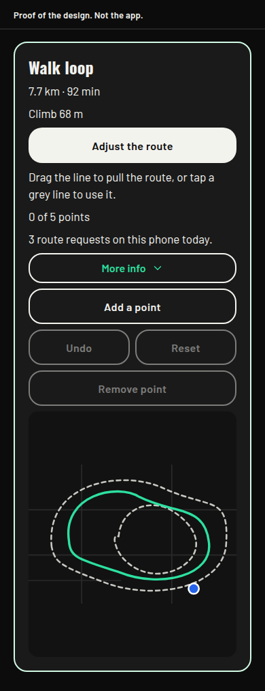
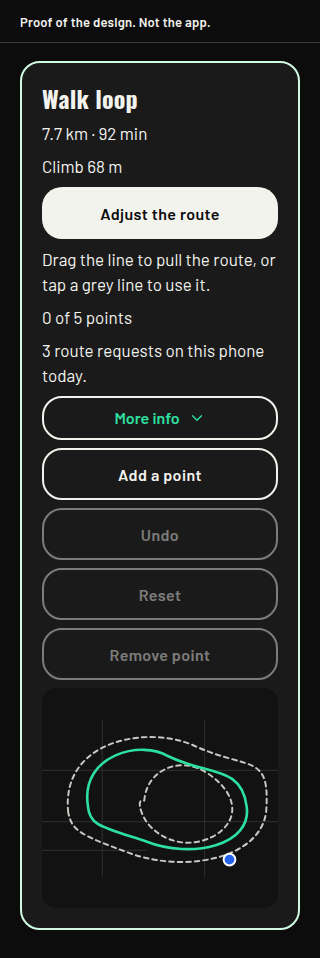
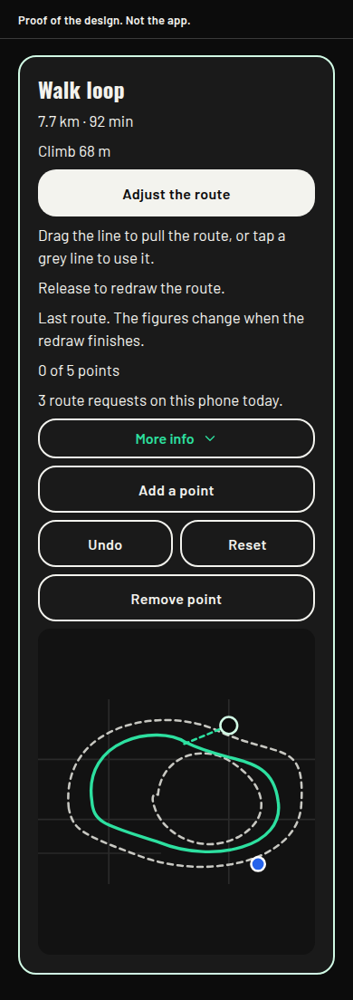
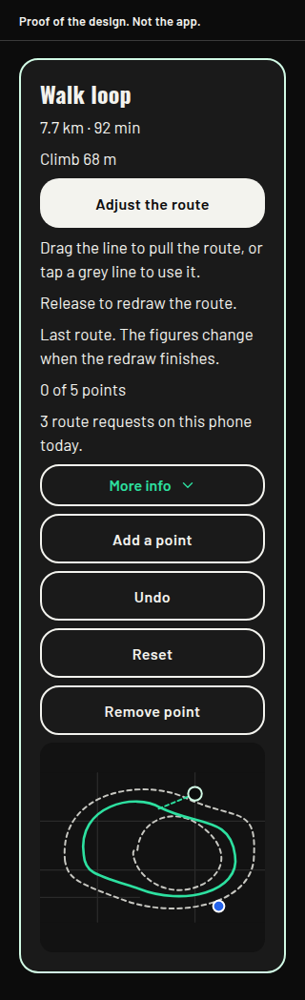

# Drag the line, and grey alternatives

Design only. Nothing in this note is in the app. No screen, no function, and no migration changes. `ios.buildNumber` stays 72. Branched from build 75, `ff6c958`. Not mixed with the Start crash hotfix (PR #48) or with a point-move hotfix.

Ben, 27 October 2026, on Adjust: "It would be better if you could drag the lines that are there when you select alter route, and it showed options of greyed out other routes you could select."

The same note said a point, once created, could not be moved. That is a separate fault in the current iPhone map, described below, and it is not this design.

## What already stands

Approved by Ben on 26 October 2026, in `docs/route-editing-decisions.md`, and present in build 75.

- Add a point drops a point on the middle of the line. Nothing is sent until a later move lifts at least 40 metres.
- A finger on the line adds a via-point. A finger on an existing via-point moves it. The start and the destination are not dragged.
- A lift under about 40 metres is ignored. A lift that counts is sent once, after a 500 millisecond pause. Five via-points is the cap.
- Empty map still pans. Dragging the line, with Adjust on, edits.
- The drawn dot can be small. The hit area is 44 points.
- The phone shows how many route requests it has made today. The account limit stays 40 a day and 12 in 10 minutes, shared with place search. The 1,500 app cap is not shown.
- Undo and Reset stay on the phone. A failed redraw keeps the previous line, and the screen can say "The route on the map is unchanged."
- The purpose string, the consent line, and consent version `2026-10-26-1` stay as approved. This design does not change them.

The web map already follows the finger (`src/ui/FootpathMap.web.tsx`). The iPhone map does not. A press there calls `onDown` and `onUp` with the same coordinate and never calls `onMove` (`src/ui/FootpathMap.tsx`). The point stays where it was dropped, and the finger pans the map. That is why a created point could not be moved. The repair is the approved gesture, on its own hotfix, and it is not drawn here.

## One sentence on the card

This sentence is **not approved**. It is the only new sentence. It is not in the app.

"Drag the line to pull the route, or tap a grey line to use it."

It sits under **Adjust the route** while Adjust is on. It does not grow a second paragraph. If Ben refuses it, it stays off the card.

The long approved lines are not rewritten. At rest they leave the card and sit behind **More info**, which stays closed until it is opened. While the finger is down, or while a redraw is in flight, or when a redraw fails, the card still says the line that already belongs to that moment:

- "Release to redraw the route."
- "Last route. The figures change when the redraw finishes."
- "Redrawing the route."
- "The route on the map is unchanged."

Behind More info, word for word, including the limit sentence that today sits on the card:

- "The account limit is 40 a day and 12 in 10 minutes, shared with place search."
- "Release to redraw the route."
- "Last route. The figures change when the redraw finishes."
- "Redrawing the route."
- "The route on the map is unchanged."

The via count stays on the card. So does the count this phone knows, such as "3 route requests on this phone today." Those two are short, and the 26 October note says the phone shows its own count. The limit sentence is the block that moves. It is the same sentence. If Ben wants it to stay in view, it stays on the card and More info does not repeat it.

Add a point, Undo, Reset, and Remove point stay buttons, in the same place, above the map. At 320 each is its own row. At 390 Undo and Reset share a row. Nothing is abbreviated.

## Drag the line, and Add a point

Add a point stays the button path. It still drops a point on the middle of the line and still sends nothing until that point moves.

Drag the line is the finger path the 26 October note already describes. The change is where the finger starts. The person grabs the line. They do not press Add a point first, and they do not have to hit the drawn dot.

- Finger down within about 80 metres of the line. A point appears under the finger. The accepted line stays solid. A dashed segment follows the finger. Nothing is sent.
- Empty map still pans. The start and the destination still do not move.
- A lift under about 40 metres is ignored. No request.
- A lift that moved is the same redraw as today: one call, after the 500 millisecond pause, with the new via-point. Five is still the cap.
- An existing point is still dragged to move it. Tap it, then Remove point, still takes it off.
- The drawn dot stays small. The hit area on the line, and on a point, is 44 points.
- A grey line is not edited by this drag. The drag always pulls the chosen line.

The local dash is still not a path, and it is still not sent. Start still copies the accepted line, never the dash.

## Grey lines

Grey lines are other routes for the same start, the same destination or the same loop length, and the same travel type. They are drawn only on the made-route card, and only while no via-point has been accepted.

- The chosen line stays the line from Make the route until a grey line is tapped.
- Tap a grey line to use it. Distance, time, and climb change together from the answer already on the phone. The phone does not invent them. If that answer has no climb, the card uses the sentence already in the app: "Climb not available for this route."
- The tap sends nothing.
- Once a via-point is accepted, the grey lines go. The redraw is the via-point call that already exists. They do not come back for that visit, except from memory after Undo or Reset. Reset does not call the service.
- Opening Adjust a second time in the same visit does not send again. Changing the map style, opening full screen, and Re-centre do not send.
- A drag does not ask for a new set of grey lines.
- If the extras cannot be fetched, the chosen line stays. Adjust still works. The failure uses the messages already approved, including "The route on the map is unchanged." A missing grey line is not a new sentence.

A saved route does not gain grey lines in this design. Saved Adjust already sends the start, the destination, and any points added, and it does not send the stored middle of the line. A saved loop would need a round trip, which that screen does not send. A saved A to B could share the alternatives call, but the travel type is chosen on that screen and each type would be another call. Line grab still belongs on both screens, because both already have the via-point gesture. Grey lines wait for the made-route card, where walk, run, or cycle, and loop or A to B, are already chosen.

## What the route service can return

The phone does not call HeiGIT. `outdoor-route` does. The host is `api.heigit.org`. The profiles already in `supabase/functions/_shared/orsRoute.ts` are walk `foot-walking`, run `foot-hiking`, and cycle `cycling-regular`.

The public restrictions page lists one cap for foot profiles and one for cycling profiles. Both apply here.

- Alternative route count: 3.
- Distance for an alternative route, and for a round trip: 100 km.
- Foot and cycling routes otherwise: 6,000 km.
- Waypoints: 50. This app still caps added points at 5.

Charioteer already clamps a requested length to 50 km, so the 100 km cap is not the one this app hits first. The hosted API reference page did not answer when this note was written. The caps above are the restrictions list. The defaults below are the service configuration and the client notes that quote it. They should be checked again when the function is written.

`alternative_routes` asks for other routes in the same directions call. `target_count` is how many. The published maximum is 3. `share_factor` defaults to about 0.6, the largest share of the best route an alternative may repeat. `weight_factor` defaults to about 1.4, how much longer an alternative may be. This design sets `target_count` to 2 and leaves the other two at the service defaults. It does not invent a tighter share. The HeiGIT forum example places `alternative_routes` beside `coordinates`, and places `round_trip` inside `options`. That is the shape to follow. The two are not combined. On 4 February 2022 the maintainer said the combination of round trip and `alternative_routes` was the failing request, and that another loop comes from another `round_trip` seed. Each seed is its own directions request. The forum examples for `alternative_routes` use two coordinates. This design does not claim that via-points and `alternative_routes` work together. That pair is not requested.

A loop with no via-points is sent today as one coordinate and `options.round_trip` of `{ length, points: 5 }`, with no seed (`buildDirectionsBody`). An A to B line with no via-points is the two ends, with no `alternative_routes`.

## A to B, one extra call

When Adjust opens on a made A to B line, and no via-point has been accepted, one directions call sends the same start and the same destination, plus `alternative_routes` with `target_count` 2. That is one `outdoor-route` invocation. It counts as one request against 12 in 10 minutes, 40 a day, and 1,500 a day. A snap retry inside that invocation is not a second count.

The line already on the card stays the chosen line. Extra geometries are the grey lines. A returned geometry that repeats the chosen line is not drawn twice. If fewer than two come back, the map shows however many came back. The call does not replace the chosen line with a new "best" line.

## A loop, two extra calls

`alternative_routes` is not sent with `round_trip`. When Adjust opens on a made loop, and no via-point has been accepted, the phone asks for two extra round trips of the same length. Each has its own integer seed. The seed is not a coordinate. The start is the same single start already sent for the loop. The map client's seed dial stops at 90. That limit is the map client, not the service. Any integer is allowed, and two different seeds can still return the same shape.

Each extra is its own `outdoor-route` invocation and its own count. Two extras, plus the line already drawn, is three lines on the map. That is the cap for a loop here. The two calls run one after the other, not together. If the first is refused, the second is not sent. If a returned loop repeats one already shown, it is not drawn again, and a third seed is not sent to fill the gap.

Opening Adjust on a loop can spend two of the 12, two of the 40, and two of the 1,500. The drawing below is that case: Make the route was one request, and the two seeds have already been sent, so the card reads "3 route requests on this phone today."

## After a via-point

The grey lines are cleared. The next call is the via-point call version 3 already makes. A loop with any via-point is the start, the points, and the start again, with no `round_trip` and no `alternative_routes`. An A to B line is the start, the points, and the destination. One call. The answer does not include grey lines.

## Cost

Counts are function calls, as today. A snap retry inside one call is not a second count. Place search still shares the 12 and the 40.

- Make the route, as today: 1.
- Open Adjust on a made A to B line, no via-point yet: 1 more. Not repeated for that visit.
- Open Adjust on a made loop, no via-point yet: 2 more. Not repeated for that visit. Fewer if a cap answers first.
- Drag the line and lift: 1. The via-point redraw. Not an alternatives call.
- Tap a grey line: 0.
- Add a point, until it moves 40 metres: 0.
- Undo, Reset, Remove point, style, full screen, Re-centre: 0.

A loop that is made, then adjusted once, is four requests before any place search. An A to B line made, then adjusted once, is three. The phone keeps showing the count it knows. It still does not pretend to know the shared remainder, and it still does not show the 1,500 cap. Grey lines are not fetched on every drag.

If the phone's own count is already at the limit, the extra calls are not sent and the chosen line stays. There is no new sentence for a skipped extra.

## The function has to change before grey lines can be built

`buildDirectionsBody` does not send `alternative_routes` or a seed. The phone cannot add either. A later build of `outdoor-route` has to accept an alternatives flag on an A to B call, and a seed on a loop, and return each extra geometry with its distance, time, and climb. The request row stays `insert({ user_id })`. No coordinate is written there. The log line stays `outdoor-route request failed`.

The 26 October approval covered version 3, the via list, which was deployed that day. It does not cover this change. This branch does not deploy it. A later deploy waits for its own approval. Line grab does not need the function change. It uses the via-point call that is already there.

## Privacy

An A to B alternatives call sends the same start and the same destination, plus `alternative_routes`, which is not a coordinate. The response is larger, because several geometries come back instead of one. HeiGIT's transparency statement, already in the consent at version `2026-10-26-1`, covers the full request and the full response for 7 days, then deletion, and a route's coordinates rounded to about 1 km with no end date, plus the request metadata. The statement is voluntary and not a binding promise. No new place is sent. The consent version does not move if that stays true.

A loop seed sends the same single start, the same length, and an integer seed. Two extra calls mean two extra requests. Each is kept under that statement. The seed is not a place. One tap of Adjust on a loop leaves the phone more than once. That is the retention cost to flag. It is still not a new place.

The whole current line is not sent as extra coordinates to find alternatives of this shape. That would be new coordinates, beyond the start, the destination, and points the person adds. It would need a retention sentence, and it might need a new consent version. This design does not do that.

The outing path is still not sent. Start does not send the line. Save still stores the chosen line only. Grey lines are not stored, and via-points are still not stored as their own list.

No new purpose string. The approved purpose string already says the request is the start, the destination, and any points added on the map.

On a saved route, the approved sentence stays word for word: "Adjusting sends the start, the destination, and any points you add. It does not send the whole saved line." Grey lines are not added there, so that sentence does not have to grow.

## Build split

Three builds, in this order. This note is none of them.

1. The iPhone point that cannot be moved. That is the approved 26 October gesture, which the web map already performs. No new sentence. No function change.
2. Line grab. The finger starts on the line, and the lift is the same via-point call. No function change. The new sentence stays off until it is approved. The card can ship this step with the approved lines only.
3. Grey lines. This needs the `outdoor-route` change and a deploy that is not covered by the 26 October approval. It also needs the sentence above, because the route colour is not the only signal and no approved sentence says that a grey line can be tapped. If the sentence is refused, grey lines wait.

The Start crash is already its own hotfix, PR #48, branch `cursor/start-route-crash-daf4`. It is not part of this split.

## Layout proofs

Proof of the design. Not the app. Sample drawings of the Adjust part of the made-route card, for a walk loop, after the two extra seeds have been sent. The name and the figures are a sample, in the app's own shape: "7.7 km · 92 min" and "Climb 68 m". The lines on the map are a sketch. Start a walk, Start a run, Start a cycle, the name field, and Save this route stay where they are and are left off these drawings. More info is closed. The limit sentence is behind it.

The chosen line is solid green. The grey lines are dashed. A finger on the line adds a black point and a green dash. The blue dot is the location mark. The point's hit area is 44 points even where the drawn dot is smaller.

Grey lines on, finger up. 390 wide.

Grey lines on, finger up. 320 wide.

Finger on the line. The grey lines are still there, because the point is not accepted yet. 390 wide.

Finger on the line. 320 wide.

## Decisions for Ben

None of these is in the app. The sentence below is **not approved**.

1. Dragging the line adds or moves a via-point the way the 26 October note describes, with the finger starting on the line. Add a point stays. Recommendation: yes, after the iPhone point-move hotfix.
2. The card shows one new sentence, and the long approved lines sit behind More info, except the gesture lines while they apply, the via count, and the request count. Recommendation: yes, only if the sentence is accepted. The limit sentence can stay on the card instead.
3. Grey lines show on the made-route card only, and only before a via-point is accepted. A saved route does not gain them. Recommendation: yes.
4. An A to B line spends one extra call, with `target_count` 2 and the service defaults for share and weight. A loop spends two extra seeded round trips, and does not send `alternative_routes`. Recommendation: yes.
5. Tapping a grey line spends nothing. A drag does not fetch another set. Recommendation: yes.
6. No new coordinates, no new purpose string, and no consent-version change, because the whole line is not sent. Recommendation: yes.
7. Grey lines wait for an `outdoor-route` change and a deploy approval of their own. Line grab does not. Recommendation: yes.
