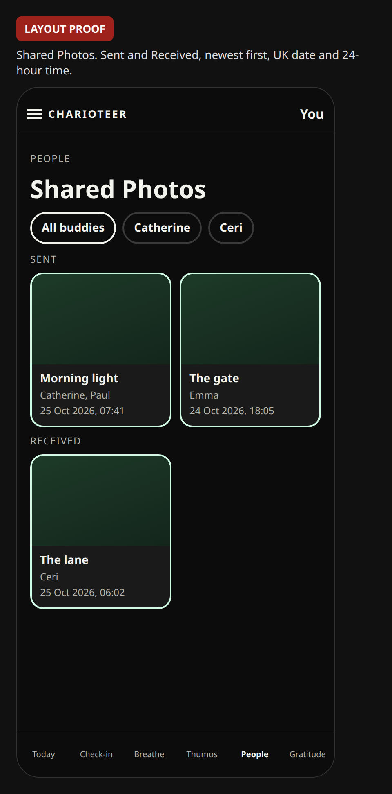
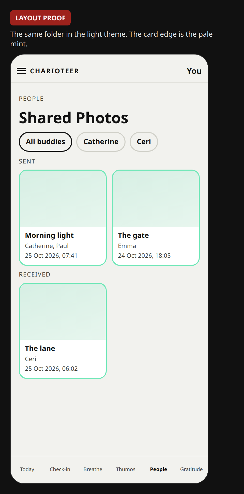
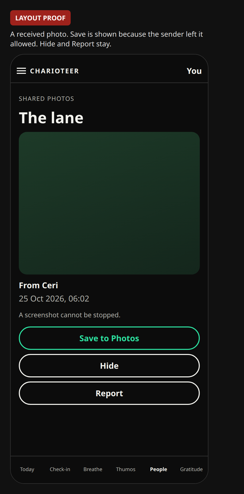
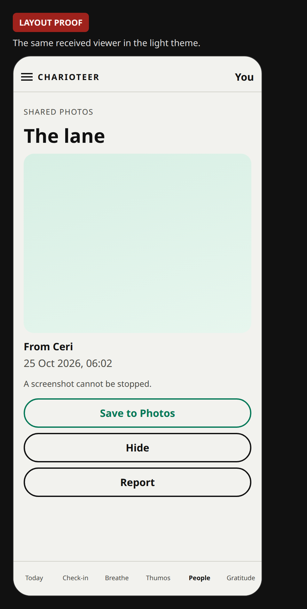
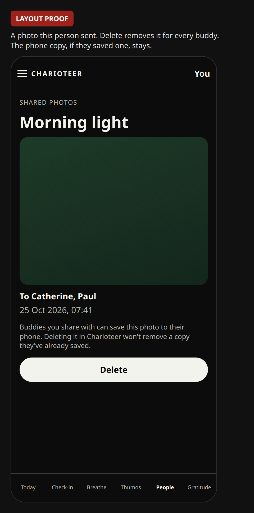
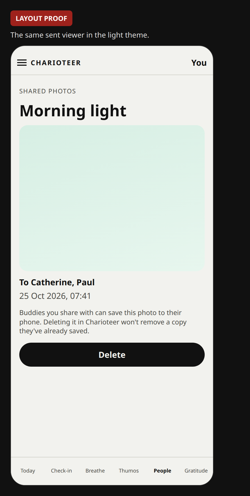

# Share a photo with buddies

Plan and SQL only. The app does not have this screen yet. The migration is in the repo and has been applied on the test database only. It has not been applied to the live project, and nothing is shipped.

This comes after the build 66 items. It is not a small change, so it is its own binary. The parent branch already uses iOS build number 67 for the calendar module. Get Outside was also described as build 67 on another branch. When this is built, use the next free TestFlight number if 67 is already taken. This plan does not change `app.json`.

## Where it sits

One card at the top of People, on the Buddies list, under “People you've buddied up with” and above the first person. One outlined button, **Share a photo**. The outline and the label use the readable green (`#2DE0A0` in the dark theme, `#047857` in the light theme). The card edge stays the pale mint. Build 66’s Profile button stays on each person, under Message. This card does not replace it.

The composer opens in that card:

- **Take photo** and **Choose photo**, the same two actions as Gratitude.
- Then the existing zoom and drag crop (`PhotoCropper`). Gratitude’s picker re-encodes a JPEG and strips the camera data, and it does not crop. The crop step is the one profile pictures already use. Both are already in the app. No third picker.
- A caption of at most 140 characters. The same limit as a photo caption elsewhere. Empty is allowed for the send.
- A tick, **Also add to my Gratitude list**, off by default.
- **Choose buddies**. Until that is opened, every accepted buddy is selected.
- A switch, **Allow buddies to save this photo**, on by default. Off hides Save on their phone. It does not stop a screenshot.
- **Send**.

The first time it opens, and again above Send, the card says: “Only the buddies you choose can see this. Not the Community.” Under that, always: “Someone you send it to can still show it to another person. A screenshot cannot be stopped.” The sender also sees, the first time and above Send: “Buddies you share with can save this photo to their phone. Deleting it in Charioteer won't remove a copy they've already saved.” There is no download button inside Charioteer. Help and the crisis lines stay where they are, in the menu.

VoiceOver: the button’s name is Share a photo. The picture’s name is the caption. With no caption, it is “Photo from {name}”.

The words for the gratitude tick live in a new component, not in `people.tsx`. That screen is tested to contain no mention of the diary.

## Feed, not a chat message

Chat today is one text body on `direct_messages`, between 1 and 2,000 characters, tied to one connection. There is no picture column. Unread counts and notifications follow each message.

Sending the photo as a chat message would write one message per buddy, raise an unread and a notification for each, and make delete a search across those copies. A link pasted into the text would be either a public address or a signed link that dies inside the thread. The private bucket does not fit that.

The photo is its own row, with one recipient row per buddy. Delete removes that row and the file for everyone, including from Shared Photos. Hide marks one recipient. Chat stays a written conversation.

## Shared Photos

One page, titled **Shared Photos**. It opens from a button on the Buddies card, and from the hamburger menu: Tools, directly under Progress photos, not a bottom tab. The menu row is added with the page, so the drawer does not point at a missing screen.

The page lists every photo this person sent and every published photo sent to them that they have not hidden. Two groups, **Sent** and **Received**, newest first. A row of buddy names filters the list. All buddies is the start. A sent photo names everyone it went to. A received photo names the sender.

Each tile shows the picture, the caption, that name, and the date and time. The stamp is the existing UK form, on the device’s own clock, 24-hour: `25 Oct 2026, 07:41`. It is `formatUkCompactWhen`. It is not forced to London if the phone is somewhere else. VoiceOver reads the same stamp with the caption.

Tapping a tile opens the viewer: the full photo, caption, who, and when. The sender gets **Delete**. A recipient gets **Hide** and **Report**. Delete removes the row and the file, so it leaves every buddy’s Shared Photos. The same private rules and 15-minute signed links apply.

## Save to the phone

Not built. No package, no config plugin, and no `NSPhotoLibraryAddUsageDescription` are in this change. Ben’s approval is required before any of the lines below are added.

The action is **Save to Photos**. It writes the stripped JPEG into an album named **Charioteer**, creating that album if it is missing. The file saved is the copy that already had the camera details removed, not a fresh export from the original.

A setting on Shared Photos, **Automatically save photos I share to my Charioteer album**, starts off and stays on this phone only. It applies to photos this person sends. A photo received from a buddy is saved only when that person taps Save. It is never automatic. If the sender turned **Allow buddies to save this photo** off, the recipient’s Save button is hidden. The screenshot line stays.

On this app’s Expo SDK 57, the calls that do not throw are `Asset.create` on the stripped file, then `Album.get('Charioteer')` or `Album.create('Charioteer', [asset])`. The older `MediaLibrary.createAlbumAsync` and `MediaLibrary.requestPermissionsAsync` are marked deprecated and throw. Permission is asked only on the first Save, with write-only and photo-only scope: `writeOnly: true` and `granularPermissions: ['photo']`.

iOS add-only can refuse a later lookup of an album by name, because that lookup reads the library. The intended path stores the album id on the phone after the first create, and adds the next photo to that id, so the app does not browse the library. If a device test shows iOS still blocks that under add-only, the work stops for a decision. It does not switch to full library read on its own.

What would change, and only after approval:

1. `npx expo install expo-media-library`, the version that matches SDK 57. This is a native module, so the binary number moves.
2. A plugin entry in `app.json`. `savePhotosPermission` sets `NSPhotoLibraryAddUsageDescription` to: “Charioteer adds a photo to an album named Charioteer on this phone. It does not look through your other photos.” `photosPermission` must be set to the existing library sentence, or the plugin replaces it with “Allow Charioteer to access your photos.” `isAccessMediaLocationEnabled` stays false, so location in the photo library is not requested. `granularPermissions` is `["photo"]` only.
3. Even with that limit, the plugin also adds Android `READ_EXTERNAL_STORAGE`, `WRITE_EXTERNAL_STORAGE`, `READ_MEDIA_VISUAL_USER_SELECTED`, `READ_MEDIA_IMAGES`, and `android:requestLegacyExternalStorage="true"`. It does not add video, audio, or media location if configured as above. Those Android lines are still broader than iOS add-only. They are part of the approval.
4. The purpose sentence already on the camera and the library, which says other people cannot see the photo, is rewritten in that same binary so a buddy photo does not make it false.

Until that approval, Save to Photos is drawn on the proofs and is not wired.

## Who can be chosen

The phone starts with every accepted buddy ticked. Choose buddies is a list of those people, one checkbox each. The server does not trust that list. For each id it keeps the person only when all of these are true:

- There is one accepted connection between the two accounts. Accepting is mutual. There is not a second row the other way.
- Both accounts have confirmed they are 18 (`buddy_is_adult`).
- Neither has blocked the other (`buddy_pair_blocked`).

Anyone who fails is left out. If nobody remains, Send fails with “Choose a buddy who is still connected.” An empty list is never treated as “everyone on the project”.

## The file

The crop is re-encoded as a JPEG. The longest side is at most 1,600 pixels, quality 0.8, and the file must be under 2 MB. That matches a progress photo. Re-encoding drops the EXIF and XMP block, which is where location and camera details live (`stripJpegLocation`). The bucket also accepts JPEG only, and refuses anything over 2 MB.

Order of a send:

1. `create_buddy_photo` writes the row and the recipient rows. The photo is not visible yet.
2. The phone uploads `buddy-photos/{owner}/{id}.jpg`.
3. `publish_buddy_photo` checks the file is there, then lets the chosen buddies see it.

A buddy opens the file with a signed link that lasts 15 minutes. The app asks for a new link when the card is opened. The bucket is private. There is no public URL. A link that was already handed out keeps working until those 15 minutes end, including after a delete or a hide.

## Gratitude tick

Off unless the person turns it on. Turning it on needs a caption, because a diary line cannot be empty (“Write a line first.”). After the buddy photo is published, the app saves a diary line and a diary photo through the calls Gratitude already uses, with the same JPEG. That is a second private file in the diary bucket. Deleting the buddy photo leaves the diary line. Deleting the diary line leaves the buddy photo.

The confirmation is the existing green tick, the haptic, and the count line (“You have recorded N things to be grateful for so far”). If the diary save fails, the buddy photo still stands, and the card says the list could not be updated.

## Delete, hide, report

- The sender’s **Delete** removes the stored file, then `delete_buddy_photo` removes the row. Recipients lose it. If the file cannot be removed, the row stays so Delete can be tried again.
- A buddy’s **Hide** sets `hidden_at` on their recipient row only.
- A buddy’s **Report** asks for a reason and writes the existing moderation queue, with `reports.buddy_photo_id`. A direct insert that sets that column is rejected. The report remains if the photo is later deleted.

## Data and access

SQL: `supabase/migrations/20261025120000_buddy_photos.sql`.

| Piece | Role |
| --- | --- |
| `buddy_photos` | Owner, caption, path, `published_at`, `allow_save` (default true). Path must be `{owner}/{id}.jpg`. |
| `buddy_photo_recipients` | One row per chosen buddy. `hidden_at` when they hide it. |
| `create_buddy_photo` | 18+, caption length, rate limit, filters the ids, inserts both tables. |
| `publish_buddy_photo` | Owner only, and only after the file is in the bucket. |
| `delete_buddy_photo` | Owner only. Recipients go with the row. |
| `hide_buddy_photo` | That recipient only. |
| `report_buddy_photo` | A current recipient, a reason, the moderation queue. |
| `buddy_photo_feed` | Photos you sent, and published photos sent to you that you have not hidden. A recipient does not receive the list of the other recipients. |
| `can_read_buddy_photo` | The storage read rule. Owner, or a chosen buddy who has not hidden it, both adults, no block, connection still accepted, and the photo published. |

Row level security is on. `public`, `anon`, and `authenticated` have no table grant. The functions are the only read and write. They run as security definer and check `auth.uid()`.

The bucket `buddy-photos` is private, JPEG only, 2 MB. Insert and delete are the owner’s folder only. Select is `can_read_buddy_photo`. There is no public read policy.

Rate limit, inside `create_buddy_photo`: 20 photos in a day, 6 in 10 minutes, at most 30 people on one photo.

This migration does not change `export_my_data` or the account-delete function. When the app change is approved, account deletion removes the `buddy-photos` folder the same way it already removes the diary folder (a missing bucket is already treated as success), and the owner’s export gains the photos they sent.

## Privacy draft

`docs/privacy.md` has a section marked draft, not live. Short version for the DPIA:

- Personal data: the image and the caption. A caption about health or sobriety is special-category data, because the person wrote it.
- Audience: the accepted buddies ticked on that send. Not the Community. Not a public URL.
- Purpose: the person chose to show those buddies a picture.
- Retention: until the sender deletes that photo, or deletes the account. Hide does not delete the file. A report outlives the photo. A signed link can linger for about 15 minutes.
- The diary tick is a separate private copy, with the diary’s own retention.
- Not used for advertising. Screenshots and a buddy showing the picture onward cannot be prevented, and the screen says so.
- A copy saved into the phone’s Charioteer album is on that device. Deleting the photo in Charioteer does not delete that copy. The sender is told this before they send. The album permission is not in the app until it is approved.
- This note is not a solicitor’s DPIA.

## Camera and library

Choosing or taking a photo uses the camera and library permission the app already has. Save to Photos is a separate, add-only permission and is not added in this change. See [Save to the phone](#save-to-the-phone).

The current purpose sentence says the photo is private and that other people cannot see it. That stays true for a progress photo and a diary photo. It would be false for a photo sent to a buddy. When this is built, those existing sentences are rewritten so they still cover a private photo and also say a photo you send is shown to the buddies you pick. Same two permissions. That wording change is why the binary number moves.

## Effort, once approved

- The SQL is already in the repo. Applying it to the live project is a separate approval.
- The composer, the Shared Photos page, the menu row, and the viewer, in components `people.tsx` only mounts. The diary word stays out of that file.
- Upload, sign for 15 minutes, delete, hide, report, and the save switch. The album write waits on the permission approval.
- The diary tick through the existing diary calls.
- The account-delete folder sweep, and the owner’s export.
- The purpose-string rewrite. No new native module beyond what the image picker already is.
- Tests: the server drops a blocked person, a child account, and someone who is not accepted; a recipient cannot see another recipient list; the storage bucket is private; people.tsx still has no diary word; the tick starts off; delete is owner-only.

## Risks

- A signed link lasts about 15 minutes after delete or hide.
- A screenshot, or a buddy showing the picture to someone else, cannot be stopped. The screen says so and does not promise otherwise.
- The purpose-string edit needs a new binary. Build number 67 may already be taken.
- The diary tick stores a second file. The two deletes are independent.
- `people.tsx` must not grow a diary word, or several existing tests fail.

## What this change does not do

The screen, the upload, and the tests for the screen are not built. The live database and the live storage bucket are unchanged. Nothing is shipped.
