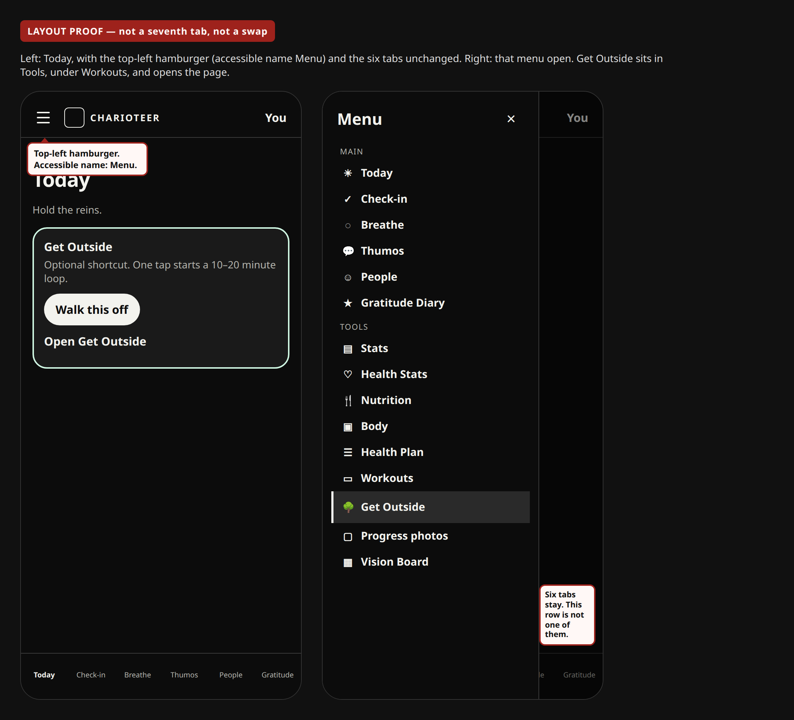
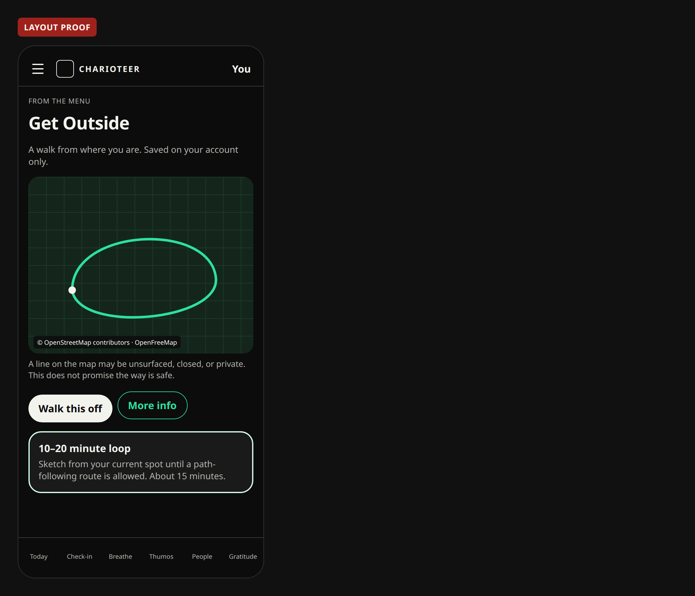
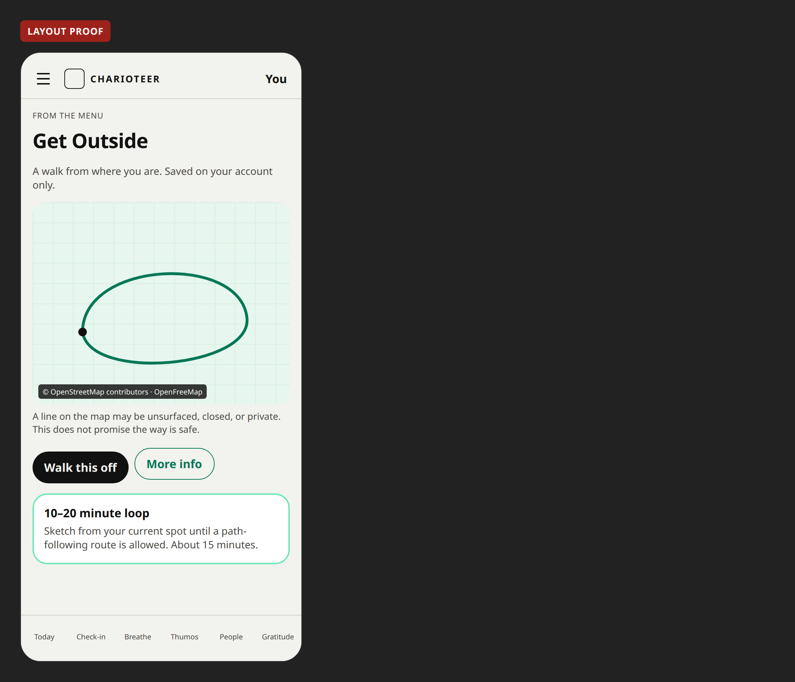
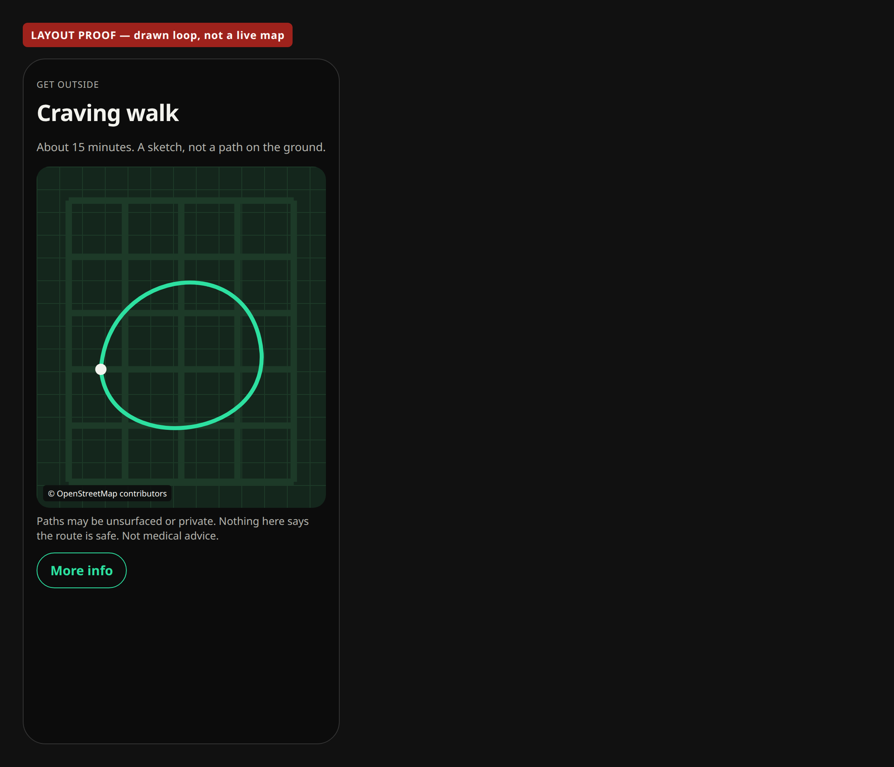

# Get Outside

Plan only. Ben has said go, and has placed the section in the top-left hamburger menu. This file does not add a screen, a map library, a permission, or an API key. It is not part of build 66. Nothing here is shipped.

Phase 1 is built later, as its own binary, after two things are true: build 66’s content is finished, and Ben has approved this plan. That binary is build 67. See [Build number](#build-number) before anyone bumps `app.json`.

Prices and licence notes below were read from the vendors’ public pages on 25 October 2026. They exclude VAT where the page says so. Confirm them again before a key is created or a bill is accepted.

## What Ben has already decided

- The working name is **Get Outside**.
- It opens from a clearly labelled row in the existing hamburger menu (the top-left button whose accessible name is Menu).
- It is not a seventh bottom tab.
- It is not a swap that removes an existing tab.
- Optional shortcuts may also sit on Today and on Breathe, for the craving walk. Those shortcuts open this same page. They are not a second home for it.

## Name

Working name: **Get Outside**.

Still available if Ben wants a shorter or sharper label later:

| Name | Why it is still on the list |
| --- | --- |
| Outside | Shorter in the menu. Vaguer. It does not say the point, which is to go out. |
| Roadwork | Fits the boxing round timer and the Elite Athlete (Cruiserweight Boxer) goal. It undersells a craving walk, a daylight nudge, and a parkrun link. |

Recommendation: keep **Get Outside**. The menu row is wide enough for the two words. The boxing timer can still be named Roadwork inside the page.

## What the section is for

One page that helps someone go outdoors. Eight jobs, in the order Ben asked for them:

1. **Craving walk.** One tap. A 10–20 minute loop from where the person is now. Also offered from Breathe, and from Today. The original brief also named Thumos; that is the same button, held as a yes/no in [Decisions still open](#decisions-still-open).
2. **Round timer for roadwork.** 3-minute rounds, 1-minute rest, haptic bells, usable with the screen off. Shown to everyone. Called out when the goal is Elite Athlete (Cruiserweight Boxer) (`elite_cruiser_boxer`).
3. **Find me a loop.** Distance or time, and easy, steady, or hard. A circular route that prefers paths. Weather and daylight aware once those sources are allowed. Weather is not in the first version.
4. **Walk with a buddy.** Share a planned walk or run. No live location. The other person sees the plan and a Done tick. This follows the existing per-buddy share switches. It never sends a coordinate.
5. **Virtual journey.** Outdoor distance and sober days laid along a famous route, starting with Land’s End to John o’ Groats, with landmarks. Progress uses totals the account already has. It does not start a new kind of tracking.
6. **Daylight nudges.** An opt-in morning reminder for a light walk, using sleep and Body Battery already on the phone. The reminder stays on the device.
7. **Money-saved miles.** The money already calculated from not drinking, linked to a walking goal the person picks. No new money figure.
8. **parkrun.** A plain link out to parkrun’s own site. No parkrun data, no logo, no scrape.

Two neighbours, queued outside this page’s first build:

- **Add to Calendar** for a planned route, reusing the system add-event sheet. No calendar permission.
- **Send a route to Garmin** as a course. Optional, and only after a separate Garmin review. Not in phase 1.

## Navigation

The bottom bar already has six equal-width tabs: Today, Check-in, Breathe, Thumos, People, Gratitude. Gratitude is the widest label. A seventh label would shrink every tab. That is why Get Outside does not go there, and why nothing is removed to make room.

The top-left control is the hamburger. Its accessible name is **Menu**. It opens the existing drawer (`SectionDrawer`), a 320-point panel titled **Menu**, grouped Main / Tools / Account. The list is `APP_SECTIONS` in `src/domain/sections.ts`. A screen that is missing from that list does not appear in the drawer. On a wide window (980 points and up) the same Menu button sits at the top of the left rail, above those same six tabs. Get Outside stays in the drawer on that layout too. It does not become a seventh rail item.

Phase 1 adds one row:

| Field | Value |
| --- | --- |
| Place | Tools, directly under Workouts and directly above Progress photos |
| Label | Get Outside |
| Accessible name | Get Outside (the row label, same rule as every other row) |
| id | `outside` |
| href | `/outside` |
| Icon | A new monochrome line icon, same stroke as the other menu glyphs. Suggested: a simple path with a tree. |
| Tab | No. `tab` stays unset. `TAB_SECTIONS` stays six. |

The row highlights only on an exact `/outside` match, the same rule Health Plan and Workouts use (`menuSectionActive`). A child screen does not light the row unless that rule is extended on purpose.

Tapping the row closes the drawer and opens the page (`router.navigate`).

The Workouts menu test currently expects Progress photos to sit immediately under Workouts, and the gratitude menu test expects the full label list. Phase 1 updates those expectations. It does not add a tab.

### Shortcuts (optional, same page)

These are doors. They are not a second section.

- **Today.** A card in the existing mint-edge style. Title Get Outside. One filled action, **Walk this off**, opens the craving walk. A quieter line, **Open Get Outside**, opens the page.
- **Breathe.** After a breathing exercise, a text button **Walk this off** with the same destination.
- **Thumos.** The original brief asked for the same one-tap walk from Thumos. It is one button, not a new flow. Include it in phase 1 only if Ben says yes. See the decision list.

No shortcut adds a tab, a badge, or a swap.

```text
Top bar:  [ ≡ Menu ]  Charioteer          You
Drawer:   Menu
          Main     Today, Check-in, Breathe, Thumos, People, Gratitude Diary
          Tools    … Workouts
                   Get Outside     ← new row, opens /outside
                   Progress photos …
Bottom:   Today | Check-in | Breathe | Thumos | People | Gratitude
          (still six, unchanged)
```

Layout proofs (drawn, not the real app):









## Phased build

Effort is described by the pieces that change, not by calendar time. Each phase is its own review. None of them is build 66.

### Phase 1 — build 67, after this plan is approved

The smallest useful version.

- Menu row, as specified above, and the page at `/outside`.
- MapLibre with a footpath-capable style. The map is a native module, so this phase needs a new iOS and Android binary. It does not run in Expo Go. See [Maps](#maps).
- Draw a route and save it on the signed-in account. Owner-only row. See [Data](#data).
- Craving walk: one tap, 10–20 minutes, a loop from the current fix. Until a router is cleared, the loop is a rough ring drawn on the phone from the fix and a radius. It is labelled as a sketch, not a path-following route. When a router is cleared, the same button swaps in the path-following loop without a new screen.
- Location permission, while the app is in use, asked only when a walk needs a fix. The page still opens with location off and lists saved routes. Copy and the system prompt are in [Privacy](#privacy).
- Today card and Breathe **Walk this off**, if Ben keeps them in this binary.
- Tests: the drawer label list includes Get Outside under Workouts; `TAB_SECTIONS` is still six; a saved route is owner-only; a shared profile, a buddy share, and a direct message still drop coordinates, paths, and start or end places.
- `npx tsc --noEmit` passes. `npx vitest run` keeps the same seven known failures and does not add an eighth.

This phase does not include the round timer, buddy sharing, the virtual journey, nudges, money-saved miles, parkrun, weather, calendar, or Garmin.

### Phase 2 — Find me a loop

Needs the routing decision. A Supabase edge function calls the router. The phone never holds the router key. Inputs are distance or time, and easy / steady / hard. The route prefers paths and returns to the start. Daylight is computed on the phone (sunrise and sunset from the date and a coarse position). Weather waits until a commercial weather source is chosen. The free Open-Meteo API is non-commercial, so it is not used.

### Phase 3 — Round timer

A clock on the page: 3 minutes work, 1 minute rest, haptic at each bell. Screen-off uses a local notification, not a silent audio trick and not a background location mode. Available to every goal. The Elite Athlete (Cruiserweight Boxer) goal gets a short line that this is the roadwork clock. It is a timer, not a training prescription.

### Phase 4 — Walk with a buddy

A plan row the owner chooses to share: title, start time, distance, duration, Done tick. The geometry stays on the owner’s route row and is not on the plan. The reader checks an accepted connection both ways, no block either way, and both accounts adult. It returns only those plan fields. It does not read Community switches and it does not publish the path. Existing share stripping (`sharedPayload.ts`) stays in force: distance and duration may remain, a coordinate or a path may not.

### Phase 5 — Virtual journey

A fixed list of landmarks for one route (Land’s End to John o’ Groats first). The marker advances from outdoor distance already saved on the account, and the sober-days count the account already stores. No new location history.

### Phase 6 — Daylight nudges

Opt-in. A local morning notification. The copy can mention sleep and Body Battery only as the reason the person turned it on. Those readings are not sent to a new server for this feature. Off until the person turns it on. No medical claim.

### Phase 7 — Money-saved miles

Uses the money-saved figure the app already calculates from weekly spend and sober days. The person picks a walking goal (for example, miles for each pound). No new financial field.

### Phase 8 — parkrun

One link to [https://www.parkrun.org.uk/](https://www.parkrun.org.uk/). Opens outside the app. Plain text. No parkrun logo, no feed, no results, no API.

### Later, not a phase of this page yet

- Add to Calendar on a planned route, through the system sheet, with no calendar permission and no purpose string.
- Garmin course upload, behind its own review.

## Maps

Checked against current MapLibre React Native docs and this app’s Expo SDK.

| Piece | This app | What MapLibre v11 asks for |
| --- | --- | --- |
| Package | not installed | `@maplibre/maplibre-react-native` v11 |
| Expo | `~57.0.27` | Expo 54 or newer |
| React Native | `0.86.3`, new architecture | React Native 0.80 or newer, new architecture only |
| React | `19.2.3` | React 19.1 or newer |
| Android | existing native binary | API 23 or newer |
| Expo Go | not how this app ships | Not supported. Add the config plugin, then a development or store build. |

The v11 screen component is `Map` with a `mapStyle`. It is not the older `MapView` name. A third-party Geoapify note has tried the library on Expo SDK 57. The official docs still require a native rebuild, which matches how Charioteer already ships. The dependency is added in phase 1, not in this plan.

The existing Apple Health route viewer (`react-native-maps` on iOS) stays as it is. It shows a workout the phone already has. It does not show a live location, and Get Outside does not reuse it for footpaths.

### Tiles

OpenStreetMap’s own tile server (`tile.openstreetmap.org`) is donation-funded. It has no service agreement. Its policy forbids bulk download, prefetch, and offline use, and it blocks heavy apps and generic user agents. It is not a source for this app.

Attribution is required on the map itself: **© OpenStreetMap contributors**, plus the style provider’s credit. MapLibre’s attribution control is the right place. A settings screen is not a substitute.

| Provider | Price read on 25 Oct 2026 | Allowance | Commercial | Notes |
| --- | --- | --- | --- | --- |
| OpenFreeMap public instance | £0, no key | Fair use of a shared server. No SLA. Offline packs capped at 3,000 tiles or 50 MB, at most 4 at once, with a unique user agent. | Allowed | Credit: “OpenFreeMap © OpenMapTiles Data from OpenStreetMap”. Project code is MIT. The map data is still under the OpenStreetMap licence (ODbL). No cookies, no account. |
| Stadia Free | $0 | 200,000 credits. A vector tile is 1 credit. | No | 14-day Professional trial, then the free plan. |
| Stadia Starter | $20 / month | 1,000,000 credits, then 3¢ per 1,000 if overage is turned on | Yes | Overage is opt-in, so a spike does not bill itself. |
| Stadia Standard | $80 / month | 7,500,000, then 2¢ per 1,000 opt-in | Yes | |
| Stadia Professional | $250 / month | 25,000,000, then 1.5¢ per 1,000 opt-in | Yes | |
| MapTiler Free | $0 | 5,000 sessions a month, or 100,000 API requests a month | No | A third-party SDK such as MapLibre is billed as tile requests, not as the session allowance. |
| MapTiler Flex | $30 / month, before VAT | 500,000 API requests, then $0.15 per 1,000, and the overage turns on by itself | Yes | The Flex session bundle (25,000 a month) does not cover MapLibre tile loads. |
| Thunderforest Hobby | £0 | 150,000 tiles | The hobby project terms | Outdoors style is the reason to look at it. |
| Thunderforest Solo | $125 or €115, before VAT | 1,500,000 tiles | Yes, solo | |
| Thunderforest Small Business | $255 or €235, before VAT | 15,000,000 tiles | Yes | |
| Thunderforest Large | $525 or €475, before VAT | The page did not state a numeric quota | Yes | Confirm the quota before choosing it. |

Recommendation: draw phase 1 on **OpenFreeMap**, so no tile key exists and the prototype can be shown. Before a public launch, move to **Stadia Starter** ($20 / month, commercial, opt-in overage). Choose Thunderforest only if the outdoors colouring is worth the higher bill. Do not use MapTiler’s session numbers as the budget for a MapLibre app.

### Routing

HeiGIT’s OpenRouteService plans page, read the same day:

- Standard is €0. The plans page allows commercial use. Read the terms again before a key exists. HeiGIT does not give legal advice on the licence.
- Directions V2: 2,000 requests a day and 40 a minute.
- Geocoding: 3,000 requests a day and 100 a minute.
- Results are under CC-BY-SA 4.0. A solicitor should say whether a route shown in the app, and a route saved in the account, can be used under that licence. Do not assume it.
- A precise GPS trace is personal data. The personal-data clause in their terms needs the same review before any trace leaves the phone. If that review says no, self-host the walking graph for the UK instead. Self-hosting has no vendor quota and keeps the trace in our own network.
- Call `api.heigit.org`. The older `api.openrouteservice.org` host is deprecated. Its quota drops to 10% from 27 August 2026, and the shutdown window published for it is 2–6 November 2026.
- One key per person. The key lives only as a Supabase secret, read by an edge function. It is never in the app binary and never in an `EXPO_PUBLIC_` variable.
- Phase 1 does not call this API. The craving walk is an on-device sketch until the review is done.

Overpass and Waymarked Trails are a later way to prefer named paths. They are not required to draw or save a route. Do not add them in phase 1.

Do not embed Komoot, Strava, or AllTrails, and do not scrape them. parkrun is a link out, nothing more.

## Data

Same shape as `planned_sessions`: the signed-in person only, row level security on, grants revoked from `public` and `anon`, then narrow column grants. The migration is written in phase 1 and applied only after a separate approval. This plan does not apply it.

`outdoor_routes` — the geometry. Owner only.

| Column | Notes |
| --- | --- |
| `id` | uuid, primary key |
| `user_id` | the owner, `auth.uid()` |
| `title` | short, length-capped |
| `kind` | `drawn` or `craving_walk` in phase 1. `loop` arrives with phase 2. |
| `distance_m` | integer |
| `duration_minutes` | integer |
| `geometry` | the line. Selected only by the owner’s own query. No share function lists this column. |
| `created_at`, `updated_at` | |

Policy: `user_id = auth.uid()` for read and write. No buddy policy on this table.

`outdoor_plans` — phase 4, and only if buddy sharing is approved. No geometry column at all, so a later mistake cannot leak a path through this table.

| Column | Notes |
| --- | --- |
| `id`, `owner_id` | |
| `title`, `starts_at`, `distance_m`, `duration_minutes`, `done_at` | the whole shared plan |

`outdoor_plan_shares` — owner adds a buddy id on purpose. The reader is a security-definer function that checks the caller, an accepted connection both ways, no block either way, and both accounts adult. It returns the plan columns above and nothing else. It does not look at Community visibility.

The user’s own export (`export_my_data`) is not changed in the phase 1 migration. A later reviewed change should add the owner’s routes to that export so a person can download their own lines. Community profiles, buddy shares, and direct messages stay on today’s rule: distance, duration, and pace may remain; a coordinate, a path, or a start or end place may not.

No table stores a live fix, a breadcrumb, or a background ping.

## Privacy

The app has no location purpose string today, and no `expo-location` dependency. Phase 1 is the first time that changes, and only after this plan is approved.

- Permission is **while using the app**. iOS: when-in-use. Android: fine and coarse, foreground only.
- No background location, no “always”, no significant-change updates, no visit monitoring.
- The system prompt is preceded by a plain sentence in the app: “Charioteer uses your location to draw a walk while this page is open. It is not tracked in the background, and it is not shared.”
- The page works without a fix. Saved routes still open. The craving walk is the action that needs a fix, and it explains why before the prompt.
- Purpose strings are added in that phase, in the same words as the sentence above. They are not added by this plan.
- Privacy policy, the DPIA, and the App Store privacy labels change when location is added. The label is precise location, linked to the user, used for app functionality, not used for tracking. This plan is not that DPIA.
- Routes are the owner’s data. They are not a community field and not a buddy field. A buddy sees a plan only after phase 4, and only the fields in that plan.

## Honest claims

Wording on the page, including the More info sheet:

- A line on the map may follow a path that is unsurfaced, closed, or private. The app does not know.
- The app does not promise that a route is safe, legal, or passable.
- This is not medical advice and not a crisis service. Help & crisis lines stays where it is.
- The round timer is a clock. It does not prescribe training.
- A daylight reminder is a reminder. It does not claim to treat anything.
- The parkrun link is a link. It does not imply a partnership.

## Accessibility, theme, Android

- VoiceOver uses the visible label. The menu row’s accessible name is Get Outside. The map has a text summary (distance, time, and the safety line) so the picture is not the only way to understand the route.
- Targets stay at least 44 points, including Menu, the new row, and Walk this off.
- Type follows the existing Dynamic Type scale. Buttons do not clip at the largest setting.
- Light and dark both ship. Card edge stays the mint accent (`#D1FAE5` in dark, `#6EE7B7` in light). Words that must be read use the existing green (`#2DE0A0` dark, `#047857` light), not the pale edge.
- One More info control, the existing outlined green pill. No second info style.
- Android uses the same MapLibre plugin and the foreground location permissions above. The timer’s screen-off bell is a notification channel, because haptic behaviour differs by phone. The system back button already closes this drawer.

## API keys

None are created or requested by this plan.

| Key | When it would exist | Where it would live |
| --- | --- | --- |
| Tile key | Only if Stadia or MapTiler is chosen for a public build. OpenFreeMap needs none. | EAS secret, restricted to the app’s bundle id. Not in git. |
| Router key | Only after the ORS licence and personal-data review, or not at all if the graph is self-hosted. | Supabase secret, read by an edge function. Not in the app. |
| Weather key | Only if a later phase buys a commercial weather plan. | Same as the router key. Not in phase 1. |

## Decisions still open

1. **Tiles.** Recommendation: OpenFreeMap for the prototype, Stadia Starter before public launch.
2. **Router.** Recommendation: do not send a GPS trace until a solicitor has read the CC-BY-SA terms and the personal-data clause. Phase 1 uses an on-device sketch. If the review fails, self-host the UK walking graph.
3. **Budget.** The prototype is £0. The first commercial tile bill in this recommendation is Stadia Starter at $20 a month, before any tax.
4. **Shortcuts in the phase 1 binary.** Recommendation: Today and Breathe, as Ben named them. Thumos is the same button and was in the original brief; say yes or no.
5. **Name.** Recommendation: keep Get Outside. Outside and Roadwork stay on the list above.
6. **Build number.** See below.

## Build number

On this branch, `app.json` still has iOS build number **62**. Phase 1 of Get Outside is the work Ben wants called **build 67**, and it waits until build 66’s content is done and this plan is approved.

Separately, the calendar work on `cursor/buddies-pending-top-daf4` already set the iOS build number to 67, because adding the calendar module needs a new binary. If that binary is the one TestFlight receives first, Get Outside cannot reuse 67. It takes the next free build number. The plan stays off that branch either way.

## What this change does not do

- No screen, no dependency, no config plugin, no purpose string.
- No API key, no Supabase secret, no edge function.
- No migration applied, and no migration file yet.
- No mixing into build 66.
- No shipping.
