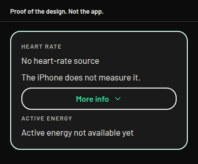
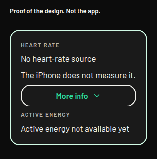

# Heart rate without assuming an Apple Watch

Design only. Nothing in this note is in the app. No screen, no library, no permission, and no background mode changes. `ios.buildNumber` stays 72. Branched from build 75, `ff6c958`. Not mixed with the Start crash hotfix or the route-adjust work.

Ben, 27 October 2026, 07:52 GMT, on build 75: "It says no heart rate source and refers to Apple Watch, what if the user is wearing a Garmin like I am now?" He wears a vívoactive 6, and he also tests with an Apple Watch.

Ben, 27 October 2026, 07:53 GMT, in his words: "I approve the new permission." That is approval in principle for a Bluetooth heart rate on an outing: the watch's Broadcast Heart Rate, read as the standard Heart Rate Service. He has not seen the exact permission string, any Info.plist change, the background mode, or the words on the screen. Those stay **not approved** until he confirms each one in his own words. This note does not build them. Build 74 and build 75 stay as they are. When he confirms the strings, the build is a branch off the latest fix tip for build 76, not off build 75. That tip is not this branch.

The 26 October decision left Garmin, Bluetooth, and Always location out of build 74 and build 75. Always location stays out. The in-principle approval is the outing broadcast only. It is not a gym session, and it is not Always location.

## What the screen says today

The empty row is the same on a walk, run, or cycle and on a strength or cardio session. The strings are in `src/domain/activitySession.ts`.

- The row title is "Heart rate".
- With no recent sample the value is "No heart-rate source".
- Under that, the app says "Start a workout on your Apple Watch to show heart rate. The iPhone does not measure it."
- Under that, on every visit, the app says "Heart rate updates while Charioteer is in front. It does not update while the app is suspended. The number stays on this phone and is not sent."
- When a number is showing, the row adds " · Apple Watch", including when the sample was not checked for which app wrote it (`activity.tsx` and `gym-session.tsx`).

"Active energy" and "Active energy not available yet" are on the strength and cardio screen only. The outing live card does not have that row. Ben's photograph includes it, so the drawing below includes it. The energy words are already source-neutral. They stay.

The read behind the row is `src/health/liveReading.ios.ts`. It asks Apple Health for heart rate, and for active energy on the gym session, only while the app is in front. It does not ask for background delivery. It does not talk to a watch radio. A sample older than about a minute becomes "No heart-rate source".

`app.json` lists `UIBackgroundModes` as `location` and `audio` only. There is no `NSBluetoothAlwaysUsageDescription` and no `bluetooth-central`.

## What is true for each source

**Apple Watch, through Apple Health.** Verified in this app. A workout on the Watch can write heart-rate samples into Apple Health. This app already has permission to read `HKQuantityTypeIdentifierHeartRate`. It reads the latest sample only while Charioteer is in front. It does not read while the app is suspended. The iPhone does not measure heart rate. Wearing the Watch without a workout often leaves the row empty, because the Watch then writes only now and then, and a sample older than about a minute is treated as no source.

**Garmin, through Apple Health.** This app does not ask Garmin Connect for a live heart rate. If a heart-rate sample is already in Apple Health, the current query can show it, and the row would still say "Apple Watch", because the code never reads the source name.

Garmin's support article is titled "Sharing Your Garmin Connect Data With Apple Health" (`https://support.garmin.com/en-US/?faq=lK5FPB9iPF5PXFkIpFlFPA`). This checkout could not read that article's body, so it does not confirm the delay, which samples are copied, or whether the Connect app has to be in front. Copies of that article say Connect shares heart rate after a device sync, that all-day heart rate is included, and that a timed activity contributes only its high and low. Those copies are not treated as the article. What this note will say, and all it will say, is that a Garmin worn during the outing is not, by itself, a live source for this row.

**Garmin Broadcast Heart Rate.** Verified in the vívoactive 6 owner's manual, "Broadcasting Heart Rate Data". The watch can broadcast heart rate to a paired device. The path is Settings, Health & Wellness, Wrist Heart Rate, Broadcast Heart Rate, or the controls menu. The manual says broadcasting decreases battery life. An activity setting can start the broadcast when the activity starts. The person has to turn it on. This app cannot turn it on.

The same manual does not name Bluetooth, and it does not name the standard Heart Rate Service. The watch is ANT+ certified, and it pairs other sensors with ANT+ or Bluetooth. This checkout did not see a broadcast from Ben's watch. A later reader that looks only for the standard Bluetooth Heart Rate Service will see the watch only if that is what the broadcast actually is. If a given broadcast is ANT+ only, the iPhone will see nothing. This design does not add ANT+.

**Active energy.** The gym row sums Apple Health active-energy samples while that screen is in front. The standard heart-rate broadcast is a heart rate, not calories. The energy row stays "Active energy not available yet" until Apple Health has samples. Whether Garmin Connect later copies active energy is in the same unread support article, so it is not stated here.

## One sentence on the row

This sentence is **not approved**. It replaces the Apple Watch hint. It is not in the app.

"The iPhone does not measure it."

"No heart-rate source" stays. It does not name a watch. The long lines leave the row and sit behind More info, which stays closed until it is opened. That is the same rule as the other cards: one short sentence, and the rest behind More info.

Behind More info, word for word, the line already on the card:

"Heart rate updates while Charioteer is in front. It does not update while the app is suspended. The number stays on this phone and is not sent."

Behind More info, these sentences are **not approved**:

- "An Apple Watch workout can put heart rate into Apple Health. This screen reads it only while Charioteer is in front."
- "Wearing a Garmin does not fill this row. A reading already in Apple Health can, after that watch has synced."
- "On a Garmin, turn on Broadcast Heart Rate. The phone reads that broadcast only during this outing."

The line that is already on the card stays true for an Apple Health sample. It is the wrong line for a broadcast that keeps updating with the phone locked. That case uses the third sentence above, and only in the build that actually reads the broadcast. Until that build, the third sentence is not shown, because the app does not read the broadcast yet.

When a number is showing, the row stops adding " · Apple Watch". The proposed suffix for an Apple Health sample is **not approved**: " · Apple Health". The code reads Apple Health and does not know which app wrote the sample. A broadcast, in the later build, would say " · Broadcast" instead. That word is not used until that build exists.

"Active energy not available yet" stays on the gym session. It is not copied onto the outing.

The same empty sentence is used on the outing and on the strength or cardio session, because they share the hint.

## The permission string

Ben approved a new permission in principle. He has not confirmed this sentence. It is **not approved**. It is the whole `NSBluetoothAlwaysUsageDescription`. There is no such key today.

"Charioteer connects to a watch or heart-rate strap that is broadcasting heart rate, only while a walk, run, or cycle is running, including when the phone is locked or you are using another app. Your heart rate stays on your phone and is not sent anywhere."

What that sentence is doing, in order:

- It connects to a watch or heart-rate strap that is broadcasting. That is Garmin's Broadcast Heart Rate, read as the standard Heart Rate Service, or another strap that uses the same service. It does not name Garmin Connect, and it does not call Connect.
- It runs only during a walk, run, or cycle he started. Not at launch, not all day, and not for a gym session. This approval is an outing.
- It names the background case: the phone locked, or another app in front. That clause is honest only if `bluetooth-central` is in the same binary. If that mode is refused, this sentence is the wrong one, and the sentence below is the one to confirm instead.
- The heart rate stays on the phone. It is not sent anywhere.

If the background mode is refused, this shorter sentence is the one that matches a foreground-only read. It is also **not approved**:

"Charioteer connects to a watch or heart-rate strap that is broadcasting heart rate, only while a walk, run, or cycle is on screen. Your heart rate stays on your phone and is not sent anywhere."

The 26 October draft named Garmin, included a gym session, and said "Garmin Connect is not used." Connect is already a separate part of the app. These sentences do not say that.

## Does the outing need `bluetooth-central`?

Flagged on its own. This is a new background mode. It is **not approved**. Today `UIBackgroundModes` is `location` and `audio` only.

Apple's Core Bluetooth guide says the common Bluetooth tasks are disabled while the app is in the background or suspended, unless the app declares a Core Bluetooth background mode. An app that does not declare one cannot scan for a peripheral in the background, and events that arrive while it is suspended are delivered only when it returns to the front. Apple names a heart-rate monitor as the reason to declare the mode. The key for the central role is `bluetooth-central`.

`location` does not grant that. It keeps location updates going, and between those updates iOS can suspend the process. It does not turn Bluetooth tasks on. `audio` does not grant it either. In this app the audio mode is for a spoken Thumos line, and the session ends when the line ends. Holding a silent audio session open so the radio stays up would be a background use the spoken line does not have. Guideline 2.5.4 is the rule that mode must match the feature.

So the existing two modes are not enough for a heart rate that keeps updating after the phone is locked, which is how an outing already runs. The recommendation is to add `bluetooth-central` for that, and only while the outing is running. The scan starts after Start, only if he is using a broadcast, and it stops on Stop, on discard, and at six hours. It does not start at launch. It does not scan all day. It is not added for an Apple Watch test, and it is not added for the gym session under this approval.

If he refuses the new mode, the broadcast works only while Charioteer is in front, same as the Apple Health read. The permission string is then the shorter one. The locked-phone clause is not used.

## What the later build would contain

Not this branch. Not build 75. After he confirms the exact strings in his own words, the branch is cut from the latest fix tip for build 76. That build carries tests, a drift check that the permission string in the binary is the sentence he confirmed, `purposeDrift`, the extended ship-check, and screen captures for his review before any ship. Until those words are confirmed, none of that is started.

The app has no Bluetooth library. A reader would use something in the class of `react-native-ble-plx`, through an Expo config plugin, in a native build. It looks for the standard Heart Rate Service only. The vívoactive 6 manual confirms Broadcast Heart Rate and the battery cost. It does not name that service. The first phone test has to show the watch is actually advertising it. If the broadcast is ANT+ only, the phone sees nothing. This design does not add ANT+.

The watch address is not stored and not logged. The reading is not written to a log, to the route request table, or to the data export, and it is not placed next to sobriety fields. The stored outing summary stays the activity, the date, the distance, the time, and the pace.

**Store profile.** The fail-safe already used for speech applies here. `src/config/speechProfile.js` treats `store`, `app-store`, `production`, an unset value, and any unknown value as a store profile. `testflight` is the only exception, and it is what keeps `audio`. A store-profile archive must not gain `NSBluetoothAlwaysUsageDescription` or `bluetooth-central` until the Security and Compliance Bot has checked the list below. Today's ship-check exits when `EXPO_PUBLIC_BUILD_PROFILE` is missing or unknown, and it exits for a store profile while the speech gate is false. It does not look for a Bluetooth key. The later build extends that check so it exits if a store profile contains the Bluetooth purpose string or `bluetooth-central` before the bot's check. A store submission stays a fresh archive with `EXPO_PUBLIC_BUILD_PROFILE=store` and a new build number. Promoting a TestFlight build is not the store path.

**Battery.** Garmin's manual says broadcasting decreases the watch battery. With `bluetooth-central`, the phone radio is used for the outing and then stops. No figure is invented here.

**DPIA.** The location DPIA describes a heart rate as a sample Apple Health already holds, read in the foreground. A radio reading is a new way of collecting the same kind of data. The DPIA and the privacy note need that path before a build. This branch does not edit them. Whether UK GDPR Article 9 applies is still for a solicitor. The Health share sentence does not change, because the broadcast is not an Apple Health read.

## What the Security and Compliance Bot should check

The bot reviews the permission wording and the DPIA impact. The check is this list, against the binary, not against this note alone.

1. The purpose string is one of the two sentences above, and it matches the binary. The locked-phone sentence is present only when `bluetooth-central` is in that same binary. The shorter sentence is the one when the mode is absent.
2. The string's claims are true: a watch or strap that is broadcasting, only during a walk, run, or cycle he started, stopped on Stop, on discard, and at six hours. The heart rate is not sent anywhere: not to the account, not to the route service, not into a log, and not into the data export.
3. A store profile does not contain `NSBluetoothAlwaysUsageDescription` or `bluetooth-central` until this check has passed. Unset, unknown, `store`, `app-store`, and `production` are store profiles. `testflight` is the only other name.
4. The scan does not start at launch, does not run all day, and does not run for a gym session. `audio` is not held open to keep the radio awake. `location` is not described as the Bluetooth permission.
5. No Always-location string is added. `NSLocationAlwaysAndWhenInUseUsageDescription` and `NSLocationAlwaysUsageDescription` stay absent.
6. The DPIA and the privacy note describe a radio reading as a new collection path. They still say the reading stays on the phone, is not a trace in the saved summary, is not joined to sobriety fields, and the watch address is not stored. Article 9 stays with a solicitor. The Health share sentence is unchanged.
7. Guideline 2.5.4: the background mode matches a heart rate the person can see on the outing. Guideline 5.1.1: the purpose string matches that use. External TestFlight is Beta App Review. A store binary is a fresh store-profile archive.
8. The first phone test shows whether the vívoactive 6 broadcast is the standard Heart Rate Service. The app does not claim that until the test shows it. No ANT+. No new network host. No Garmin Connect call for this reading.
9. Screen sentences he has not confirmed in his own words are not in the binary. The nutrition label is filled from the binary after the check, not from this note.

## After the outing, from Apple Health

This uses the Health read the app already has. No new permission. No Bluetooth key. No `bluetooth-central`.

On Finished, if Apple Health has heart-rate samples from the start of the outing to Stop, the card can show one line. This sentence is **not approved**:

"Apple Health heart rate for this outing: 142 bpm on average."

The number is an example. If there are no samples, the line is absent. It does not say Garmin, and it does not say Apple Watch. A vívoactive 6 appears there only when Garmin Connect has already put samples into Apple Health. This note does not claim how long that sync takes.

The line is on the Finished screen. It is not added to the saved summary, and Done still keeps the distance, the time, and the pace. A stored heart rate would be a later decision.

Active energy on that screen, for a gym session, stays the Apple Health sum. It is not estimated from a broadcast.

## Order

1. Ben confirms the exact strings in his own words. Until then nothing in this note is built. Build 75 stays as it is. The in-principle approval does not put a key into `app.json`.
2. The empty-row sentence, and More info, on the outing and the gym session. No new key. The row stops saying Apple Watch. The Broadcast Heart Rate sentence stays off the screen until the build that reads the broadcast.
3. The Finished line, from Apple Health samples already on the phone. No new key.
4. Live Bluetooth for an outing, on a branch off the latest fix tip for build 76, not off build 75. That branch is cut only after he confirms, in his own words, the exact permission string and either `bluetooth-central` or the shorter foreground sentence. It carries tests, a drift check that the permission string matches the confirmed sentence, `purposeDrift`, a ship-check, and captures for review before any ship. A store-profile archive does not gain the new permission or `bluetooth-central` until the Security and Compliance Bot has checked the list above. That is a new native build and a fresh store archive.

## Layout proofs

Proof of the design. Not the app. More info is closed. The energy row is the gym session's row, included because the photograph had it. The outing uses the same heart-rate lines and does not have that energy row.

390 wide.

320 wide.

## Decisions for Ben

You approved a new permission in principle on 27 October 2026, 07:53 GMT, in your words: "I approve the new permission." That covers an outing broadcast only. The sentences below are still **not approved**. None of them is in the app. Confirm each one you want, in your own words, before a build.

1. Replace the Apple Watch hint with "The iPhone does not measure it." Keep "No heart-rate source". Recommendation: yes.
2. Move the foreground sentence, and the two Apple Health sentences, behind More info. Recommendation: yes. "On a Garmin, turn on Broadcast Heart Rate. The phone reads that broadcast only during this outing." is shown only in the build that reads the broadcast.
3. When a number is showing, say "Apple Health" rather than "Apple Watch". Recommendation: yes.
4. On Finished, show an Apple Health average for that outing when samples exist. Do not store it. Recommendation: yes.
5. Confirm this `NSBluetoothAlwaysUsageDescription` together with `bluetooth-central`: "Charioteer connects to a watch or heart-rate strap that is broadcasting heart rate, only while a walk, run, or cycle is running, including when the phone is locked or you are using another app. Your heart rate stays on your phone and is not sent anywhere." Recommendation: yes. `location` and `audio` do not keep a heart-rate broadcast updating after the phone locks. If you refuse the mode, confirm the shorter sentence instead: "Charioteer connects to a watch or heart-rate strap that is broadcasting heart rate, only while a walk, run, or cycle is on screen. Your heart rate stays on your phone and is not sent anywhere." The locked-phone clause is then left out.
6. After those words are confirmed, build on a branch off the latest fix tip for build 76, not build 75. That branch has tests, a permission-string drift check, `purposeDrift`, a ship-check, and captures before any ship. A store-profile archive does not gain the permission or the mode until the Security and Compliance Bot has checked the list in this note. Recommendation: yes.
