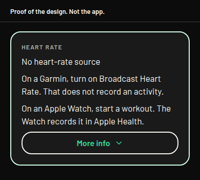
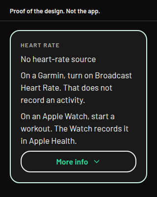
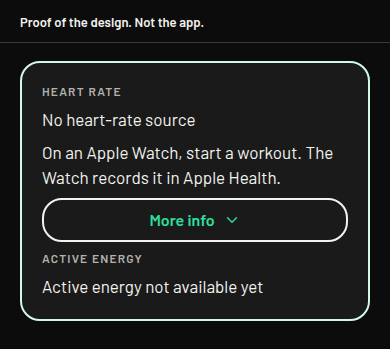
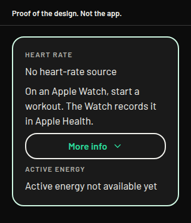

# Heart rate without assuming an Apple Watch

Design only. Nothing in this note is in the app. No screen, no library, no permission, and no background mode changes. `ios.buildNumber` stays 72. Branched from build 75, `ff6c958`. Not mixed with the Start crash hotfix or the route-adjust work.

Ben, 27 October 2026, 07:52 GMT, on build 75: "It says no heart rate source and refers to Apple Watch, what if the user is wearing a Garmin like I am now?" He wears a vívoactive 6, and he also tests with an Apple Watch.

Ben, 27 October 2026, 07:53 GMT, in his words: "I approve the new permission." That is approval in principle for a Bluetooth heart rate on an outing: the watch's Broadcast Heart Rate, read as the standard Heart Rate Service. At that time he had not confirmed the exact permission string or the background mode. This note does not build them. Build 74 and build 75 stay as they are.

Ben, 27 October 2026, 08:02 GMT, asked whether a live session would be recorded by Garmin, and the same for Apple, and pre-approved the Bluetooth permission if it is not recorded. That condition is about the Bluetooth path. The Garmin broadcast, used as Broadcast Heart Rate, is the path that does not record an activity. The Apple Watch workout is recorded by the Watch. It uses the Health read the app already has, not this Bluetooth permission.

Ben, 27 October 2026, 08:28 GMT, in his words: "Approve the two heart-rate lines as written: the Garmin Broadcast Heart Rate line and the Apple Watch workout line." That approves the two outing lines below, as written. It does not approve the More info text or the gym wording. Those stay **not approved**. The Garmin line stays off the screen until a build reads the broadcast.

Ben, 27 October 2026, 08:36 GMT, decided build 76 is the Start-route crash fix, the point-drag fix, and the Apple Watch outing line only. The Garmin line stays out of that build. The gym wording stays out. Line drag and grey alternatives stay out. Bluetooth stays out of build 76. That build is a separate branch. This note does not contain it.

The same decision approves the locked-phone permission string, and it approves adding `bluetooth-central`. That string is the whole `NSBluetoothAlwaysUsageDescription`. It is not in the app. It is not build 76. The Security and Compliance Bot checks it before a later build 77.

The Security and Compliance Bot reviewed this plan on 27 October 2026. The conditions in "Conditions before build 77" are design only. Nothing is built. Build 76 takes nothing from that review. Its diff adds no permission, no purpose string, and no background mode. `app.json` and the ship-check are unchanged on that branch. The only Bluetooth lines in that diff are tests that `app.json` has no `NSBluetoothAlwaysUsageDescription` and no `bluetooth-central`.

The 26 October decision left Garmin, Bluetooth, and Always location out of build 74 and build 75. Always location stays out. The in-principle approval is the outing broadcast only. It is not a gym session, and it is not Always location.

## What the screen says today

The empty row is the same on a walk, run, or cycle and on a strength or cardio session. The strings are in `src/domain/activitySession.ts`.

- The row title is "Heart rate".
- With no recent sample the value is "No heart-rate source".
- Under that, the app says "Start a workout on your Apple Watch to show heart rate. The iPhone does not measure it."
- Under that, on every visit, the app says "Heart rate updates while Charioteer is in front. It does not update while the app is suspended. The number stays on this phone and is not sent."
- When a number is showing, the row adds " · Apple Watch", including when the sample was not checked for which app wrote it (`activity.tsx` and `gym-session.tsx`).

"Active energy" and "Active energy not available yet" are on the strength and cardio screen only. The outing live card does not have that row. Ben's photograph includes it, so the drawing below includes it. The energy words are already source-neutral. They stay.

The read behind the row is `src/health/liveReading.ios.ts`. It asks Apple Health for heart rate, and for active energy on the gym session, only while the app is in front. It does not ask for background delivery. It does not talk to a watch radio. A sample older than about a minute becomes "No heart-rate source".

`app.json` lists `UIBackgroundModes` as `location` and `audio` only. There is no `NSBluetoothAlwaysUsageDescription` and no `bluetooth-central`.

## What is true for each source

**Apple Watch, through Apple Health.** Verified in this app. There is no broadcast-only heart rate this app can read. A live number from the Watch arrives only as an Apple Health sample, and a workout on the Watch is what keeps those samples coming. The Watch records that workout. This app reads `HKQuantityTypeIdentifierHeartRate`. It reads the latest sample only while Charioteer is in front. It does not read while the app is suspended. It does not write a heart rate or a workout. The only Apple Health writes in this app are food and water, on a different screen, and the update purpose already says heart rate and workouts are not written. The iPhone does not measure heart rate. Wearing the Watch without a workout often leaves the row empty, because the Watch then writes only now and then, and a sample older than about a minute is treated as no source.

**Garmin, through Apple Health.** This app does not ask Garmin Connect for a live heart rate. If a heart-rate sample is already in Apple Health, the current query can show it, and the row would still say "Apple Watch", because the code never reads the source name.

Garmin's support article is titled "Sharing Your Garmin Connect Data With Apple Health" (`https://support.garmin.com/en-US/?faq=lK5FPB9iPF5PXFkIpFlFPA`). This checkout could not read that article's body, so it does not confirm the delay, which samples are copied, or whether the Connect app has to be in front. Copies of that article say Connect shares heart rate after a device sync, that all-day heart rate is included, and that a timed activity contributes only its high and low. Those copies are not treated as the article. What this note will say, and all it will say, is that a Garmin worn during the outing is not, by itself, a live source for this row.

**Garmin Broadcast Heart Rate.** Verified in the vívoactive 6 owner's manual, "Broadcasting Heart Rate Data". The watch can broadcast heart rate data and view it on paired devices. The path is Settings, Health & Wellness, Wrist Heart Rate, Broadcast Heart Rate, or the controls menu. The steps are turn that on, pair with the other device, and press to stop. The manual says broadcasting decreases battery life. The person has to turn it on. This app cannot turn it on.

That page does not describe saving an activity. It does not use the words "does not record". What it describes is broadcasting, then viewing the number on a paired device. A tip says an activity setting can start the broadcast when an activity begins, for example toward an Edge bike computer. Starting an activity is a separate choice. If he starts one, the watch records that activity. Charioteer does not start one, and it does not ask the watch to save one. The Bluetooth path he pre-approved is Broadcast Heart Rate alone.

The approved outing line says "That does not record an activity." That clause is manual-based, not observed. The manual page does not use the words "does not record". It says the watch broadcasts heart rate and that the number can be viewed on a paired device. A tip says an activity setting can start the broadcast when an activity begins. Until the watch is checked on a phone, the clause stays a reading of the manual. This checkout did not see the watch leave an activity unrecorded.

The same manual does not name Bluetooth, and it does not name the standard Heart Rate Service. The watch is ANT+ certified, and it pairs other sensors with ANT+ or Bluetooth. This checkout did not see a broadcast from Ben's watch. A later reader that looks only for the standard Bluetooth Heart Rate Service will see the watch only if that is what the broadcast actually is. If a given broadcast is ANT+ only, the iPhone will see nothing. This design does not add ANT+.

**Active energy.** The gym row sums Apple Health active-energy samples while that screen is in front. The standard heart-rate broadcast is a heart rate, not calories. The energy row stays "Active energy not available yet" until Apple Health has samples. Whether Garmin Connect later copies active energy is in the same unread support article, so it is not stated here.

## The short lines on the row

Approved by Ben on 27 October 2026, 08:28 GMT, in his words: "Approve the two heart-rate lines as written: the Garmin Broadcast Heart Rate line and the Apple Watch workout line." These two lines are for an outing. They replace the Apple Watch hint on that screen. They are not in the app.

"On a Garmin, turn on Broadcast Heart Rate. That does not record an activity."

"On an Apple Watch, start a workout. The Watch records it in Apple Health."

"No heart-rate source" stays. On an outing, both lines sit under it. The longer notes sit behind More info, which stays closed until it is opened. That More info text is **not approved**.

The gym wording is **not approved**. The proposal, still unconfirmed, is that a gym session shows the Apple Watch line only, and does not show the Garmin line.

The Garmin line is approved and stays off the screen until a build reads the broadcast. Until that build, the app cannot use Broadcast Heart Rate, so the line would be the wrong instruction. The Apple Watch line is approved for an outing. On 27 October 2026, 08:36 GMT, he put that line into build 76 and left the Garmin line out. This note does not contain that code.

Behind More info, word for word, the line already on the card:

"Heart rate updates while Charioteer is in front. It does not update while the app is suspended. The number stays on this phone and is not sent."

Behind More info, these sentences are **not approved**:

- "Broadcast Heart Rate sends the number to a paired device. Those steps do not save an activity. Charioteer does not start one. If you start an activity on the Garmin, the watch records that activity. The phone reads the broadcast only during this outing."
- "An Apple Watch has no broadcast-only heart rate. The workout runs on the Watch, and the Watch keeps it. Charioteer reads the heart rate from Apple Health while that workout runs. It writes nothing from this row to Apple Health."
- "The iPhone does not measure it."
- On an outing: "Wearing a Garmin does not fill this row until Broadcast Heart Rate is on. A reading already in Apple Health can, after that watch has synced."
- On a gym session: "Wearing a Garmin does not fill this row. A reading already in Apple Health can, after that watch has synced."

Those More info sentences stay **not approved**. The broadcast sentence, and the outing sentence about wearing a Garmin, are shown only in the build that reads the broadcast. The approved short Garmin line is held for the same reason. The line that is already on the card stays true for an Apple Health sample. It is the wrong line for a broadcast that keeps updating with the phone locked. The broadcast sentence covers that case, and only in that build.

When a number is showing, the row stops adding " · Apple Watch". The proposed suffix for an Apple Health sample is **not approved**: " · Apple Health". The code reads Apple Health and does not know which app wrote the sample. A broadcast, in the later build, would say " · Broadcast" instead. That word is not used until that build exists.

"Active energy not available yet" stays on the gym session. It is not copied onto the outing.

Today the outing and the gym session share one hint. The two approved lines are the outing lines. Using the Apple Watch line alone on a gym session is **not approved**. The proposal is that split, because a broadcast is not read during a gym session under this approval, and telling someone there to turn on Broadcast Heart Rate would describe a read this approval does not add. The Garmin line on an outing still waits for the broadcast reader.

## The permission string

Approved by Ben on 27 October 2026, 08:36 GMT, for the locked-phone version. It is the whole `NSBluetoothAlwaysUsageDescription`. There is no such key today. It is not in build 76. Security checks it before build 77.

"Charioteer connects to a watch or heart-rate strap that is broadcasting heart rate, only while a walk, run, or cycle is running, including when the phone is locked or you are using another app. Your heart rate stays on your phone and is not sent anywhere."

Security, on 27 October 2026, suggested a different sentence. It is **not approved**. Ben confirms any replacement in his own words. A string he has not confirmed stays out of the binary, including the system prompt and any on-screen sentence.

"Charioteer connects by Bluetooth to a watch or heart-rate strap that you choose and that is broadcasting heart rate, only while a walk, run, or cycle is running, including when the phone is locked or you are using another app. Your heart rate stays on your phone and is not sent anywhere."

The difference from the confirmed sentence is "by Bluetooth" and "that you choose". Those words match the device-choice condition. They do not replace the 08:36 sentence until he confirms them.

What the confirmed sentence is doing, in order:

- It connects to a watch or heart-rate strap that is broadcasting. That is Garmin's Broadcast Heart Rate, read as the standard Heart Rate Service, or another strap that uses the same service. It does not name Garmin Connect, and it does not call Connect.
- It runs only during a walk, run, or cycle he started. Not at launch, not all day, and not for a gym session. This approval is an outing.
- It names the background case: the phone locked, or another app in front. That clause is honest only with `bluetooth-central` in the same binary. He approved that mode with this sentence.
- The heart rate stays on the phone. It is not sent anywhere.

This shorter sentence is not the approved wording. It would match a foreground-only read if the mode were refused. It was not:

"Charioteer connects to a watch or heart-rate strap that is broadcasting heart rate, only while a walk, run, or cycle is on screen. Your heart rate stays on your phone and is not sent anywhere."

The 26 October draft named Garmin, included a gym session, and said "Garmin Connect is not used." Connect is already a separate part of the app. These sentences do not say that.

## Does the outing need `bluetooth-central`?

Approved with the locked-phone sentence on 27 October 2026, 08:36 GMT. It is a new background mode. It is not in the app. Today `UIBackgroundModes` is `location` and `audio` only. Build 76 keeps that list. Build 77 is where `bluetooth-central` is added, after the Security and Compliance Bot has checked the list below.

Apple's Core Bluetooth guide says the common Bluetooth tasks are disabled while the app is in the background or suspended, unless the app declares a Core Bluetooth background mode. An app that does not declare one cannot scan for a peripheral in the background, and events that arrive while it is suspended are delivered only when it returns to the front. Apple names a heart-rate monitor as the reason to declare the mode. The key for the central role is `bluetooth-central`.

`location` does not grant that. It keeps location updates going, and between those updates iOS can suspend the process. It does not turn Bluetooth tasks on. `audio` does not grant it either. In this app the audio mode is for a spoken Thumos line, and the session ends when the line ends. Holding a silent audio session open so the radio stays up would be a background use the spoken line does not have. Guideline 2.5.4 is the rule that mode must match the feature.

So the existing two modes are not enough for a heart rate that keeps updating after the phone is locked, which is how an outing already runs. The recommendation is to add `bluetooth-central` for that, and only while the outing is running. The scan starts after Start, and only for the device he picked before the outing. It stops on Stop, on discard, at six hours, and if the app is killed. Those four stops are tested. It does not start at launch. It does not scan all day. It does not run for a gym session. It does not run after sign-out or after Stop. It is not added for an Apple Watch test.

He approved the mode, so the plan is the locked-phone sentence with `bluetooth-central`. If Security later says that mode cannot ship, the broadcast would work only while Charioteer is in front, and the shorter sentence would need his words again. That shorter sentence is not approved.

## What the later build would contain

Not this branch. Not build 75. Not build 76. After the Security and Compliance Bot has checked the list below, the branch is cut from the latest fix tip for build 77. That build carries tests, a drift check that the permission string in the binary is the approved sentence, `purposeDrift`, the extended ship-check, and screen captures for his review before any ship. None of that is started in this note.

The app has no Bluetooth library. A reader would use `react-native-ble-plx` 3.5.1, through its Expo config plugin, in a native build. The exact licence records, the plugin props, and the phone test are under "Conditions before build 77". It looks for the standard Heart Rate Service only. The vívoactive 6 manual confirms Broadcast Heart Rate and the battery cost. It does not name that service. The first phone test has to show the watch is actually advertising it. If the broadcast is ANT+ only, the phone sees nothing. This design does not add ANT+.

The recommendation is to store no address and no identifier, so he picks the device every outing. If he decides to store the iOS peripheral identifier, the DPIA says so, and sign-out and account deletion delete it, the same clear as the walked line. Either choice is his, and the screen wording that goes with it is **not approved** until he writes it. A Bluetooth error, a device name, an identifier, and a heart-rate value are not written to a log, to client-error reporting, to the route request table, or to the data export, and the reading is not placed next to sobriety fields. The stored outing summary stays the activity, the date, the distance, the time, and the pace.

**Store profile.** The fail-safe already used for speech applies here. `src/config/speechProfile.js` treats `store`, `app-store`, `production`, an unset value, and any unknown value as a store profile. `testflight` is the only exception, and it is what keeps `audio`. A store-profile archive must not gain `NSBluetoothAlwaysUsageDescription` or `bluetooth-central` until the Security and Compliance Bot has checked the list below. Today's ship-check exits when `EXPO_PUBLIC_BUILD_PROFILE` is missing or unknown, and it exits for a store profile while the speech gate is false. It does not look for a Bluetooth key. The later build extends that check so it exits if a store profile contains the Bluetooth purpose string or `bluetooth-central` before the bot's check. A store submission stays a fresh archive with `EXPO_PUBLIC_BUILD_PROFILE=store` and a new build number. Promoting a TestFlight build is not the store path.

**Battery.** Garmin's manual says broadcasting decreases the watch battery. With `bluetooth-central`, the phone radio is used for the outing and then stops. No figure is invented here.

**DPIA.** The location DPIA describes a heart rate as a sample Apple Health already holds, read in the foreground. That description stays the description of the current build. A radio reading is a new collection path, and this note adds it to `docs/dpia-location.md`. The privacy notice and the nutrition label still describe the current build. They are updated from the checked binary before a store build. Whether UK GDPR Article 9 applies, and the lawful basis, stay with a solicitor. The Health share sentence does not change for the current read. It covers a live foreground sample. It does not cover a Finished-screen average.

## What the Security and Compliance Bot should check

The bot reviews the permission wording and the DPIA impact. The check is this list, against the binary, not against this note alone.

1. The purpose string in the binary is a sentence Ben has confirmed in his own words. The drift check proves the built plist string equals that sentence. The confirmed sentence today is the 08:36 locked-phone sentence. Security's suggested sentence, which adds "by Bluetooth" and "that you choose", is **not approved** and stays out of the binary. The plugin default `Allow $(PRODUCT_NAME) to connect to bluetooth devices` is never the string. `modes` is set explicitly to `central` only, which is the plist value `bluetooth-central`. `peripheral` is not set. `bluetooth-central` is in that same binary only after this check. The shorter on-screen sentence is not the approved wording.
2. The string's claims are true: a watch or strap that is broadcasting, chosen by the person before the outing, and the app connects only to that device. The scan runs only during a walk, run, or cycle he started. It stops on Stop, on discard, at six hours, and if the app is killed. Those four stops are tested. The heart rate is not sent anywhere: not to the account, not to the route service, not into `client_errors` or `purge_client_errors`, not into a console log, not into analytics, not into a crash breadcrumb, and not into the data export. A packet check on the final binary shows that no heart-rate value, device name, or identifier leaves the phone, and that the binary adds no new network host.
3. A store profile does not contain `NSBluetoothAlwaysUsageDescription` or `bluetooth-central` until this check has passed. Unset, unknown, `store`, `app-store`, and `production` are store profiles. `testflight` is the only other name. The later build extends the ship-check so a store profile that contains either exits. Today's ship-check does not look for them. There is no external TestFlight group while `audio` is in the binary, until the ducking test passes. Build 77 still carries `location`, `audio`, and `bluetooth-central`.
4. The scan does not start at launch, does not run all day, does not run for a gym session, and does not run after sign-out or after Stop. `audio` is not held open to keep the radio awake. `location` is not described as the Bluetooth permission.
5. No Always-location string is added. `NSLocationAlwaysAndWhenInUseUsageDescription` and `NSLocationAlwaysUsageDescription` stay absent. No Android permission is added. The Android background service stays off.
6. The DPIA describes the Bluetooth reading as a new collection path. The privacy notice and the nutrition label are updated from the checked binary before a store build. The reading stays on the phone, is not a trace in the saved summary, is not in `export_my_data`, and is not joined to sobriety fields. If an iOS peripheral identifier is stored, the DPIA says so, and sign-out and account deletion clear it, the same clear as the walked line. If none is stored, he picks the device every outing. Article 9 and the lawful basis stay with a solicitor. The Health share sentence is unchanged. It covers a live foreground read of the latest Apple Health sample. It does not cover a Finished-screen average of past samples.
7. Guideline 2.5.4: the background mode matches a heart rate the person can see on the outing. Guideline 5.1.1: the purpose string matches that use. App Review notes explain the feature and give a way to test it without a Garmin, a demo or a mock reading. External TestFlight is Beta App Review. A store binary is a fresh store-profile archive.
8. The first phone test, before any feature work, shows whether the vívoactive 6 broadcast is the standard Heart Rate Service (`180D`). The procedure is in this note. The app does not claim that until the test shows it. No ANT+. No new network host. No Garmin Connect call for this reading. The Garmin claim stays inside what the vívoactive 6 manual page says. "That does not record an activity" is manual-based, not observed, until it is verified on the phone.
9. Screen sentences he has not confirmed in his own words are not in the binary. That includes Security's suggested permission sentence, the device-choice screen wording, and the Finished line. The nutrition label is filled from the binary after the check, not from this note.
10. The Garmin line says Broadcast Heart Rate does not record an activity. That clause is manual-based, not observed, until a phone check verifies it. The app does not start a Garmin activity. The Apple line says the Watch records the workout in Apple Health, and this row does not write a heart rate or a workout. The Garmin line is absent until the broadcast reader is in that same binary. The later build adds a test, in the style of the route sanitiser and the walked-line source scan, that a Bluetooth error, a device name, an identifier, and a heart-rate value never reach those sinks.

## After the outing, from Apple Health

This uses the Health read the app already has. No new permission. No Bluetooth key. No `bluetooth-central`.

On Finished, if Apple Health has heart-rate samples from the start of the outing to Stop, the card can show one line. This sentence is **not approved**:

"Apple Health heart rate for this outing: 142 bpm on average."

The number is an example. If there are no samples, the line is absent. It does not say Garmin, and it does not say Apple Watch. A vívoactive 6 appears there only when Garmin Connect has already put samples into Apple Health. This note does not claim how long that sync takes.

The line is on the Finished screen. It is not added to the saved summary, and Done still keeps the distance, the time, and the pace. A stored heart rate would be a later decision.

The existing Health share sentence was written for a live foreground read. The outing clause is "During a walk, run, or cycle you start, the latest heart rate from Apple Health can be shown on that screen." The gym clause shows the latest heart rate and active energy while you train. The DPIA says that read stays foreground-only and does not continue while the phone is locked. That covers the latest sample on the live screen. It does not cover reading past samples for the outing and showing an average afterwards. A purpose change needs Ben's approval of the new sentence. If the line is shown, it says "from Apple Health" only. Several sources can write those samples. Missing samples, or samples too sparse to stand as the outing's heart rate, mean the line is absent. The line does not name Garmin, and it does not name Apple Watch.

Active energy on that screen, for a gym session, stays the Apple Health sum. It is not estimated from a broadcast.

## Conditions before build 77

Recorded from the Security and Compliance Bot review on 27 October 2026. Design only. No library, no permission, no background mode, and no screen is added here. No Charioteer build is required for the phone test below.

### First: is the vívoactive 6 broadcast the Heart Rate Service?

Before any feature work, Ben runs one phone test with a free Bluetooth Low Energy scanner. LightBlue and nRF Connect are two such apps. The manual does not name Bluetooth and does not name the Heart Rate Service. This design does not claim the watch uses that service until the test shows it. This design does not add ANT+.

The standard Heart Rate Service is UUID `180D`. The Heart Rate Measurement characteristic is UUID `2A37`.

1. On the vívoactive 6, turn on Broadcast Heart Rate. The manual path is Settings, Health & Wellness, Wrist Heart Rate, Broadcast Heart Rate. The controls menu is the other path the manual names. Press to start the broadcast.
2. On the iPhone, open the scanner. Look only for an advertiser of service `180D`.
3. If `180D` is advertised, write down that it was, and write down the advertised name. Do not connect to any other person's device. A strap in a gym can be someone else's heart rate.
4. If no `180D` advertiser appears, the broadcast may be ANT+ only. The iPhone then sees nothing. Stop there. Do not start the Charioteer feature on the assumption that the service exists.
5. Stop the broadcast on the watch when the check is done.

Report two facts: whether `180D` was advertised, and the advertised name.

### The person picks the device

Before the outing starts, the person picks the watch or strap from a list. A plain explanation is on the screen before the iOS Bluetooth prompt. The app connects only to that device. It never connects to the first thing that advertises. A stranger's strap is someone else's health data.

What is remembered is Ben's decision. Both options below, and the screen wording that goes with them, stay **not approved** until he decides and writes the words.

- Storing no address and no identifier means he picks the device at the start of every outing. That is the recommendation in this note.
- Storing the iOS peripheral identifier on the phone avoids that pick. If he chooses that, the DPIA says the identifier is stored on the phone, and sign-out and account deletion delete it, the same clear as the walked line.

Security's suggested permission sentence is the candidate for the system prompt. It is **not approved**. The on-screen explanation before that prompt needs words he approves as well. This note does not invent a second sentence.

### Logs and error reports

A Bluetooth error, a device name, an identifier, and a heart-rate value never reach client-error reporting (`client_errors` and `purge_client_errors`), console logs, analytics, or crash breadcrumbs. This repo has no Sentry, Bugsnag, Crashlytics, PostHog, Amplitude, or Mixpanel. The later build adds a test in the style of the route sanitiser and the walked-line source scan. That scan requires `src/activity/walkedLine.ts` to contain none of `supabase`, `functions.invoke`, `console.`, or `fetch(`. The Bluetooth test is the same kind of guard for the radio reading. This note does not add the test.

### Library, exact version

The class is `react-native-ble-plx` 3.5.1. It can scan, connect, and listen for characteristic updates, and its notes say it supports an iOS background mode. It needs a native rebuild. It does not run in Expo Go. It does not speak Bluetooth Classic, so it does not add ANT+.

Three licence records, read on 27 October 2026 from the tagged files:

1. The `LICENSE` file at tag `v3.5.1` is the Apache License 2.0. It names Copyright 2016 Polidea and Copyright 2021 intent sp. z o.o. `https://github.com/dotintent/react-native-ble-plx/blob/v3.5.1/LICENSE`
2. `package.json` at that same tag sets `"license"` to `MIT`. The npm registry metadata for 3.5.1 also says MIT. The podspec sets `s.license` from `package["license"]`, so CocoaPods metadata says MIT while the `LICENSE` file in the same tag is Apache-2.0. This note records the mismatch and does not pick a winner. A solicitor resolves it before the library is added.
3. The iOS pod dependency in that podspec is `MultiplatformBleAdapter` `0.2.0` (`s.dependency "MultiplatformBleAdapter", "0.2.0"`). The `LICENSE` file at tag `0.2.0` is the Apache License 2.0. Its appendix copyright line is the unfilled template `Copyright [yyyy] [name of copyright owner]`. The README at that same tag says Copyright 2023 intent sp. z o.o. and Apache-2.0, and says the adapter uses RxAndroidBle and RxBluetoothKit. `https://github.com/dotintent/MultiPlatformBleAdapter/blob/0.2.0/LICENSE`

### The Expo plugin must not use its defaults

The 3.5.1 README documents the config plugin. With no props, defaults are used.

- `bluetoothAlwaysPermission` defaults to `Allow $(PRODUCT_NAME) to connect to bluetooth devices`. Setting `false` skips the key. Build 77 sets this prop to the exact sentence Ben has confirmed. That is the 08:36 sentence until he confirms a replacement. Security's suggested sentence is **not approved** and is not this value.
- `modes` adds iOS `UIBackgroundModes`. The option names are `peripheral` and `central`. The default is undefined. The Info.plist value for the central role is `bluetooth-central`. Build 77 sets `modes` explicitly to `["central"]` only. It does not set `peripheral`.
- `isBackgroundEnabled` is the Android background service. Default `false`. Build 77 leaves it false.
- `neverForLocation` defaults to `false`. Build 77 does not turn it on.

The Android install notes list `BLUETOOTH_SCAN`, `BLUETOOTH_CONNECT`, `BLUETOOTH`, `BLUETOOTH_ADMIN`, and `ACCESS_FINE_LOCATION`. Build 77 adds no Android permission. The drift check proves the built plist string equals Ben's confirmed sentence, character for character, and that it is not the plugin default.

### Privacy notice and the label, before a build

Heart rate is health data. "Your heart rate stays on your phone and is not sent anywhere" is proved by a packet check on the final binary: no heart-rate value, device name, or identifier leaves the phone, and the binary adds no new network host. The value stays out of `export_my_data`, the saved summary, and sobriety fields. Article 9 and the lawful basis go to the solicitor. The nutrition label is filled from the checked binary only. The Bluetooth collection path is in `docs/dpia-location.md`. The current Apple Health description there stays the description of the current build. The privacy notice and the store label still describe the current build. They are updated from the checked binary before a store build. This design edit does not rewrite them.

### How build 77 is tested and shipped

No code in this note. No library install. No Info.plist change. Build 76 does not contain this.

`UIBackgroundModes` would be `location`, `audio`, and `bluetooth-central`. The scan starts after Start, only for the device he picked, and stops on Stop, on discard, at six hours, and if the app is killed. Those four stops are tested. It does not start at launch, it does not run all day, it does not run for a gym session, and it does not run after sign-out or after Stop. The reading stays on the phone. It is not sent, not logged, not stored on the outing summary, and not placed next to sobriety fields.

The approved Garmin sentence is shown only in that build. "That does not record an activity" stays manual-based, not observed, until a phone check verifies it. The More info text stays **not approved** and stays off the screen.

There is no external TestFlight group while `audio` is in the binary, until the ducking test passes. The Bluetooth key and `bluetooth-central` stay out of any store-profile archive until Security checks the final binary against the list of 10. App Review notes explain the feature and give a way to test it without a Garmin: a demo or a mock reading.

**Drift checks that build must update.** `src/domain/outdoorRoute.test.ts` expects `UIBackgroundModes` to be exactly `location` and `audio`. Build 77 changes that expectation for the testflight profile to `location`, `audio`, and `bluetooth-central`, and it checks the permission string is the sentence Ben has confirmed, word for word, and not the plugin default. `purposeDrift` keeps the Health share sentence and the location sentence, and it gains a check that the Bluetooth sentence matches the confirmed words. A store profile still must not contain `NSBluetoothAlwaysUsageDescription` or `bluetooth-central` until the Security check has passed. Today's ship-check does not look for those entries. Build 77 extends it so a store profile that contains either exits. Unset, unknown, `store`, `app-store`, and `production` are store profiles. `testflight` is the only other name. The log test named above is part of that build.

**What Security checks.** The list under "What the Security and Compliance Bot should check", against the final binary. The purpose string is the sentence Ben has confirmed. `bluetooth-central` is in that same binary. A store-profile archive does not gain either until that check has passed.

## Order

1. The phone test above comes first, before any feature work. No Charioteer build.
2. Build 76 is the crash fix, the point-drag fix, and the Apple Watch outing line. It is a separate branch. This note does not contain it. More info text and the gym wording stay **not approved**.
3. The Garmin line stays off the screen until the build that reads the broadcast. "That does not record an activity" stays manual-based, not observed, until a phone check verifies it.
4. The Finished line stays **not approved**. The current Health share sentence does not cover an after-outing average. A new sentence needs his words. No new key until then.
5. Ben decides whether the phone remembers the iOS peripheral identifier, and he approves the screen wording. Security's suggested sentence stays **not approved** until he confirms it in his own words.
6. Build 77 is the Bluetooth outing, after those decisions and after Security has checked the list of 10 against the final binary. The branch is cut from the latest fix tip then, not from build 75 and not from this note. It carries tests, the drift checks named above, the extended ship-check, and captures before any ship. A store-profile archive does not gain the new permission or `bluetooth-central` until that check. There is no external TestFlight group while `audio` remains, until the ducking test passes. That is a new native build and a fresh store archive.

## Layout proofs

Proof of the design. Not the app. More info is closed.

The outing card has both short lines and no active-energy row.

390 wide.

320 wide.

The gym card is the screen in the photograph. That gym wording is **not approved**. It has the Apple Watch line only, plus the energy row. It does not say Broadcast Heart Rate.

390 wide.

320 wide.

## Decisions for Ben

You approved a new permission in principle on 27 October 2026, 07:53 GMT, in your words: "I approve the new permission." That covers an outing broadcast only. On 27 October 2026, 08:28 GMT, in your words: "Approve the two heart-rate lines as written: the Garmin Broadcast Heart Rate line and the Apple Watch workout line." That covers the two outing lines only. On 27 October 2026, 08:36 GMT, you put the Apple Watch line into build 76 and approved the locked-phone Bluetooth sentence with `bluetooth-central` for a later build. More info text and the gym wording are still **not approved**. The Bluetooth sentence is approved and not built.

1. Approved for an outing, as written. "On a Garmin, turn on Broadcast Heart Rate. That does not record an activity." "On an Apple Watch, start a workout. The Watch records it in Apple Health." Keep "No heart-rate source". The Apple Watch line is in build 76, on a separate branch. The Garmin line stays off until a build reads the broadcast. "That does not record an activity" is manual-based, not observed, until a phone check verifies it. Showing the Apple Watch line alone on a gym session is **not approved**.
2. Behind More info: the broadcast sends the number to a paired device and those steps do not save an activity; if he starts a Garmin activity himself, the watch records it; an Apple Watch workout is recorded by the Watch and this row writes nothing to Apple Health; "The iPhone does not measure it." Recommendation: yes. The Garmin More info sentence is shown only in the build that reads the broadcast.
3. When a number is showing, say "Apple Health" rather than "Apple Watch". Recommendation: yes.
4. On Finished, show an Apple Health average for that outing when samples exist. Do not store it. Recommendation: yes.
5. Approved on 27 October 2026, 08:36 GMT. `NSBluetoothAlwaysUsageDescription`: "Charioteer connects to a watch or heart-rate strap that is broadcasting heart rate, only while a walk, run, or cycle is running, including when the phone is locked or you are using another app. Your heart rate stays on your phone and is not sent anywhere." `bluetooth-central` goes with that sentence. Not built. Not build 76. Security checks it before build 77. The shorter on-screen sentence is not the approved wording.
6. Build 77, after the conditions in this note, from the latest fix tip then. Tests, a permission-string drift check against the sentence you have confirmed, `purposeDrift`, a ship-check that fails a store profile carrying the Bluetooth key or `bluetooth-central`, and captures before any ship. A store-profile archive does not gain the permission or the mode until the Security and Compliance Bot has checked the list of 10 against the final binary. No external TestFlight group while audio is in the binary, until the ducking test passes.
7. Before that build, run the scanner procedure in this note on the vívoactive 6. Report whether service `180D` is advertised, and the advertised name. No Charioteer build. If `180D` is absent, the broadcast may be ANT+ only, and the feature waits.
8. Device choice, still open. The recommendation is to store no address and no identifier, so you pick the device at the start of every outing. If you choose to store the iOS peripheral identifier on the phone, the DPIA records it, and sign-out and account deletion delete it, the same clear as the walked line. The on-screen explanation before the iOS prompt needs words you approve.
9. Security's suggested permission sentence is **not approved**. It adds "by Bluetooth" and "that you choose" to the sentence you confirmed at 08:36. Confirm a replacement in your own words, or the 08:36 sentence stays the only confirmed string. A string you have not confirmed stays out of the binary.
10. The Finished line still needs a new Health purpose sentence if it is built. The current sentence covers a live foreground read of the latest sample. It does not cover an average of past samples shown afterwards. The line says "from Apple Health" only, and it is absent when samples are missing or too sparse.
