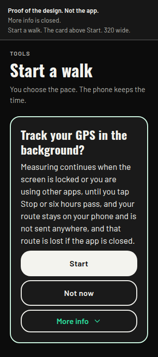
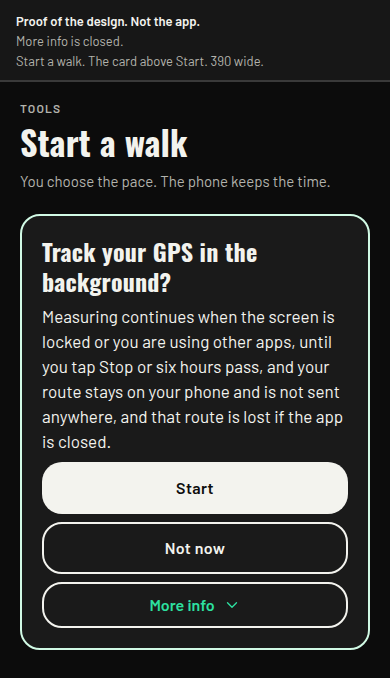
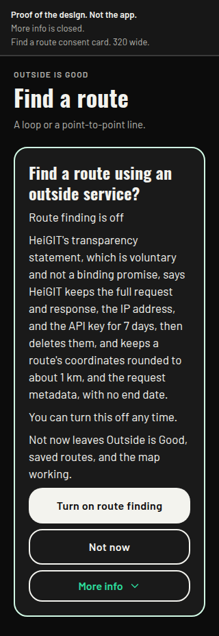
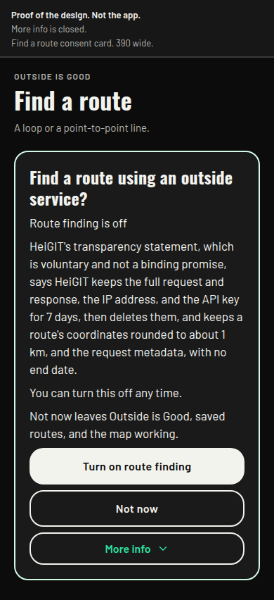
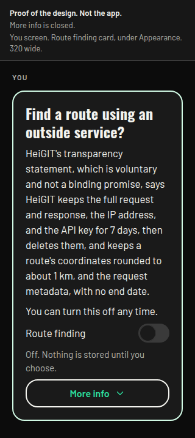
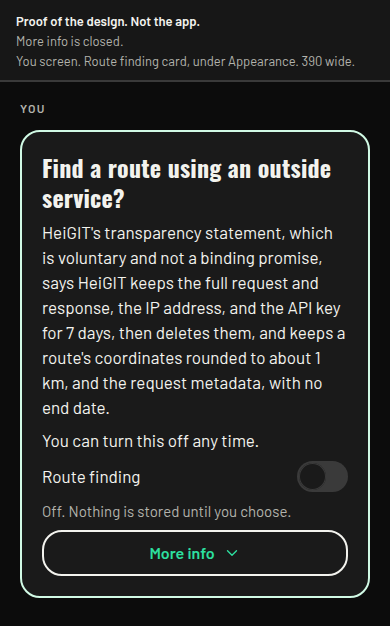

# Route finding, and the outing, with a question on top

Design only. Ben has not approved the new headings or the new sentences. No screen change on this branch. No migration is written or applied. No deploy. `ios.buildNumber` stays 72. No new permission. No new purpose string. No SQL. Branched from the build 75 integration tip `ff6c958` (PR #46). Not shipped.

Ben, 27 October 2026, on the route-service card: "It just doesn't look user friendly so can you move large body of text below the functionality, or put the core message in one small sentence a pre the more info button. The problem is, when humans see large bodies of text like that, they tend to not read it anyway."

Later the same day: "Maybe something like \"Track Your GPS in the Background?\"" He then asked, about that question on both screens: "Would it make sense on both?"

His aim is that nobody reads a big block. Each text-heavy consent screen gets a plain question heading, then one short sentence that carries the core, with the long approved text behind More info, below the controls.

The GPS question fits the outing setup, before Start a walk, Start a run, or Start a cycle. It does not fit route finding. Route finding is not GPS tracking. The consent card and the Profile switch get their own question, and that question does fit both of those screens.

The layout proofs are drawings. Each one is labelled "Proof of the design. Not the app." They are not screenshots of the running app. More info is closed in every drawing.

## What the code does today

Checked on `ff6c958`.

### Route finding

`RouteServiceNotice` in `src/ui/RouteServiceNotice.tsx` is the shared block. The consent card (`src/ui/RouteConsentCard.tsx`) and the Profile switch (`src/ui/RouteFindingSwitch.tsx`) both use it. Find a route shows the card before any route call (`src/app/(main)/find-route.tsx`). You shows the switch under Appearance (`src/app/(main)/profile.tsx`).

In view, in this order:

1. The first approved sentence.
2. More info, closed. The retention paragraph is inside it, so it is not on the card until the person opens More info.
3. "You can turn this off any time."

The consent card then shows "Not now leaves Outside is Good, saved routes, and the map working.", then **Turn on route finding**, then **Not now**.

The Profile card then shows the switch labelled Route finding, then the status line. With nothing stored yet, that line is "Off. Nothing is stored until you choose." When the switch is already on, the status line is "On since {when}. Stored on this phone only. Wording 2026-10-26-1."

Opening More info expands in place, above those controls, so the long text pushes the switch and the buttons down the card.

There is no question heading. The card title on Find a route is "Route finding is off". The Profile card label is "Route finding".

The lines inside More info, in this order, word for word:

- A route sends the coordinates and the travel type only. It does not send your name or account number. HeiGIT sees our server's address, not your phone's. A place search sends the words you type.
- HeiGIT's transparency statement says the full request and response, the IP address, and the API key are kept for 7 days to look for abuse, then deleted. For a route, coordinates rounded to about 1 km, and the request metadata, are kept with no end date. This is done on servers in the EU. The statement is voluntary and not a binding promise.
- Nothing is shared with other people.
- Location is used only while the app is open.
- HeiGIT transparency statement: https://account.heigit.org/info/transparency-statement
- This choice is stored on this phone only. Another phone starts off. Nothing is shared.
- © OpenStreetMap contributors
- © openrouteservice by HeiGIT | Data from OpenStreetMap
- OpenStreetMap data is available under the Open Database Licence. The credit names the contributors. This is not a request to accept OpenStreetMap terms.
- A route from the service is under CC-BY-SA 4.0. It stays on your account. It is not sent to other people.
- A start point can be personal data. HeiGIT terms say not to send personal data except for their own account. This test version sends a start point only after you turn route finding on.
- The April 2022 privacy policy (https://heigit.org/privacy-policy/) says personal data is kept only as long as needed. It does not give these day counts. The 7 days, the coordinates kept after rounding to two decimal places, and the EU servers are in the transparency statement. That statement says it is voluntary and not a binding promise. The terms (https://account.heigit.org/info/tos) do not restate the 7 days. A place search is geocoding. The same statement says the typed place and its coordinate are not kept past those 7 days.

`ROUTE_CONSENT_VERSION` is `2026-10-26-1`. Route finding stays on only when the stored choice is on and the version matches. A different version turns it off. The status line then reads "Off. The wording changed (2026-10-26-1). Turn it on again if you still want route finding. Stored on this phone only."

`src/domain/findRoute.test.ts` checks that the first line comes before More info, and that "You can turn this off any time." comes after More info. A later build updates that check. This sheet does not.

### The outing, before Start

The setup screen is `src/app/(main)/activity.tsx`. The eyebrow is Tools. The title is Start a walk, Start a run, or Start a cycle. The intro is "You choose the pace. The phone keeps the time."

The card above the buttons shows `beforeStartLine()` in full, then **Start** and **Not now**, then `ACTIVITY_LOCATION_LINE` in full:

- You can lock the phone, take a call, or open another app. Measuring continues until you tap Stop, or for six hours. A blue location mark shows while it is on. The route stays on this phone. If the app is closed, that route is lost.
- Distance and pace keep going after you lock the phone, until you tap Stop or six hours pass. The route stays in memory for that outing. It is cleared when you stop or discard it. If the app is closed, it is lost. The outing path is not sent.

Good to know sits under that card. It keeps the safety lines, the path line, the battery line, and `ACTIVITY_LOCATION_LINE` again. This sheet does not fold Good to know away.

The iOS permission dialog, asked from Start, shows `LOCATION_WHEN_IN_USE` in `src/domain/outdoorRoute.ts`. That string is also the purpose sentence in `app.json`. It is not drawn as an in-app card. Word for word:

> Charioteer uses your location while you are on a walk, run or cycle to track distance and give you spoken updates, including when the screen is locked or you are using other apps. Your route stays on your phone and is not sent anywhere. The same permission shows where you are while the map is open. A route is sent to the route service only if you turn route finding on. That request is the start, the destination, and any points you add on the map. It is not the outing path.

There is no Always location sentence. `NSLocationAlwaysAndWhenInUseUsageDescription` is not set. Measuring continues while the screen is locked or another app is in front, until Stop or six hours. If the app is closed, the route is lost.

On the live screen the intro is already one line: "You can lock the phone. Measuring continues until you tap Stop." This sheet does not put the question on that screen. The person has already tapped Start.

## Recommendation

### The outing setup

Question heading, in the app's sentence case. The words are Ben's. On screen they follow the other headings, so "Your" and "Background" are not capitals. Not approved until Ben says so.

> Track your GPS in the background?

It means the outing he is about to start. The phone can be locked, or another app can be in front, and measuring continues. It does not ask for Always location. Closing the app loses the route. The short sentence says that, so the heading is not an Always prompt.

One sentence under the heading, above Start. Not approved until Ben says so.

> Measuring continues when the screen is locked or you are using other apps, until you tap Stop or six hours pass, and your route stays on your phone and is not sent anywhere, and that route is lost if the app is closed.

It uses the approved clauses. "Your route stays on your phone and is not sent anywhere" is the purpose-string clause, with a small "your" because it sits in the middle of the sentence. The purpose string itself is not edited. The sentence also says the measuring stops at Stop or six hours, and that closing the app loses the route.

Below Start and Not now, More info, closed. Opening it shows these three blocks, word for word, in this order. A later build should render the constants, not a second copy of the words.

1. You can lock the phone, take a call, or open another app. Measuring continues until you tap Stop, or for six hours. A blue location mark shows while it is on. The route stays on this phone. If the app is closed, that route is lost.
2. Distance and pace keep going after you lock the phone, until you tap Stop or six hours pass. The route stays in memory for that outing. It is cleared when you stop or discard it. If the app is closed, it is lost. The outing path is not sent.
3. Charioteer uses your location while you are on a walk, run or cycle to track distance and give you spoken updates, including when the screen is locked or you are using other apps. Your route stays on your phone and is not sent anywhere. The same permission shows where you are while the map is open. A route is sent to the route service only if you turn route finding on. That request is the start, the destination, and any points you add on the map. It is not the outing path.

Block 3 is the purpose sentence, shown again so the full permission explanation is one tap away. `app.json` and the system dialog keep that same string. This design does not change it.

Good to know stays under the card, as it is now, including the safety lines and the battery line. The live-screen intro stays the one approved line.

Order on the Start card:

1. Track your GPS in the background?
2. The new sentence (not approved)
3. Start
4. Not now
5. More info

### Route finding, both screens

The GPS question does not go here. A route call sends the start, the destination, and any points added on the map. It is not the outing path. The route-service line already says "Location is used only while the app is open."

Recommended heading, on the consent card and on the Profile switch. Not approved until Ben says so.

> Find a route using an outside service?

It is a question about the choice on that card. It does not say GPS, and it does not say the outing is tracked. "Send your route to an outside service?" is the heading not to use. "Your route" is easy to read as the outing path, and the purpose sentence says that request is not the outing path.

One sentence under the heading, above the controls, on both screens. This is the retention core. It is not approved until Ben says so. It is the same sentence as the earlier note on this sheet.

> HeiGIT's transparency statement, which is voluntary and not a binding promise, says HeiGIT keeps the full request and response, the IP address, and the API key for 7 days, then deletes them, and keeps a route's coordinates rounded to about 1 km, and the request metadata, with no end date.

It is one sentence, and it is longer than a slogan. A shorter line would leave out part of what is kept. It names the full request and the response, the IP address, the API key, the 7 days and the deletion, a route's coordinates rounded to about 1 km, the request metadata, and no end date. It says the statement is voluntary and not a binding promise. "A route's coordinates" matches the approved line. A place search is not kept past the 7 days. That limit stays in the note inside More info.

"To look for abuse" and "This is done on servers in the EU" stay in the approved paragraph, word for word, inside More info. They say why the 7 days are kept, and where. They are not a further category of data.

The short line Ben's note asked to set beside this one is easier to read. It is not the recommendation. It understates the keep.

> The route service keeps what you send for 7 days, and a rounded version of your places with no end date.

"What you send" leaves out the response, the IP address, and the API key. "A rounded version of your places" does not say about 1 km, does not say the request metadata, and can be read as the typed place. The typed place is not kept past those 7 days. The line does not say the 7-day items are then deleted. It does not say the statement is voluntary and not a binding promise.

"You can turn this off any time." stays in view, under the new sentence and above the controls. It is not rewritten.

The approved first sentence moves behind More info. It is not rewritten. It is the first line inside More info, then the lines already listed above, in the same order.

> The start point, the destination, and any points you add on the map are sent to our route service (OpenRouteService, built on OpenStreetMap data) to make the route.

The new sentence does not replace the retention paragraph. That paragraph stays inside More info, word for word.

More info sits below the controls. On Find a route, below **Turn on route finding** and **Not now**. On You, below the switch and the status line. Opening it no longer pushes those controls down. It stays closed until the person opens it.

Order on the consent card:

1. Find a route using an outside service?
2. Route finding is off
3. The retention sentence (not approved)
4. You can turn this off any time.
5. Not now leaves Outside is Good, saved routes, and the map working.
6. Turn on route finding
7. Not now
8. More info

Order on the Profile card. The same sentences when the switch is already on. Only the status line changes. The drawing shows the switch off, with nothing stored yet.

1. Find a route using an outside service?
2. The retention sentence (not approved)
3. You can turn this off any time.
4. Route finding, with the switch
5. Off. Nothing is stored until you choose.
6. More info

## Consent text and version

No change to `ROUTE_CONSENT_LINES`. No change to `ROUTE_CONSENT_VERSION`. It stays `2026-10-26-1`.

The route heading and the retention sentence are extra lines. They are not added to `ROUTE_CONSENT_LINES`. The facts in the sentence are already in the retention paragraph, which is already one of those lines.

A new version would turn route finding off for people who already turned it on, until they turn it on again. This sheet does not do that. Ben can ask for a fresh opt-in. That would be a version change, and it is not required to show the heading or the sentence.

The outing heading and the outing sentence are not part of route consent. They do not use `ROUTE_CONSENT_VERSION`. The purpose sentence is unchanged, so this design does not call for a new purpose string or a new permission.

No permission change. No purpose-string change. No SQL. `app.json` and `Info.plist` stay as they are. `UIBackgroundModes` stays `location` and `audio`. `ios.buildNumber` stays 72.

## Options

1. Recommended. The GPS question and the outing sentence on the Start card only. The route question and the long retention sentence on the consent card and the Profile switch. More info below the controls on each, with the approved long text word for word.

2. The same route layout, with Ben's shorter retention sentence in view instead of the long one. Not recommended. The wording is above, under Route finding. It understates what HeiGIT keeps.

3. The same route layout, with a longer visible sentence that also carries "to look for abuse" and the EU servers. Still one sentence. Still not approved. Use this if those two clauses must be in view without a tap:

> HeiGIT's transparency statement, which is voluntary and not a binding promise, says HeiGIT keeps the full request and response, the IP address, and the API key for 7 days to look for abuse, then deletes them, and keeps a route's coordinates rounded to about 1 km, and the request metadata, with no end date, on servers in the EU.

4. Put "Track your GPS in the background?" on the route card and the Profile switch as well. Not recommended. Those screens do not track the outing. The route call is the start, the destination, and any points added on the map, and only while route finding is on.

5. Outing heading "Keep measuring with the phone locked?" instead of Ben's words. It names the lock, and it does not use a word Apple uses for Always location. Not the default. Ben asked for his words, and the sentence already says the route is lost if the app is closed.

6. Leave the approved first sentence in view, under the route question and above the retention sentence. The send is then read without a tap. Not the default. The heading is the plain form of that choice, and the sentence stays word for word inside More info. Two sentences under the heading is the wall this note is trying to avoid.

7. No new route sentence. Move the current route text below the controls and leave the full retention paragraph in view. Not recommended. The paragraph is still the large body.

## Layout proofs

Drawings of option 1. Proof of the design. Not the app. More info is closed. Dark theme, the same colours as the app. Widths are 320 and 390.

Start a walk. The card above Start. The activity, route, and Thumos cards stay above it and are not redrawn. Good to know stays below it. 320 wide, 725 tall. 390 wide, 678 tall.

The Find a route consent card. 320 wide, 927 tall. 390 wide, 852 tall. The retention sentence is long, so this card is still tall. The buttons sit under the sentence. The licences and the full paragraph sit under the buttons, behind More info.

The Route finding card on You, under Appearance. The switch is off. 320 wide, 716 tall. 390 wide, 626 tall.

## Decisions for Ben

Not approved. Waiting on Ben.

1. On the Start card, use the heading "Track your GPS in the background?" and the outing sentence above? Recommendation: yes. Not on the route card or the Profile switch. Not approved until Ben says so.
2. On the consent card and the Profile switch, use the heading "Find a route using an outside service?" Recommendation: yes. The GPS question does not fit those screens. Not approved until Ben says so.
3. Under that route heading, use the long retention sentence, and keep Ben's shorter line as the alternative only? Recommendation: yes. The shorter line understates the keep. Not approved until Ben says so.
4. Put More info below the controls on each of these screens, with the approved long text word for word inside it? Recommendation: yes.
5. Leave the consent lines and the version `2026-10-26-1` unchanged? Recommendation: yes. Ben can ask for a fresh opt-in. That would be a version change. The outing lines do not use that version.
6. No new permission, no new purpose string, and no SQL? Recommendation: yes. The purpose sentence stays as it is.
