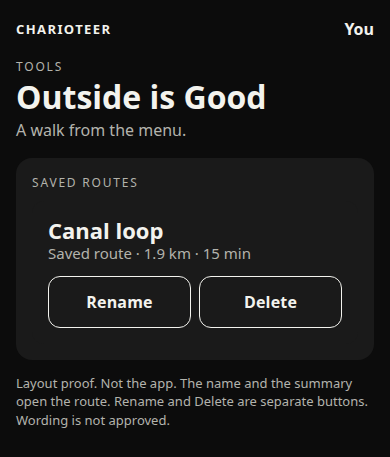
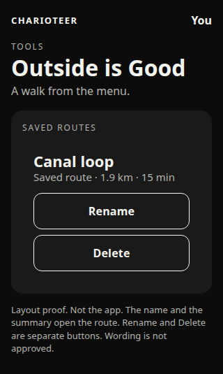
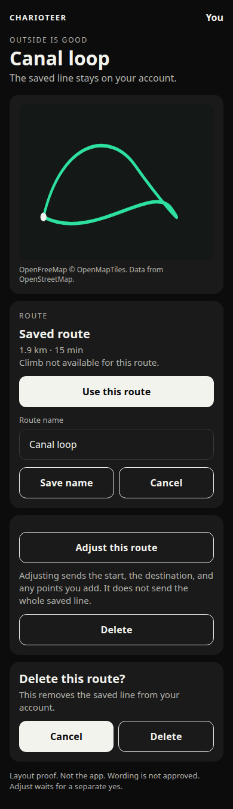
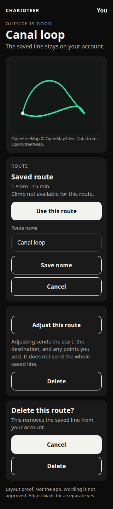
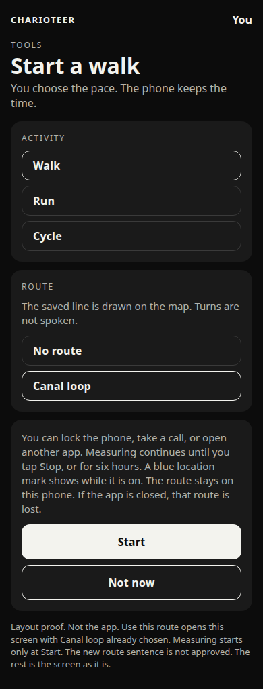
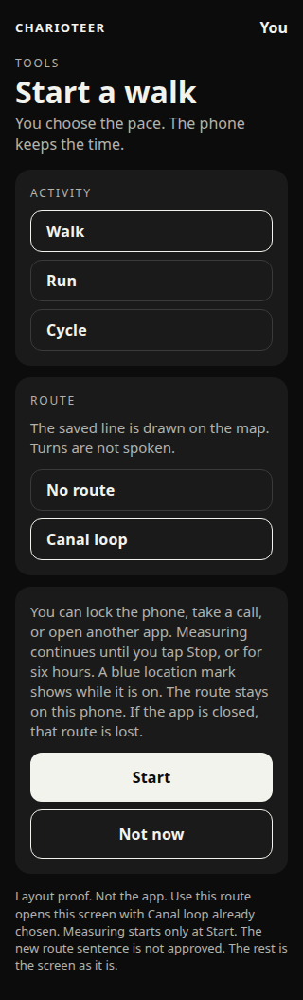

# Open a saved route again

Design only. Nothing here is built. No screen, button, or database change is in the app. No migration is applied. Build 74 is not changed by this note. The ship commit for build 74 stays `2a94a1ed0d310322418f85725b7f1ffe3c4a10c5`.

Written 26 October 2026 from Ben's iPhone: "The saved route is there but it would be good to open it up again to use the same one and the ability to Name it/rename it."

## Recommendation

Keep this out of build 74. Build 74 is being finalised. Its wording is already approved, including the route-adjusting purpose sentence and the outing banner. The route-adjusting note for that build says the saved-route list does not gain an edit control. Opening, renaming, and a new database grant are a later build.

The next build can do three things, once Ben approves the wording below:

1. Tap a saved route and open it.
2. **Use this route**, which opens the existing Start screen with that route already chosen. The person still taps Start.
3. Rename it, from the open route and from the list.

Adjusting the saved line is described below so it can be approved or left out. It sends coordinates, and it needs a wider database grant than rename. It should not ride along unless Ben says yes to that part on its own.

## What is there today

Outside is Good lists saved routes. Each card shows the name, the kind, the distance and the time, and Delete. The Saved routes map (Open the map) draws every saved line on one map and repeats the same cards. A card is not a button. Only Delete is.

The name is chosen at save. The field is **Route name**, at most 80 characters. The stored check is the same: the name is 1 to 80 characters. A blank name is refused. Two routes may share a name. There is no unique index.

A saved route is one line. The points, the distance, the time, and the climb when the service sent one, sit on that row. The via-points that drew it are not stored as their own list.

Start a walk, Start a run, and Start a cycle already offer each saved name as a choice. The live map already draws that line, and the walked line is a second colour. The screen says the name is a reminder and that turns are not spoken. Choosing it does not call the route service. The outing path is not sent.

The table is `outdoor_routes`. The policy `outdoor_routes_own` is already owner-only: `user_id = auth.uid()` for every command. `public` and `anon` have no grant. The signed-in person can select, insert, and delete. There is no update grant. The app never calls update on this table. `updated_at` exists and nothing sets it on a later change, because a later change is not possible yet.

## 1. Open it

Tapping the name and the summary opens one route. Rename and Delete stay their own buttons, so a tap on Delete does not open the route.

The same card is on Outside is Good and on the Saved routes map. Both open the same screen. The overview map still draws every line. Tapping that overview map does not pick one route. The card does.

The open screen shows:

- The map, with that one line, the light or dark style, and the credit already on the map.
- The name.
- The kind. A route saved as a loop says Loop. An A to B line says A to B. An older line, including Canal loop in the sample, says Saved route. A craving walk says Craving walk.
- The distance and the time already stored.
- The climb, when the row has one. When it does not, the screen uses the sentence already in the app: "Climb not available for this route."

Opening reads the row the phone already loaded for this account. It does not call the route service. It does not send the line. Map tiles are the same OpenFreeMap tiles as the other maps. The line is not part of a tile request.

Where I am, if it is on this screen, is the control already on the Saved routes map. It reads a while-using fix so the dot can be drawn. It does not ask the route service for a line.

## 2. Use this route

**Use this route** opens the existing Start a walk screen. The route is already chosen. Walk is selected, and the person can switch to Run or Cycle before starting, as they can today. The before-start line stays. Measuring begins only when they tap Start. The route screen does not start the watch.

On that Start screen the route note would change. The sentence there today is "Optional. A saved route is a reminder, not a guide that speaks turns." The proposed sentence, not approved, is: "The saved line is drawn on the map. Turns are not spoken."

After Start, the live map draws two lines, as it already can. The saved line is the guide, in the route colour. The line walked so far is the other colour, and it still lives only in memory. It is cleared on Stop, on discard, and if the app is closed. It is not written into the summary. It is not sent.

At Start the phone copies the saved points and the name into that outing. A rename or a delete after that does not change the guide under way. The copy lasts until Stop. It is not a second saved route.

The guide is the line already on the phone from the account. Use this route does not call the route service. The request that made the line, if there was one, already happened at save time.

If an outing or a gym session is already running, **Use this route** does not start another. The screen uses the sentence already in the app: "Finish the session already running before you start another." The approved outing banner can sit on the open route as well, with its Stop button, while an outing is measuring.

A craving walk can be used the same way. The line is still only a guide. Turns are not spoken.

## Adjusting the same line

A saved route does not keep the via-points. It keeps the finished line. Adjusting it is a new request, not a replay of the old one.

**Adjust this route** would turn on the same gestures as Find a route: one request when the finger lifts, after a 500 millisecond pause, five points at most, Undo and Reset on the phone. The quota is the one already in the route function: 40 a day and 12 in 10 minutes for the account, shared with place search. The phone still does not show the shared remainder or the 1,500 app cap.

What that request sends:

- The start. That is the first point of the saved line.
- The destination. That is the last point of the saved line. For a loop the destination is the start again, and the round-trip option is not sent.
- Any points added on the map, up to five.
- The travel type. Walk, Run, or Cycle, chosen on the adjust screen. The saved kind is the shape, not the travel type.

What that request does not send: the rest of the saved points, the route name, the account number, and the outing path.

The consent already approved on 26 October 2026 has to be on before any of those points are sent. The version is `2026-10-26-1`. If it is off, the screen shows the question already in the app, **Turn on route finding**, and sends nothing until the answer is yes.

If the redraw fails, the saved line, the distance, the time, and the climb stay. The screen can use the sentence already approved for a failed redraw: "The route on the map is unchanged."

Saving a successful redraw replaces that same row: the line, the distance, the time, the climb, and the kind. It does not insert a second route. That replace needs the wider update grant below. Until that grant is applied, Adjust cannot be offered, because Save today only inserts and would make a copy.

A craving walk does not get Adjust. That line was drawn on the phone. It is not sent to the route service to be redrawn.

This adjust path is not part of the recommended next build unless Ben approves it in the same breath as the wording.

## 3. The name

At save, nothing new. The field stays **Route name**. The suggestion stays "My route", or "Walk loop", or the craving name, as today. 80 characters. Empty is refused.

Rename, later, uses the same field. It is on the open route, under the name. It is also on the list: **Rename** opens the field on that card.

Rules:

- 80 characters, the same cap as the field and the table.
- Spaces at the ends are dropped. A name that is only spaces is empty.
- Empty is not saved. The previous name stays. The screen says: "A route needs a name."
- The same name on two routes is allowed. Canal loop can exist twice. The kind, the distance, and the time tell them apart. This design does not add a unique index.

**Save name** writes the title. **Cancel** puts the previous name back and does not write.

## 4. The database

Rename needs an update grant. The policy does not need to change. `outdoor_routes_own` already limits every command, including update, to `user_id = auth.uid()`. `public` and `anon` stay without a grant. The owner still cannot read or write another person's row.

There is no trigger on `updated_at`. The rename sets it.

This is the rename grant. It is listed here and it is not applied. It does not grant update of the line, the user id, or the other columns.

```sql
-- Not applied. Design only. Do not run this for build 74.
-- Owner-only rename of a saved route.
-- outdoor_routes_own already requires user_id = auth.uid().
-- This grant does not add a policy, and it does not grant anything to public or anon.

grant update (title, updated_at) on table public.outdoor_routes to authenticated;
```

The write is the title and the time, for that owner's row. It does not send a coordinate.

Replacing the line after Adjust needs a wider grant. It is listed here and it is not applied. It still does not grant update of `user_id`. Offer Adjust only after this grant exists, otherwise Save would insert a second row.

```sql
-- Not applied. Design only. Do not run this unless Ben has approved Adjust.
-- Replaces the line on the same saved route. Still owner-only.
-- Does not grant update of user_id. Does not grant anything to public or anon.

grant update (
  title,
  kind,
  distance_m,
  duration_minutes,
  geometry,
  ascent_m,
  updated_at
) on table public.outdoor_routes to authenticated;
```

If both are approved, apply the wider grant only. It includes the title. Do not apply either one from this note.

Climb on the open screen reads `ascent_m` when the detail migration has already added it. That migration is a separate file and this note does not apply it. If the column is absent, the screen shows "Climb not available for this route." and the route still opens.

`export_my_data` still does not include a saved route. This note does not close that gap, and it does not put the outing path into the export.

## 5. Privacy and wording

No new permission. No new purpose string. `Info.plist` and `app.json` stay as they are. The while-using sentence approved on 26 October 2026 still covers the outing and the open map. The consent line and the banner stay as approved. This design does not change them.

Opening, using, and renaming do not call the route service.

A rename writes the new title to the owner's row. It does not write a coordinate.

Use this route copies the saved line onto the outing map. That copy stays on the phone. The outing path is not sent.

Adjust, and only Adjust, sends the start, the destination, the added points, and the travel type, and only after the existing consent. The whole saved line is not in that request.

New wording, all of it unapproved, for Ben:

- Use this route
- Rename
- Save name
- Cancel
- The saved line is drawn on the map. Turns are not spoken.
- Guide: Canal loop. The line stays on this phone. Turns are not spoken.
- A route needs a name.
- Adjust this route
- Adjusting sends the start, the destination, and any points you add. It does not send the whole saved line.
- Delete this route?
- This removes the saved line from your account.

Sentences that stay as they are, and are not new wording:

- Climb not available for this route.
- Finish the session already running before you start another.
- The route on the map is unchanged.
- Turn on route finding
- The approved purpose string, the approved consent line, and the approved outing banner.

The open control is the name and the summary. Its accessible name is "Open Canal loop", with the real title. That name is not a second button on the card.

## 6. Accessibility, 320, 390, and delete

The name and the summary are one button. Rename, Delete, Use this route, Save name, Cancel, and Adjust this route are buttons. Each target is at least 44 points. The drawn line can be thin. The map's accessible name is "Map with the saved route".

VoiceOver on the open screen reads the name, the kind, the distance and the time, the climb, the route line, then Use this route, the name field, Save name, Cancel, Adjust this route, and Delete.

Save name is disabled while the field is empty, and the disabled reason is "A route needs a name."

The route colour is not the only signal. The kind is written, and on the live map the guide and the walked line are different colours and the name is written under the figures.

The screen scrolls at larger text. The map stays at least 180 points tall. Nothing is abbreviated at 320.

At 320 every button is its own row.

At 390 the map is taller. Rename and Delete share a row on the list. Save name and Cancel share a row. In the delete question, Cancel and Delete share a row. Use this route stays a full row. Adjust this route stays a full row, because the sentence under it is long. The same sentences are used at both widths.

Delete asks first. Today it does not. The question is a card on the same screen, so the words are ours.

- Delete this route?
- This removes the saved line from your account.
- Cancel is the filled button. Delete is the outline, so the destructive action is not the one that looks like the main action.

Cancel leaves the route. Delete removes that row for this owner, as Delete does today. It does not remove the guide from an outing that already copied the line at Start. It does not send the line.

## Layout proofs

These drawings are the proposal. They are not screens in the app.

The list. The name opens the route. Rename and Delete are separate. At 390 those two share a row.





The open route. The line, the figures, the name, Use this route, Adjust, and the delete question. At 390, Save name and Cancel share a row, and Cancel and Delete share a row.





Use this route lands on the Start screen that already exists. Canal loop is already chosen. Start is still required. The route sentence on this drawing is the unapproved one. The rest of the screen is unchanged.





## What Ben decides

1. Next build, not build 74. This note recommends that. Build 74 stays the ship commit above.
2. Open, Use this route, and rename in that next build. This note recommends yes, after the wording is approved.
3. Duplicate names stay allowed. This note recommends that.
4. Adjust in that same build, or later, or not at all. This note recommends later, on its own yes, because it sends the start, the destination, and the added points, and it needs the wider grant.
5. The unapproved sentences in the wording list.
6. The rename grant, and only if Adjust is included, the wider grant. Neither is applied now.
