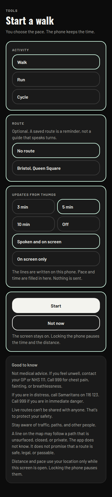
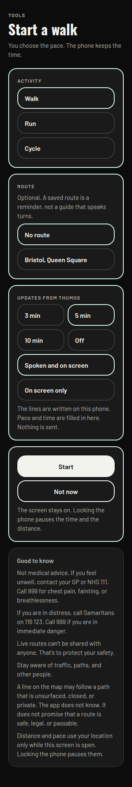
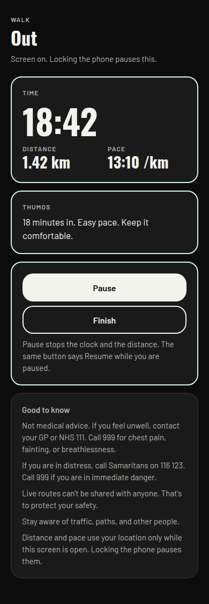
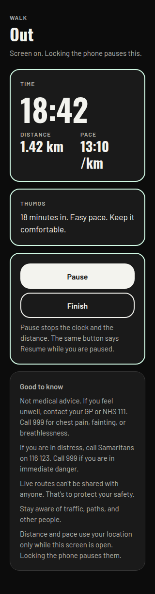
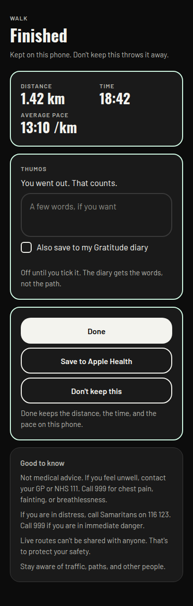
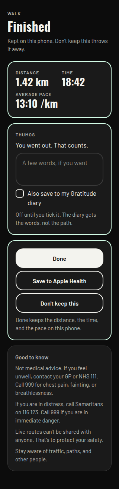
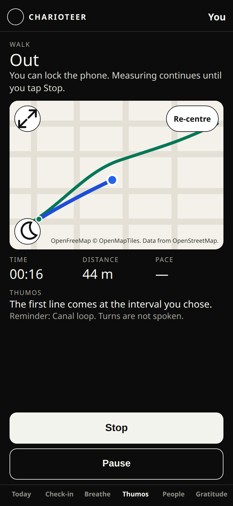
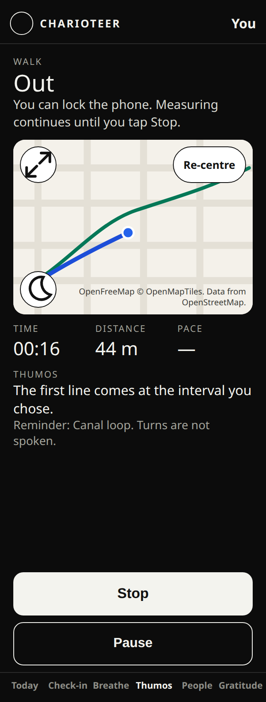
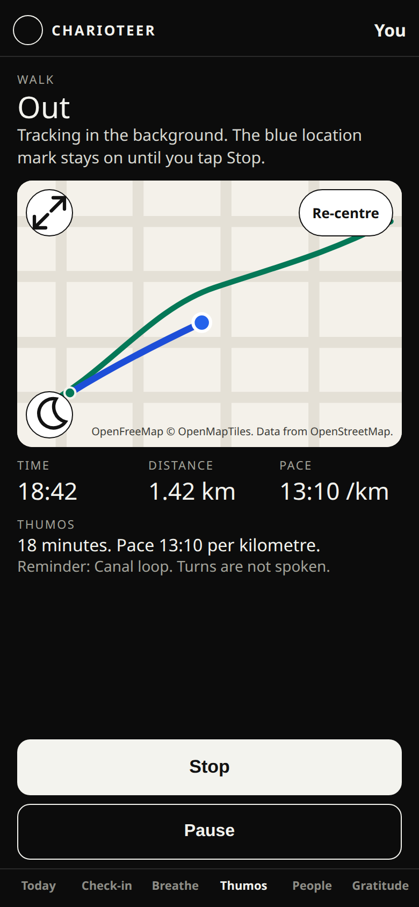
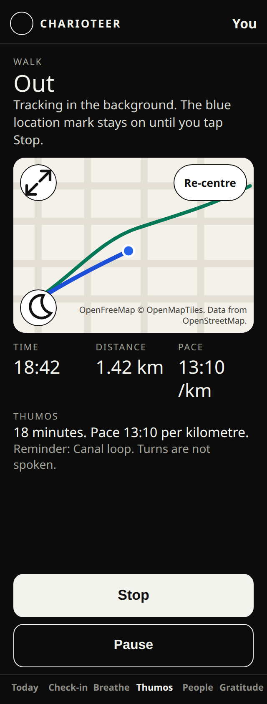

# Start a walk, a run, or a cycle

Version 1 is in the app on this branch. Ben approved it on 26 October 2026, and the same morning asked for the map on the live screen. That build keeps the screen awake and pauses when the phone locks. It has no background mode.

On 26 October 2026 at 07:42 GMT Ben changed the scope. Tracking must keep running when the phone is locked, during a call, in another app, and while music plays. A spoken line should lower the music for a moment and then let it return. That replaces the awake-screen plan and the rule against a background mode. It is not built. No purpose string has been changed. No Info.plist key has been added. Apple Health, a cloud summary, and live model lines are still not built. The iOS build number stays 72. Nothing is shipped.

The decision is **Background tracking and spoken updates over music**. The pictures in that section are layout proofs. They are not screens in the app.

Outside is Good has three buttons: **Start a walk**, **Start a run**, and **Start a cycle**. They sit on the existing card, under Find a route and above Open the map. The button opens the setup screen with that activity already chosen. The person can still switch. Walk this off stays hidden.

The setup and finished pictures are layout proofs. The live pictures are the screen. The short outing in them is there so the map has a line to show. The example figures further down (1.42 km, 18:42, 13:10 per km) are not that outing.

## Recommendation, short

1. The phone stays awake. Locking it pauses the outing. No background location, and no Always location.
2. Thumos writes the line on the screen and can speak it while that screen is open. A small buzz marks the moment. No notification every few minutes.
3. The sentences are a list kept on the phone. Pace and time are filled in there. Nothing is sent. A live model comes later, only if you say so.
4. Distance and pace come from the phone's location while the screen is open. Not from the step counter. A cycle does not make useful steps, and the motion sentence today says we do not use motion.
5. Keep the summary on the phone: type, date, distance, time, average pace. No path, on the phone or in the cloud. While the outing is on screen, the map draws the line so far. That line stays in memory and is thrown away with the screen. It is not saved and it is not sent. The Apple Health button is drawn, and it waits for your OK on new wording.
6. The careful lines stay in Good to know, once each, in the same quiet type as the other Outside screens. No warning banner.
7. Leave Walk this off hidden. This is a different idea.
8. First version is the awake screen, the local lines, the spoken line, and the summary. Lock-screen tracking, Apple Health, and a live model come later, each only after you approve the wording.

Items 1, 2, and 8 are what the branch does today. They are not the plan after 07:42 GMT. The plan is the background section below. It waits for the wording. It is not in the app.

## The screens

Setup. Activity, an optional saved route, how often Thumos speaks, and whether that is spoken or on screen only. Start keeps the screen on.

During the outing. The same OpenFreeMap map as route finding is on the screen, light by default, with the light/dark switch, full screen, and the attribution. The blue dot follows the person. A chosen route is drawn in both styles. The line walked so far is drawn too, and it is not saved. Time, distance, pace, and the latest line sit under the map. Pause and Finish stay in reach. Panning the map leaves it there until Re-centre. While paused, Pause becomes Resume.

These two pictures pause when the phone locks. The plan after 07:42 GMT is drawn in the background section.

The summary. Distance, time, and average pace. A note is optional. The gratitude tick is off. Done closes the screen and the summary stays. Don't keep this throws it away. Save to Apple Health is on the drawing and is not part of the first build.

A saved route, if they pick one, is drawn on that live map. It does not speak turns. Route finding's own map is unchanged, and this screen does not call the route service again. The line of the outing is only the points still in memory. Finish writes the summary, which still has no path.

Outside is Good can list the last few summaries, with Delete. That list is not in the pictures. Deleting the app deletes the list. Say that in the list.

## 1. Tracking while the phone is locked

**What the branch does today: the screen stays awake. Locking the phone pauses the time and the distance.** The plan after 07:42 GMT is the next section. This one is the history, and it is still the code.

Today the app may use location only while a map is open, and only if the person allows it. The purpose sentence says it is not tracked in the background. Background location is switched off. Always location is switched off. The map and the route screen still do not watch location. The activity screen reads a balanced fix only while it is open, and the live map draws that fix. The map does not start a second location watch, and it does not add a host.

Three ways to run an outing:

**Screen kept awake.** The person taps Start. The screen stays lit. If they lock the phone, the clock and the distance pause, and the screen says so before they start. This uses the location permission the app already has (while the app is in use). It does not add a new permission key. It does need new words in the existing sentence, because measuring a walk is more than showing a dot on the map. Those words are the purpose sentence in the app. Apple reads purpose sentences.

**Background, with the blue location mark.** Apple lets an app keep location going after the screen locks, if the person started it, and if a blue mark stays visible so they can see location is on. It stops when they finish, and if they force-quit the app. This is still the while-using permission. It does not ask for Always. It does add a background mode (`location` under UIBackgroundModes). Apple can ask for a short video: start, lock the phone, the mark showing, then stop. The usual Expo background switch is the wrong tool for this. Turning that on and calling the background permission asks for Always. We would not do that. This can be a later version. It is a real review, and it is lighter than Always.

**Always location.** The phone could track after the app is closed, with no mark the person is watching. That is a new purpose sentence (`NSLocationAlwaysAndWhenInUseUsageDescription`), the same background mode, and a stricter review. Apple asks why while-using is not enough. For an outing the person starts and stops, while-using is enough. I would not ask for Always.

**Apple Health or the step counter only.** Health can show a distance after a watch has already recorded a workout. It does not give a live pace every five minutes during an outing that Charioteer itself is timing. The step counter would also make today's motion sentence false. That sentence says Charioteer does not use motion or fitness data. A cycle barely registers as steps. I would not use the step counter.

What Apple will ask, if we stay with the recommendation: they will read the updated while-using sentence. They should not ask for a background-location video, because the background mode stays off.

On Android the first version is the same: location while the app is open. A later locked-phone version would show a visible "Walk in progress" notification. It would not ask for all-the-time location. Google Play treats all-the-time location as its own review.

The screen staying lit uses more battery than a locked phone. Say that in Good to know, in the lock sentence. That cost is the reason a later version may let the phone lock. It is also the reason not to do it now.

## 2. How Thumos delivers the update

**What the branch does today: the line is on the screen. The phone can also speak it, while that screen is open. A short buzz happens with the line. Notifications stay out of it.** Speaking over music while the phone is locked is the background section. It is not built.

The person picks 3, 5, or 10 minutes, or Off. Off keeps the clock and keeps Thumos quiet. They also pick "Spoken and on screen" or "On screen only".

Speaking uses the phone's own voice (a text-to-speech library, `expo-speech`). It does not use the microphone. It does not need a new permission. It does not need a background audio mode. When the screen locks, or the app is not in front, the voice stops. That matches the pause. Adding a background audio mode so a voice could keep talking on the lock screen is a common rejection. Apple expects that mode for music or podcasts, not for a sentence every five minutes. We should not add it.

Music: the spoken line should lower the music for a moment and then let it return. The library does not give a guarantee in writing. The first build has to be checked on a phone. If the music stops and does not come back, On screen only is the reliable choice and the spoken option should wait. The on-screen line is always there either way.

The microphone sentence stays as it is. It says Charioteer does not record audio, and that voice is switched off. Speaking a line is not recording. "Voice is switched off" means the app does not listen. I would not rewrite that sentence for this. A reviewer who only skims it might ask. The answer is that nothing is recorded.

A buzz uses the haptic the app already uses when something is saved. No permission.

**Notifications.** The app already asks for notification permission, for messages and for workout reminders. The same yes covers a local alert. iOS has no purpose sentence for that prompt. I would still not fire one every three or five minutes. On the lock screen it tells anyone looking that the person is out, which fights the line we already show: "Live routes can't be shared with anyone. That's to protect your safety." If they have said no to notifications, we would have to ask again or send them to Settings. The on-screen line does not need that.

## 3. Where the sentences come from

**Recommendation: a short list of lines stored in the app. The phone fills in the time and the pace. Nothing leaves the phone.**

A line is calm and short. It does not give medical advice, a heart-rate claim, or a calorie. It does not say "you should". If the pace is not ready yet, the line talks about the time only. The same list can praise a walk, a run, and a cycle without pretending to be a coach who knows the person.

**A live model (Thumos through xAI) is later, and only if you explicitly opt in.** Today `XAI_PERSONAL_DATA_ENABLED=false` is the switch that keeps personal data from being sent for coaching. An update that sent pace, time, or place would be personal data. Place should not be sent even if you later opt in. Pace and time would be the most we would send, and only after a separate yes on that screen, and only while that switch allows it. The first version does not call Thumos, the model, or any server for these lines.

## 4. Pace and distance

**Recommendation: the phone's location, only after they tap Start, only while the activity screen is open. Pause and Finish stop it.**

Drop a fix that is worse than about 50 metres. Drop a jump that would mean an impossible speed for the activity they chose (a rough cap, so a bad fix does not add a kilometre). Those caps are filters. They are not targets, and the app does not switch someone from walk to run because they sped up. The activity is whatever they picked.

If the fix is still poor, show "Waiting for a clearer fix" and do not add distance yet. Under about 50 metres, show the pace as a dash, so the first seconds do not flash a wild number.

The map's "where I am" behaviour stays as it is. This watch exists only on the activity screen. The tests that forbid a continuous watch would be opened for that one screen when this is built, and left closed everywhere else.

Battery: the lit screen costs more than the location fixes. Balanced accuracy is enough. Best-possible navigation accuracy, all the time, is not.

The step counter stays unused, so the motion sentence stays true. Android motion activity stays off.

## 5. Saving

**Recommendation: on the phone only. The summary is the activity, the date, the distance, the time, and the average pace. No path.**

A path is a trail of where they were. The first version does not store one, even on the phone. The live map draws the accepted fixes while the outing is open, so the person can see where they have been. Those points are not written to the summary, not written to the account, and not sent. Leaving the live screen can keep them in memory until Finish or until the screen is left behind. Finish writes the summary and drops the line. Don't keep this removes the summary. Outside is Good can show the last few summaries, with Delete. Reinstalling, or deleting the app, clears them. The screen should say that.

**Not a cloud table in the first version.** A table of outings would be location-related even without the path, because a distance and a time still say that someone went out. It would need a privacy-note update, a line in the data download (`export_my_data`), and the same delete as the rest of the account. Saved routes already sit on the account, and that migration does not add them to the download. A new activity table must not copy that gap. If you later want the summary to follow the account, store the summary only, still with no path, and add it to the download and to delete before it is switched on.

**Apple Health.** The app can already read workouts. The sentence that covers writing says it writes food and water, and that it does not write workouts. A Save to Apple Health button would make that sentence false. The button is on the drawing so you can see it. It is not in the first build. Building it needs the new sentence at the end of this note, and your OK. What it would write, after that: the type (walk, run, or cycle), the start, the end, and the distance. It would not write the path, a heart rate, steps, or a calorie guess. We do not have a heart rate from this screen, and a guessed calorie reads like advice.

**Gratitude.** The tick uses the words already in the app: "Also save to my Gratitude diary". It is off. If they tick it, the diary gets the note they typed, the same private diary as any other line. That note does live on the account, like the rest of the diary. It does not include the path. An empty note does not create a diary line.

## 6. Safety copy

**Recommendation: Good to know only. Quiet type. No banner.**

Use the lines the other Outside screens already use, once each:

- Not medical advice. If you feel unwell, contact your GP or NHS 111. Call 999 for chest pain, fainting, or breathlessness.
- If you are in distress, call Samaritans on 116 123. Call 999 if you are in immediate danger.
- Live routes can't be shared with anyone. That's to protect your safety.

"Stop if you feel unwell" is already inside the first line. A second sentence would say it twice, so the footer does not add one.

Two short lines that belong to this screen:

- Stay aware of traffic, paths, and other people.
- Distance and pace use your location only while this screen is open. Locking the phone pauses them.

The path line the map already shows ("A line on the map may follow a path that is unsurfaced, closed, or private...") stays on setup, once, because they may have picked a saved route. It is not a banner.

The lock sentence is also in the setup card, above the fold, so they see it before they scroll to Good to know. It is how the feature works. It is not a second medical warning.

## 7. Walk this off

**Leave it hidden.** `SHOW_WALK_THIS_OFF` stays false. The craving walk is a different idea. Start a walk does not link to it, does not reuse its screen, and does not mention it. Turning the constant on is a separate decision.

## 8. First version, and later

**First version**

- Three buttons on Outside is Good.
- The setup screen in the pictures.
- The screen stays on. Locking pauses.
- Location only during the outing, with the filters above.
- On-screen lines from the list on the phone. Spoken as well, if they leave that on, and if a phone check shows music comes back.
- A short buzz with each line.
- Pause, Resume, Finish.
- The summary on the phone, a short recent list, Delete.
- The gratitude tick, words only, off by default.
- Good to know, as above.
- The while-using sentence rewritten, with your OK, in the same binary. No new permission key.

**Later, each one only after you say so**

- Let the phone lock, with Apple's blue location mark and the background mode. Not Always. Android: a visible "Walk in progress" notification, not all-the-time location.
- Save to Apple Health, after the write sentence is changed.
- A summary on the account, with no path, included in the download and in delete, and a short addition to the location privacy note.
- A path kept on the phone, if you want a map of the outing afterwards.
- Live Thumos lines, only with an explicit opt-in, and still with no place sent.
- An automatic pause when they stop moving. The first version pauses only when they tap Pause.

**Not proposed**

- Always location.
- The step counter, or any change to the motion sentence.
- Background audio.
- A notification for each update.
- A cloud path.
- A calorie.
- Any link to Walk this off.

## Background tracking and spoken updates over music

Ben, 26 October 2026, 07:42 GMT. This section is the plan. It is not built. Nothing here has been written into Info.plist or into a purpose string.

The person starts a walk, a run, or a cycle. They can then lock the phone, take a call, open another app, or play music. The clock and the distance keep going until they tap Stop in the app. A spoken line, if they asked for one, plays over the music. The music drops for that sentence and then comes back.

While the app is open, the live screen still shows the map. It is the same OpenFreeMap map as route finding, light first, with the light or dark switch, full screen, and the attribution. The blue dot follows them. A chosen route is drawn. The line so far is drawn. Re-centre brings the dot back after a pan. Time, distance, pace, and the latest line sit under the map. Stop is on that screen. Pause still holds the clock for a rest. Pause is not the end. Stop is the end.

When the app is not in front, they do not see this screen. iOS shows a blue location mark so they can see measuring is on. When they come back, the same screen is here, the time has moved, and it says tracking is in the background, with Stop.

The two pictures earlier in this note, live-390 and live-320, are the screen in the app today. That screen pauses when the phone locks.

### (a) Location

The least permission that does the job is the one the app already asks for: While Using the App. Add the background mode `location`, and show the blue mark. Do not ask for Always.

When this is built, it would work like this.

- They tap Start. The app asks for location only if it does not already have While Using. The call is `requestForegroundPermissionsAsync`. It does not call `requestBackgroundPermissionsAsync`. That second call is the Always prompt.
- Measuring uses `expo-task-manager` and `expo-location` `startLocationUpdatesAsync`, with `showsBackgroundLocationIndicator: true`, `pausesUpdatesAutomatically: false`, and `activityType: Fitness`.
- The blue mark is required. With only While Using, iOS keeps delivering updates in the background when that mark is showing. If the mark is off, those updates stop.
- `pausesUpdatesAutomatically` has to be passed as false. In this SDK the native task turns pausing on if the flag is left out. Standing at a junction must not look like the outing ended. They can tap Pause if they want the clock to hold.
- Fitness is Apple's activity type for walking, running, and cycling. It is not the motion permission, and it does not read the step counter. The motion sentence stays as it is.
- Stop calls `stopLocationUpdatesAsync`. The blue mark goes away.

Always is the heavier option. It needs a second purpose string, `NSLocationAlwaysAndWhenInUseUsageDescription`, and a prompt that can say Change to Always Allow. Always is what lets iOS relaunch the app after they have swiped it away. This outing does not need that. If they swipe the app away, measuring stops. That is the right outcome. Do not add an Always string.

One limit to test on a phone before any build is called done. The Expo location task also starts significant-change monitoring. Apple uses that kind of monitor to relaunch an app that was swiped away, and it belongs with Always. With only While Using, a swipe-away should not relaunch the app. If the test shows iOS offering Always, do not add the Always sentence. Stop the extra monitor instead.

The map and Find a route do not start this task. Route finding still runs only after they turn it on. This outing does not send its path to the route service.

The while-using sentence for this plan is in **Wording that needs your OK**. It is not the sentence in the app today. Today's sentence says locking pauses the outing. That would be false after this is built.

### (b) Spoken lines over music

The words are still the list on the phone. Time and pace are filled in on the phone. Nothing is sent. There is no microphone. The microphone sentence does not change.

`expo-speech` speaks with the phone's voice. On iOS, `useApplicationAudioSession: false` tells the system to use a separate audio session that mixes with other audio and ducks it. That is the first thing to use. It is not a promise until a phone plays music, hears one line, and hears the music come back.

If that check fails, and the music stops and stays stopped, speak through a playback session set to duck others. That is `AVAudioSession` category playback with the duck-others option, the same idea as interruption mode `duckOthers`. Turn the session on for the sentence and off when the sentence ends, so the music comes back to full volume. Do not use a record category. Do not ask for the microphone. A line recorded in advance is a fallback only if the phone's own voice cannot duck. It is still not a microphone, and the words are still not sent anywhere.

Speaking while the phone is locked, or while another app is in front, needs the background mode `audio`. The location mode keeps the measuring going. It does not give permission to make a sound. Without `audio`, a line that has already started may finish as they leave, and the next line will not be heard.

Do not play silence for the whole outing. A silent player, used so the app stays awake, is a common rejection under guideline 2.5.4. The location mode is what keeps the outing alive between lines. Audio runs only for the sentence they asked for. If they chose On screen only, do not start the audio session for that outing.

A phone call takes the audio. Do not speak over the call. Measuring can continue through the call. The outing does not end because the phone rang. When the call ends, the next line can speak.

### (c) Info.plist keys, the review rules, and the video

Nothing in this list is added now.

Keys that would be added:

- `UIBackgroundModes` entry `location`
- `UIBackgroundModes` entry `audio`

Key that would be replaced:

- `NSLocationWhenInUseUsageDescription`, with the sentence in the wording list

Keys that stay absent:

- `NSLocationAlwaysAndWhenInUseUsageDescription`
- `NSLocationAlwaysUsageDescription`

Keys that stay, with the same words they have today:

- `NSMicrophoneUsageDescription`
- `NSMotionUsageDescription`
- The Face ID, camera, photo, calendar, and Health sentences

The Expo switch `isIosBackgroundLocationEnabled` is what writes the `location` background mode. In this SDK it does not write an Always sentence by itself, as long as the Always permission options stay false. The Android switch `isAndroidBackgroundLocationEnabled` is a different switch. It adds all-the-time location. Leave it false. A later Android build would show a visible "Walk in progress" notification. It would not ask for all-the-time location.

The App Review guidelines that apply:

- **2.5.4.** A background mode may be used only for the job it names. `location` is for the outing they started, which has to keep measuring when the phone is locked. `audio` is for the spoken line they turned on, and only while that outing is running. A mode with nothing to show, or audio used to stop the app from sleeping, is a rejection.
- **5.1.1.** The purpose sentence must say what the app really does, in plain words, and the app must do that. Ask when they tap Start, not at first launch. Do not ask for Always when While Using is enough. A sentence that still says the app does not track in the background would be a rejection, because it would be false.
- **5.1.2.** Say what happens to the data. This location is for the outing. It is not shared with other people. It is not used for advertising. It is not sent to the route service. The path is not uploaded. The privacy note has to say so before this ships. The store label stays Precise Location, for the app's function, and not for tracking across other companies' apps.

The review note should say that in plain words, and the video should show it:

1. Tap Start a walk. If the location question appears, the while-using sentence is readable.
2. The map is on screen. The blue dot moves. Stop is on screen.
3. Lock the phone. The blue location mark is visible. Music is playing.
4. A spoken line plays. The music drops. The music comes back.
5. Open another app, or take a call. Come back. The time and the distance have moved. The screen says tracking is in the background. Tap Stop. The blue mark is gone. The summary is distance, time, and pace, with no path.
6. Start again and swipe the app away. Measuring stops. The app does not relaunch itself.

The rejection risk is real. The likely causes are an Always prompt, a purpose sentence that still says locking pauses the outing, a background mode with nothing to show, a silent audio keepalive, or no video. The wording and the video come first. This note does not start the build.

### (d) Battery, and what can still go wrong

A live GPS fix costs battery. The fitness activity type, and a short distance between fixes, keep the phone from waking for every tiny jitter. High accuracy is the one to try first. Best-for-navigation burns more, and it waits for a phone test that shows the pace is too coarse.

`pausesUpdatesAutomatically: false` means a standstill does not make iOS power the radios down. That costs more at a rest stop. Pause is there if they want the clock to hold.

iOS can still slow or stop updates. Low Power Mode, heat, and memory pressure do this. The blue mark is not a promise of a fix every second. A poor fix still adds no distance.

A phone call does not end the outing. It does cut off the voice for the length of the call.

If the signal drops, the time already counted stays, and the distance waits for the next clear fix. The app does not fill in the gap.

If they swipe the app away, the process ends. Under While Using, iOS does not start it again. Measuring stops. The next open should say that it stopped because the app was closed.

### (e) Privacy

While the outing is running, the path is on the phone. Memory is enough while the app is open. A copy on the phone is allowed so a crash can draw the line again when they come back. That copy is the points of this outing.

The path is deleted when they tap Stop. It is also deleted on the next open if they had swiped the app away. It is not sent to the account, the route service, the coach, or anyone else. Coordinates are not written to a log.

The saved summary stays the activity, the date, the distance, the time, and the average pace. No path. Keeping the path after Stop would be a later decision, and only if you say so.

The summary fields, without any coordinates, can be written on the phone as the outing goes. A swipe-away then still has the distance and the time up to the last fix. That write is not a path.

### (f) What the screen has to show

The four pictures in this section are the layout. The map stays visible while the app is open. Stop is on the screen in both states: the ordinary live screen, and the screen they see when they come back while measuring has been running in the background. The words on those pictures are the in-app lines in the wording list.

## Wording that needs your OK

None of this is in the app. Nothing below is written into Info.plist until you approve it.

**While-using location, for background measuring.** Same permission as today. New words, because today's sentence would become false. There is no Always sentence.

Today, and still the sentence in the app: "Charioteer uses your location while the map is open, to show where you are, and during a walk, run, or cycle you start, to measure distance and pace. That measure runs only while the activity screen is open. Locking the phone pauses it. It is not tracked in the background. It is not shared with other people. A route is sent to the route service only if you turn route finding on. A route is stored only if you save it. A finished activity stores the distance, time, and pace on this phone, not the path."

Proposed `NSLocationWhenInUseUsageDescription`: "Charioteer uses your location while the map is open, to show where you are. During a walk, run, or cycle you start, it keeps measuring distance and pace while the phone is locked or you are in another app, until you tap Stop. iOS shows a blue location mark the whole time that measuring is on. Swiping the app away stops it. Location is not shared with other people. A route is sent to the route service only if you turn route finding on. A route is stored only if you save it. While an outing is running, the path stays on this phone and is deleted when you tap Stop. A finished activity stores the distance, time, and pace on this phone, not the path."

Do not add `NSLocationAlwaysAndWhenInUseUsageDescription`. Do not add `NSLocationAlwaysUsageDescription`.

**Lines on the screen, for the same build.** Not purpose strings. They still need the same OK, because they are what the person reads.

- Before Start: "You can lock the phone, take a call, or open another app. Measuring continues until you tap Stop. A blue location mark shows while it is on."
- On the live screen: "You can lock the phone. Measuring continues until you tap Stop."
- When they come back and it has been running: "Tracking in the background. The blue location mark stays on until you tap Stop."
- In Good to know: "Distance and pace keep going after you lock the phone, until you tap Stop. The path stays on this phone for that outing and is deleted when you stop. It is not sent."
- Beside the spoken choice: "A spoken line lowers your music for a moment, then lets it return. The phone speaks. Nothing is recorded."
- The end control: "Stop"
- Pause stays "Pause", and "Resume" after a pause. Pause holds the clock. Stop ends the outing.

**Microphone.** No new words. The sentence stays: "Charioteer does not record audio. Voice is switched off in this version. Apple requires this note because an audio component is included in the app."

**Motion.** No new words. The sentence stays: "Charioteer does not use your motion or fitness data. The map component in the app can reference motion sensors, so Apple requires this note."

**While-using location, already in the app.** This is the purpose sentence on the device today. It matches a screen that pauses when the phone locks. The route-service sentence is in it, and that part stays true. If background measuring is built, the proposed sentence above replaces this one.

"Charioteer uses your location while the map is open, to show where you are, and during a walk, run, or cycle you start, to measure distance and pace. That measure runs only while the activity screen is open. Locking the phone pauses it. It is not tracked in the background. It is not shared with other people. A route is sent to the route service only if you turn route finding on. A route is stored only if you save it. A finished activity stores the distance, time, and pace on this phone, not the path."

The map screens keep their own page line. That line is about the map, not about an outing.

**Apple Health write, only if you want that button built.** Not the first version.

Today: "Charioteer writes the food and water you log to Apple Health: dietary energy, protein, carbohydrate, sugar, fibre, fat, sodium and water. It does not write steps, sleep, heart rate, workouts, or weight."

Proposed: "Charioteer writes the food and water you log to Apple Health: dietary energy, protein, carbohydrate, sugar, fibre, fat, sodium and water. If you tap Save to Apple Health after a walk, run, or cycle, it also writes that workout: the type, the time, and the distance. It does not write the path, steps, sleep, heart rate, or weight."

**Still not added, even after this change of scope**

- `NSLocationAlwaysAndWhenInUseUsageDescription`.
- `NSLocationAlwaysUsageDescription`.
- A new motion sentence. The current one stays, because the app does not read motion.
- A new microphone sentence. Speaking is not recording.

`UIBackgroundModes` `location` and `audio` are the keys in section (c). They are not in the binary. They wait for the wording above.

## Review risks

The binary on this branch pauses when the phone locks, and it has no background mode. Its purpose sentence matches that.

The plan after 07:42 GMT does use background location and a short burst of audio. That is a real review. Guideline 2.5.4, 5.1.1, and 5.1.2 are the ones that apply, and they are set out in section (c), with the video. An Always prompt, a sentence that still says locking pauses the outing, or a silent audio keepalive, are the likely rejections. The wording is not in the binary until you approve it.

Writing a workout while the Health sentence says we do not write workouts would be a rejection. The button stays on the drawing until the sentence is approved.

A step counter while the motion sentence says we do not use motion would be the same kind of rejection. The step counter is not in the plan.

## What this note does not do

Version 1, including the live map, is in the app on this branch. It still pauses when the phone locks. The background section is a decision only. No purpose string was changed. No Info.plist key was added. No new host. Build number 72. Nothing shipped. The outdoor-route function is still not deployed. Build 73 stays on its own branch.
