# Start a walk, a run, or a cycle

## Build 74, approved 26 October 2026

Ben approved background tracking and speech over music, the location purpose sentence, the Health share sentence, the audio wording, and `UIBackgroundModes` `location` and `audio`. This branch contains that build. It is not shipped. The iOS build number stays 72.

Still not approved, and not in this build: Always location, Garmin or Bluetooth, and Save to Apple Health.

What the branch does:

- A walk, run, or cycle keeps a while-using location watch going when the phone is locked, when another app is in front, and when the outing screen is left. The watch is `watchPositionAsync`. It does not call a background-permission API. On iOS the watch streamer is patched so a caller can set fitness activity type, the blue location mark, and standard updates only, and only when the binary lists the location background mode. It does not start significant-change or region monitoring. Accuracy is High, about 10 metres, with a 10 metre distance filter. iOS is told not to pause updates while the person is standing still. Stop, discard, the six-hour limit, and process death are what stop the watch.
- The outing path stays in memory and is cleared on Stop, on discard, and when the process ends. The outing path is not saved, logged, or sent. Route finding is not called with it. No live-tracking route goes to HeiGIT.
- The time limit is `OUTING_TIME_LIMIT_MS`, six hours. Ben confirmed that length on 26 October 2026. Pause does not extend it. It is checked on each location fix, when the app returns to the foreground, and on a one-second timer. Any of those stops the watch. A forgotten outing is the failure mode the blue mark is there to show, and the time limit is what ends it.
- Thumos updates are a switch, then 3, 5, or 10 minutes, and spoken or on screen only. The outing copies the default from You. That default starts off.
- Spoken lines are on for TestFlight when the person picks spoken updates. The `audio` background mode stays. On screen only never starts an audio session. There is no silent keepalive. App Store submission is blocked until a real phone shows music ducks, then returns to full volume after each line, with no leftover audio session, including a phone call and Bluetooth headphones.
- Heart rate uses a foreground HealthKit observer and an anchored query while the outing or gym session is in front. The background-delivery entitlement is not added. The live number is not sent, not exported, and not written next to sobriety fields. Ben re-approved the Health share sentence on 26 October 2026. The clause that said the heart rate could show while the phone is locked was removed. The reading does not continue while the phone is locked.
- Workouts has Start live session, Strength or Cardio, a heart-rate row, and an active-energy row.

Items 1, 2, and 8 in the short recommendation below described an earlier awake-screen plan. They are superseded by this section.

Later on 26 October 2026 Ben kept the audio background mode and turned speech on for TestFlight. He also re-approved the Health share sentence with the locked-phone heart-rate clause removed. The location sentence still says spoken updates. Ben approved the Good to know battery line on 26 October 2026, as written: "A finer location fix, about 10 metres, uses more battery than a coarse one. It stops when you tap Stop, or after six hours." iOS automatic pause of location updates is off, because a rest stop was stalling distance. Stop and the six-hour limit still end the session.

Hard release gate: App Store submission is blocked until a real phone shows music ducks, then returns to full volume after each line, with no leftover audio session, including a phone call and Bluetooth headphones. On screen only never starts an audio session. There is no silent keepalive. `APP_STORE_SPEECH_DUCK_GATE_PASSED` stays false until that phone test is recorded in this note and in `docs/app-store-activity-review.md`.

`EXPO_PUBLIC_BUILD_PROFILE` drives `TESTFLIGHT_SPEECH_ON` and the `audio` entry in `UIBackgroundModes`. Unset, or `testflight`, is this build: speech on, and `audio` stays. `store`, `app-store`, and `production` keep speech off and omit `audio` until the gate above is true. The ship check exits 1 for a store-profile target while the gate is false. Ben's decision stands: build 74 for TestFlight testing keeps audio and speech on.

Phone test checklist, not done:

- Blue mark and fixes with the screen locked
- Force-quit stops it
- Stop stops it
- 6h limit (a debug short limit is ok)
- A call during an outing
- Permission denied, then granted
- No stalls
- Bluetooth headphones
- Music ducking and release with speech on

Proxy check result: not done. The packet check includes tile requests. After the phone test, fill this slot in this form: proxy check done on build X, no coordinates in non-tile requests. The nutrition label stays open until that result is filled.

New wording for Ben. Not approved. Outing in progress banner, on Outside is Good and the home screen, with a Stop button: "Outing in progress. Measuring is still on. Open it to see the map, or tap Stop to end it."

A real iOS compile is still required before TestFlight can prove any of this. The compile has to show: the location patch builds; High accuracy is about 10 metres and is not Best-for-navigation; `pausesLocationUpdatesAutomatically` is false; the fitness activity type and the blue mark are set only when the binary lists the location background mode; no significant-change monitoring; leaving the outing screen does not stop measuring; Stop, discard, the six-hour limit, and force-quit do; speech uses iOS's own speech session so music can duck, and that duck is not proven until the phone test above.

Version 1 was the awake screen. Ben approved the map on the live screen the same morning, then changed the scope.

On 26 October 2026 at 07:42 GMT Ben changed the scope. Tracking must keep running when the phone is locked, during a call, in another app, and while music plays. A spoken line should lower the music for a moment and then let it return. That replaces the awake-screen plan and the rule against a background mode. It is not built. No purpose string has been changed. No Info.plist key has been added. Apple Health, a cloud summary, and live model lines are still not built. The iOS build number stays 72. Nothing is shipped.

Later the same day the Security and Compliance Bot sent an advisory on that plan. The background section below records it as recommendations. Ben decides. Nothing in the advisory is built. Where the advisory is tighter than the 07:42 draft, the advisory is the recommendation.

On 26 October 2026 at 08:09 GMT Ben asked for a live heart rate and for split times. That is also design only. It is the section **Heart rate and split times**. No permission string was changed for it.

On 26 October 2026 at 08:18 GMT Ben asked for a live feed on the Workouts screen for a gym session, such as cardio or strength, that is not a GPS outing. That is the section **A gym session in progress**. It is design only. No permission string was changed for it. Build 73 stays first.

The decision is **Background tracking and spoken updates over music**. The pictures in that section are layout proofs. They are not screens in the app.

Outside is Good has three buttons: **Start a walk**, **Start a run**, and **Start a cycle**. They sit on the existing card, under Find a route and above Open the map. The button opens the setup screen with that activity already chosen. The person can still switch. Walk this off stays hidden.

The setup and finished pictures are layout proofs. The live pictures are the screen. The short outing in them is there so the map has a line to show. The example figures further down (1.42 km, 18:42, 13:10 per km) are not that outing.

On 26 October 2026 at 12:05 GMT Ben asked where he turns Thumos updates on, and where a normal gym workout shows a live heart rate. Neither of those controls is a finished feature. The answer is the next section. Build 73 has already shipped from `fb05f08`. This note is rebased onto that commit. It does not change a purpose string.

## Where each control lives

Nothing in this section is a new permission. The pictures are layout proofs. They are not a build.

There is no separate Settings screen. The lasting default sits on **You**, which is Account in the drawer. Notifications is a different row. These updates are not push alerts, so they do not go there.

**Thumos updates for a walk, a run, or a cycle.** Drawer, Tools, **Outside is Good**. On that card, under Find a route and above Open the map: **Start a walk**, **Start a run**, **Start a cycle**. Those three buttons are already on this branch. Each one opens the setup screen with that activity chosen. He can still switch.

On that setup screen the design is a switch, **Thumos updates**, and, when it is on, **3 minutes**, **5 minutes**, and **10 minutes**, plus **Spoken and on screen** or **On screen only**. That choice is for this outing. It does not change the default on You.

The setup screen now has the switch, **Thumos updates**, and, when it is on, **3 minutes**, **5 minutes**, and **10 minutes**, plus **Spoken and on screen** or **On screen only**. That choice is for this outing. It copies the default on You and does not change it. You starts with the switch off.

**The default.** Drawer, Account, **You**. A card, **Activity updates**, after Appearance and before Notifications. The same switch and the same 3, 5, and 10 minute choice. Recommendation: the switch starts off. Five minutes and On screen only are what he sees when he turns it on. Both setup screens copy this when they open.

**A normal gym workout, and its heart rate.** Drawer, Tools, **Workouts**. Above the history card, under the refresh bar: **Start live session**. That name replaces the earlier draft **I'm training now**. The history, the charts, and the calendar stay where they are.

Start live session opens its own setup. **Strength** or **Cardio**. The same **Thumos updates** switch and the same 3, 5, and 10 minute choice, again for this session only. **Start** opens the live screen. That live screen is where the heart-rate row lives. It is not on the Workouts history, not on the calendar, and not on Health Stats. There is no map. If Apple Health has no recent sample, the row says **No heart-rate source**. The iPhone does not measure heart rate. This screen is in build 74. It is not shipped. Heart rate is a foreground read. The row says **No heart-rate source** when Apple Health has nothing recent.

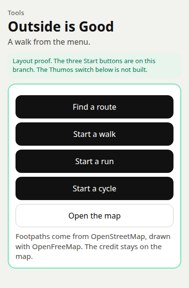

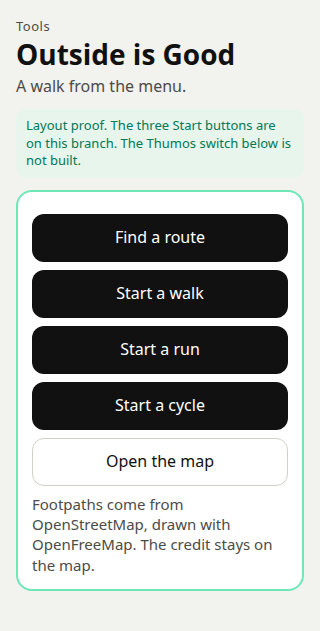

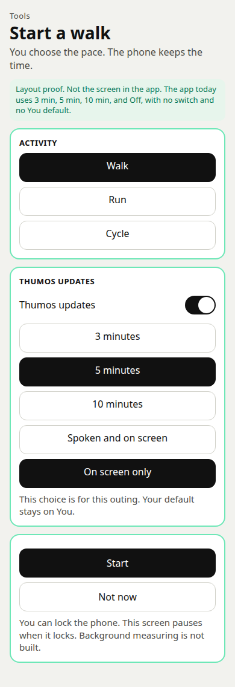

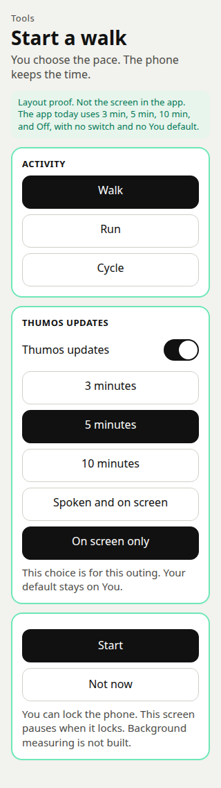

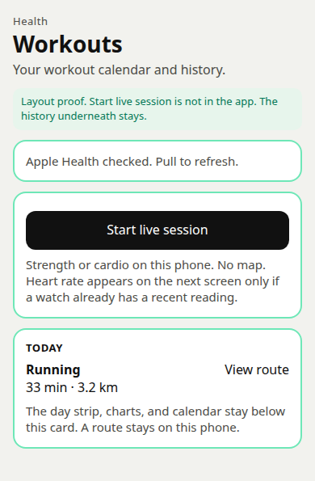

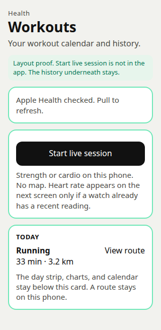

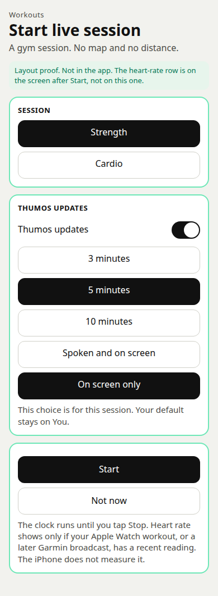

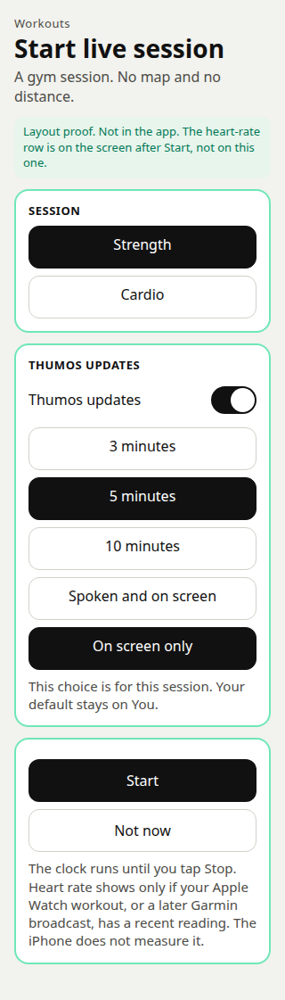

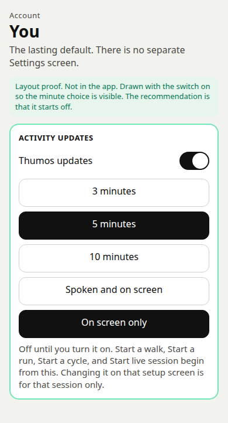

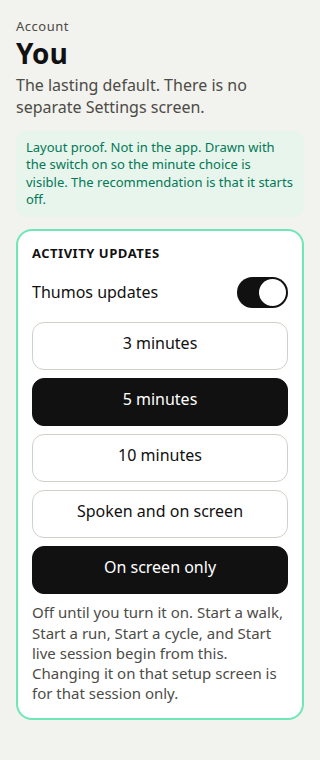

## Recommendation, short

1. Superseded by the approved background section. The outing keeps measuring when the phone is locked. There is still no Always location.
2. Superseded by the approved background section. Thumos writes the line on the screen. Speech waits for the phone check. A small buzz marks the moment. No notification every few minutes.
3. The sentences are a list kept on the phone. Pace and time are filled in there. Nothing is sent. A live model comes later, only if you say so.
4. Distance and pace come from the phone's location while the screen is open. Not from the step counter. A cycle does not make useful steps, and the motion sentence today says we do not use motion.
5. Keep the summary on the phone: type, date, distance, time, average pace. No path, on the phone or in the cloud. While the outing is on screen, the map draws the line so far. That line stays in memory and is thrown away with the screen. It is not saved and it is not sent. The Apple Health button is drawn, and it waits for your OK on new wording.
6. The careful lines stay in Good to know, once each, in the same quiet type as the other Outside screens. No warning banner.
7. Leave Walk this off hidden. This is a different idea.
8. Superseded by the approved background section. Build 74 is the while-using watch, the local lines, the on-screen update, the summary, the foreground heart-rate row, and the gym session. A live model is still later.

Items 1, 2, and 8 are superseded. The background section below is what Ben approved on 26 October 2026. It is in this branch. It is not shipped.

## The screens

Setup. Activity, an optional saved route, how often Thumos speaks, and whether that is spoken or on screen only. Start keeps the screen on.

During the outing. The same OpenFreeMap map as route finding is on the screen, light by default, with the light/dark switch, full screen, and the attribution. The blue dot follows the person. A chosen route is drawn in both styles. The line walked so far is drawn too, and it is not saved. Time, distance, pace, and the latest line sit under the map. Pause and Finish stay in reach. Panning the map leaves it there until Re-centre. While paused, Pause becomes Resume.

These two pictures pause when the phone locks. The plan after 07:42 GMT is drawn in the background section.

The summary. Distance, time, and average pace. A note is optional. The gratitude tick is off. Done closes the screen and the summary stays. Don't keep this throws it away. Save to Apple Health is on the drawing and is not part of the first build.

A saved route, if they pick one, is drawn on that live map. It does not speak turns. Route finding's own map is unchanged, and this screen does not call the route service again. The line of the outing is only the points still in memory. Finish writes the summary, which still has no path.

Outside is Good can list the last few summaries, with Delete. That list is not in the pictures. Deleting the app deletes the list. Say that in the list.

## 1. Tracking while the phone is locked

**History.** An earlier build kept the screen awake and stopped measuring when the phone was locked. That behaviour is superseded.

The map still asks for location only while that page is open, and only if the person allows it. Always location stays off. The map and the route screen do not watch location. The activity screen starts one continuous while-using watch when they tap Start. The map does not start a second watch, and it does not add a host.

Three ways to run an outing:

**Screen kept awake.** The person taps Start. The screen stays lit. If they lock the phone, the clock and the distance pause, and the screen says so before they start. This uses the location permission the app already has (while the app is in use). It does not add a new permission key. It does need new words in the existing sentence, because measuring a walk is more than showing a dot on the map. Those words are the purpose sentence in the app. Apple reads purpose sentences.

**Background, with the blue location mark.** This is the build. Apple lets an app keep location going after the screen locks, if the person started it, and if a blue mark stays visible so they can see location is on. It stops when they finish, and if they force-quit the app. This is still the while-using permission. It does not ask for Always. It does add a background mode (`location` under UIBackgroundModes). Apple can ask for a short video: start, lock the phone, the mark showing, then stop. `isIosBackgroundLocationEnabled` writes that mode and, with the Always permission options left false, does not write an Always sentence. The app does not call a background-permission request. The watch is `watchPositionAsync`. A patch on the watch streamer sets the fitness activity type, the blue mark, and standard updates only when the binary lists the location mode. It does not use the task consumer, so it does not start significant-change monitoring.

**Always location.** The phone could track after the app is closed, with no mark the person is watching. That is a new purpose sentence (`NSLocationAlwaysAndWhenInUseUsageDescription`), the same background mode, and a stricter review. Apple asks why while-using is not enough. For an outing the person starts and stops, while-using is enough. I would not ask for Always. The Security and Compliance Bot advisory, in the background section, is the recommendation if that later version is built. It keeps While Using, refuses Always, and refuses significant-change and region monitoring.

**Apple Health or the step counter only.** Health can show a distance after a watch has already recorded a workout. It does not give a live pace every five minutes during an outing that Charioteer itself is timing. The step counter would also make today's motion sentence false. That sentence says Charioteer does not use motion or fitness data. A cycle barely registers as steps. I would not use the step counter.

What Apple will ask: they will read the while-using sentence, which says measuring continues when the screen is locked or another app is open. The location background mode is on, so they can ask for a short video. The script is in `docs/app-store-activity-review.md`: Start, the in-app explanation, the While Using prompt with no Always choice, lock the phone, the blue mark, one spoken line, and Stop. There is no Always prompt. The spoken line in that video is the phone check for music ducking. TestFlight speaks when spoken updates are chosen. App Store submission is blocked until a real phone shows music ducks, then returns to full volume after each line, with no leftover audio session, including a phone call and Bluetooth headphones.

On Android the first version is the same: location while the app is open. A later locked-phone version would show a visible "Walk in progress" notification. It would not ask for all-the-time location. Google Play treats all-the-time location as its own review.

The screen staying lit uses more battery than a locked phone. Say that in Good to know, in the lock sentence. That cost is the reason a later version may let the phone lock. It is also the reason not to do it now.

## 2. How Thumos delivers the update

**What the branch does today: the line is on the screen, and TestFlight also speaks it when spoken updates are chosen, including after the outing screen is left.** A short buzz happens with the line on a phone. Notifications stay out of it. On screen only does not speak. App Store submission is blocked until a real phone shows music ducks, then returns to full volume after each line, with no leftover audio session, including a phone call and Bluetooth headphones.

The person picks 3, 5, or 10 minutes, or Off. Off keeps the clock and keeps Thumos quiet. They also pick "Spoken and on screen" or "On screen only".

Speaking uses the phone's own voice (a text-to-speech library, `expo-speech`). It does not use the microphone. It does not need a new permission. It does not need a background audio mode. When the screen locks, or the app is not in front, the voice stops. That matches the pause. Adding a background audio mode so a voice could keep talking on the lock screen is a common rejection if the mode is used to keep the app awake. The app today does not add it. The later plan does add it, only to speak a line they asked for, and the session is released when the line ends. That plan is not built.

Music: the spoken line should lower the music for a moment and then let it return. The library does not give a guarantee in writing. The first build has to be checked on a phone. If the music stops and does not come back, On screen only is the reliable choice and the spoken option should wait. The on-screen line is always there either way.

The microphone sentence stays as it is. It says Charioteer does not record audio, and that voice is switched off. Speaking a line is not recording. "Voice is switched off" means the app does not listen. I would not rewrite that sentence for this. A reviewer who only skims it might ask. The answer is that nothing is recorded.

A buzz uses the haptic the app already uses when something is saved. No permission.

**Notifications.** The app already asks for notification permission, for messages and for workout reminders. The same yes covers a local alert. iOS has no purpose sentence for that prompt. I would still not fire one every three or five minutes. On the lock screen it tells anyone looking that the person is out, which fights the line we already show: "Live routes can't be shared with anyone. That's to protect your safety." If they have said no to notifications, we would have to ask again or send them to Settings. The on-screen line does not need that.

## 3. Where the sentences come from

**Recommendation: a short list of lines stored in the app. The phone fills in the time and the pace. Nothing leaves the phone.**

A line is calm and short. It does not give medical advice, a heart-rate claim, or a calorie. It does not say "you should". If the pace is not ready yet, the line talks about the time only. The same list can praise a walk, a run, and a cycle without pretending to be a coach who knows the person. Version 1 keeps that. The later heart-rate section may state a number that Apple Health already has. It still does not interpret the number.

**A live model (Thumos through xAI) is later, and only if you explicitly opt in.** Today `XAI_PERSONAL_DATA_ENABLED=false` is the switch that keeps personal data from being sent for coaching. An update that sent pace, time, or place would be personal data. Place should not be sent even if you later opt in. Pace and time would be the most we would send, and only after a separate yes on that screen, and only while that switch allows it. The first version does not call Thumos, the model, or any server for these lines.

## 4. Pace and distance

**Recommendation: the phone's location, only after they tap Start, only while the activity screen is open. Pause and Finish stop it.**

Drop a fix that is worse than about 50 metres. Drop a jump that would mean an impossible speed for the activity they chose (a rough cap, so a bad fix does not add a kilometre). Those caps are filters. They are not targets, and the app does not switch someone from walk to run because they sped up. The activity is whatever they picked.

If the fix is still poor, show "Waiting for a clearer fix" and do not add distance yet. Under about 50 metres, show the pace as a dash, so the first seconds do not flash a wild number.

The map's "where I am" behaviour stays as it is. This watch exists only on the activity screen. The tests that forbid a continuous watch would be opened for that one screen when this is built, and left closed everywhere else.

Battery: the lit screen costs more than the location fixes. Balanced accuracy is enough. Best-possible navigation accuracy, all the time, is not.

The step counter stays unused, so the motion sentence stays true. Android motion activity stays off.

## 5. Saving

**Recommendation: on the phone only. The summary is the activity, the date, the distance, the time, and the average pace. No path.**

A path is a trail of where they were. The first version does not store one, even on the phone. The live map draws the accepted fixes while the outing is open, so the person can see where they have been. Those points are not written to the summary, not written to the account, and not sent. Leaving the live screen can keep them in memory until Finish or until the screen is left behind. Finish writes the summary and drops the line. Don't keep this removes the summary. Outside is Good can show the last few summaries, with Delete. Reinstalling, or deleting the app, clears them. The screen should say that.

**Not a cloud table in the first version.** A table of outings would be location-related even without the path, because a distance and a time still say that someone went out. It would need a privacy-note update, a line in the data download (`export_my_data`), and the same delete as the rest of the account. Saved routes already sit on the account, and that migration does not add them to the download. A new activity table must not copy that gap. If you later want the summary to follow the account, store the summary only, still with no path, and add it to the download and to delete before it is switched on.

**Apple Health.** The app can already read workouts. The sentence that covers writing says it writes food and water, and that it does not write workouts. A Save to Apple Health button would make that sentence false. The button is on the drawing so you can see it. It is not in the first build. Building it needs the new sentence at the end of this note, and your OK. What it would write, after that: the type (walk, run, or cycle), the start, the end, and the distance. It would not write the path, a heart rate, steps, or a calorie guess. Version 1 does not show a heart rate. A later read, if you approve it, only displays a rate Apple Health already has. It still does not write one. A guessed calorie reads like advice.

**Gratitude.** The tick uses the words already in the app: "Also save to my Gratitude diary". It is off. If they tick it, the diary gets the note they typed, the same private diary as any other line. That note does live on the account, like the rest of the diary. It does not include the path. An empty note does not create a diary line.

## 6. Safety copy

**Recommendation: Good to know only. Quiet type. No banner.**

Use the lines the other Outside screens already use, once each:

- Not medical advice. If you feel unwell, contact your GP or NHS 111. Call 999 for chest pain, fainting, or breathlessness.
- If you are in distress, call Samaritans on 116 123. Call 999 if you are in immediate danger.
- Live routes can't be shared with anyone. That's to protect your safety.

"Stop if you feel unwell" is already inside the first line. A second sentence would say it twice, so the footer does not add one.

Two short lines that belong to this screen:

- Stay aware of traffic, paths, and other people.
- Distance and pace keep going after you lock the phone, until you tap Stop or the time limit. The route stays in memory for that outing.

The path line the map already shows ("A line on the map may follow a path that is unsurfaced, closed, or private...") stays on setup, once, because they may have picked a saved route. It is not a banner.

The lock sentence is also in the setup card, above the fold, so they see it before they scroll to Good to know. It is how the feature works. It is not a second medical warning.

## 7. Walk this off

**Leave it hidden.** `SHOW_WALK_THIS_OFF` stays false. The craving walk is a different idea. Start a walk does not link to it, does not reuse its screen, and does not mention it. Turning the constant on is a separate decision.

## 8. First version, and later

**First version**

- Three buttons on Outside is Good.
- The setup screen in the pictures.
- The screen stays on. Locking pauses.
- Location only during the outing, with the filters above.
- On-screen lines from the list on the phone. Spoken as well, if they leave that on, and if a phone check shows music comes back.
- A short buzz with each line.
- Pause, Resume, Finish.
- The summary on the phone, a short recent list, Delete.
- The gratitude tick, words only, off by default.
- Good to know, as above.
- The while-using sentence rewritten, with your OK, in the same binary. No new permission key.

**Later, each one only after you say so**

- Let the phone lock, with Apple's blue location mark and the background mode. Not Always. Android: a visible "Walk in progress" notification, not all-the-time location.
- Save to Apple Health, after the write sentence is changed.
- A summary on the account, with no path, included in the download and in delete, and a short addition to the location privacy note.
- A path kept on the phone, if you want a map of the outing afterwards.
- Live Thumos lines, only with an explicit opt-in, and still with no place sent.
- An automatic pause when they stop moving. The first version pauses only when they tap Pause.

**Not proposed**

- Always location.
- The step counter, or any change to the motion sentence.
- Background audio.
- A notification for each update.
- A cloud path.
- A calorie.
- Any link to Walk this off.

The list above is the first version, which is already in the app. The next section is the later plan. Background audio appears there only so a Thumos line can be heard, and only if you approve that build. Always location stays out.

## Background tracking and spoken updates over music

Ben, 26 October 2026, 07:42 GMT, with the Security and Compliance Bot advisory folded in the same day. This section is the plan. It is not built. Nothing here has been written into Info.plist or into a purpose string. You decide whether it is built.

The person starts a walk, a run, or a cycle. They can then lock the phone, take a call, open another app, or play music. The clock and the distance keep going until they tap Stop in the app. A spoken line, if they asked for one, plays over the music. The music drops for that sentence and then comes back.

While the app is open, the live screen still shows the map. It is the same OpenFreeMap map as route finding, light first, with the light or dark switch, full screen, and the attribution. The blue dot follows them. A chosen route is drawn. The line so far is drawn. Re-centre brings the dot back after a pan. Time, distance, pace, and the latest line sit under the map. Stop is on that screen. Pause still holds the clock for a rest. Pause is not the end. Stop is the end.

When the app is not in front, they do not see this screen. iOS shows a blue location mark so they can see measuring is on. When they come back, the same screen is here, the time has moved, and it says tracking is in the background, with Stop.

The line drawn on these proofs is the path held in memory during the outing. If the app is killed, that line is gone. The pictures do not show a saved route of the outing. Stop on these proofs is the button in the app. It is not a notification.

The two pictures earlier in this note, live-390 and live-320, are the screen in the app today. That screen pauses when the phone locks.

### (a) Location

Security recommendation. While Using the App, plus the background mode `location`, plus the blue mark. Never Always. Do not add `NSLocationAlwaysAndWhenInUseUsageDescription`. Do not add `NSLocationAlwaysUsageDescription`. Do not call `requestBackgroundPermissionsAsync`. That call is the Always prompt.

Updates start only when they tap Start on the activity screen. Opening the map, opening setup, Find a route, and launching the app do not start them. If While Using is not granted yet, Start is when the app asks, with `requestForegroundPermissionsAsync`, and only after the in-app explanation in the wording list.

Updates stop in all of these cases:

- They tap Stop. Stop is the end of the outing. The same clear happens if they discard it.
- The app is terminated. A swipe-away, a crash, or the system ending the process all count. iOS does not relaunch the app. Measuring does not resume on the next open.
- A time limit. Ben confirmed six hours from Start on 26 October 2026. Pause does not extend it. At six hours, updates stop, the path is cleared, and the screen says the outing stopped because it reached the time limit.

The in-app state while measuring is on, including after they come back from the lock screen or another app, says tracking is active and shows Stop. Stop is that button. No notification is posted to say tracking is on, and no notification carries Stop.

What build 74 sets on the while-using watch:

- `showsBackgroundLocationIndicator: true`. With only While Using, iOS keeps delivering updates in the background when that mark is showing. If the mark is off, those updates stop.
- `activityType: Fitness`. That is Apple's type for walking, running, and cycling. It is not the motion permission, and it does not read the step counter. The motion sentence stays as it is.
- `pausesLocationUpdatesAutomatically` is passed explicitly. The advisory names the property and does not say on or off. The earlier draft of this note said off, so a rest would not look like the outing ended. That mixed up two things. An automatic pause of the radios is not the end of the outing. The in-app state stays "tracking active" until Stop, the time limit, or the process ending. The security reading is to leave automatic pause on, so a long standstill can power the radios down. This SDK does not agree with itself about the default: the TypeScript comment says the default is false, and `EXLocationTaskConsumer` uses true if the option is omitted. Pass the value you choose. Recommendation: true. You decide.
- Accuracy and `distanceFilter` no finer than the outing needs. Recommendation: Balanced accuracy, and a distance filter of 10 metres. Best-for-navigation, and a filter of 0, are finer than this needs. The filters already in version 1 stay: drop a fix worse than about 50 metres, and drop a jump that would be an impossible speed. Those numbers are for you to confirm with the 10 metres.

Do not use significant-change monitoring. Do not use region monitoring, a geofence, or visit monitoring. This is a hard no, not a test-and-see. The earlier draft said to stop the extra monitor only if a phone test offered Always. That hedge is withdrawn.

`startLocationUpdatesAsync` in this SDK registers `EXLocationTaskConsumer`. That consumer calls `startUpdatingLocation` and also `startMonitoringSignificantLocationChanges`, and the background-permission APIs ask for Always. Build 74 does not call them. The outing uses `watchPositionAsync` with while-using permission only. The patched watch streamer can set `allowsBackgroundLocationUpdates` and the blue mark. It does not call `startMonitoringSignificantLocationChanges` or `startMonitoringForRegion`.

The map and Find a route do not start this task. Route finding stays a separate feature. It must not reuse the live path. A route request contains the start, the destination, any points added on the map, and the travel type. It is not the outing path. Ben approved that sentence on 26 October 2026. The activity screen does not call the route service.

The while-using sentence for this plan is in **Wording that needs your OK**. It is not the sentence in the app today. Today's sentence says locking pauses the outing. That would be false after this is built.

### (b) Spoken lines over music

Security recommendation. The background mode `audio` exists only to play a Thumos line. No other audio claim. No silent keepalive, no recording, and no music feature.

The words are still the list on the phone. Time and pace are filled in on the phone. Nothing is sent. There is no microphone. The microphone sentence does not change.

The audio session mixes with other audio and ducks it: `mixWithOthers` and `duckOthers` together. Activate the session for the utterance. Deactivate it when the utterance is done, and notify the other app, so the music comes back to full volume. Do not leave the session active between lines. Do not use a record category.

`expo-speech` with `useApplicationAudioSession: false` is acceptable only if a phone test shows that this is what it actually does: mix, duck, and release the session when the line ends. If it holds the session, do not use it that way. Speak through a playback session with both options, and deactivate that session after each line. A line recorded in advance is a fallback only if the phone's own voice cannot do this. It is still not a microphone, and the words are still not sent anywhere.

Speaking while the phone is locked, or while another app is in front, needs the background mode `audio`. The location mode keeps the measuring going. It does not give permission to make a sound. Without `audio`, a line that has already started may finish as they leave, and the next line will not be heard.

Do not play silence for the whole outing. A silent player, used so the app stays awake, is a common rejection under guideline 2.5.4. The location mode is what keeps the outing alive between lines. If they chose On screen only, do not start the audio session for that outing.

A phone call takes the audio. Do not speak over the call. Measuring can continue through the call. The outing does not end because the phone rang. When the call ends, the next line can speak.

### (c) Info.plist keys, the review rules, and the video

Nothing in this list is added now.

Keys that would be added:

- `UIBackgroundModes` entry `location`
- `UIBackgroundModes` entry `audio`

Key that would be replaced:

- `NSLocationWhenInUseUsageDescription`, with the sentence in the wording list

Keys that stay absent:

- `NSLocationAlwaysAndWhenInUseUsageDescription`
- `NSLocationAlwaysUsageDescription`

Keys that stay, with the same words they have today:

- `NSMicrophoneUsageDescription`
- `NSMotionUsageDescription`
- The Face ID, camera, photo, calendar, and Health sentences

The Expo switch `isIosBackgroundLocationEnabled` is what writes the `location` background mode. In this SDK it does not write an Always sentence by itself, as long as the Always permission options stay false. The Android switch `isAndroidBackgroundLocationEnabled` is a different switch. It adds all-the-time location. Leave it false. A later Android build would show a visible "Walk in progress" notification. It would not ask for all-the-time location.

The App Review guidelines that apply:

- **2.5.4.** A background mode may be used only for the job it names. `location` is for the outing they started, which has to keep measuring when the phone is locked. `audio` is for the spoken line they turned on, and only while that outing is running. A mode with nothing to show, or audio used to stop the app from sleeping, is a rejection.
- **5.1.1.** The purpose sentence must say what the app really does, in plain words, and the app must do that. Ask when they tap Start, not at first launch. Do not ask for Always when While Using is enough. A sentence that still says the app does not track in the background would be a rejection, because it would be false.
- **5.1.2.** Say what happens to the data. This location is for the outing. It is not shared with other people. It is not used for advertising. It is not sent to the route service. The path is not uploaded. The privacy note has to say so before this ships. The store label stays Precise Location, for the app's function, and not for tracking across other companies' apps.

The App Review note should say that in plain words, and the demo should be steps plus a video:

1. Tap Start a walk. The in-app explanation is on screen before any system prompt. If the location question appears, the while-using sentence is readable. The prompt is While Using. It does not offer Always.
2. The map is on screen. The blue dot moves. Stop is a button on the screen. No notification is the Stop control.
3. Lock the phone. The blue location mark is visible. Music is playing.
4. A spoken line plays. The music drops. The music comes back to full volume when the line ends.
5. Open another app, or take a call. Come back. The time and the distance have moved. The screen says tracking is active. Tap Stop. The blue mark is gone. The summary is distance, time, and pace, with no path.
6. Start again and swipe the app away. Measuring stops. The app does not relaunch itself. The path from that outing is gone.

The privacy nutrition label is checked against the final binary, after this is built and not before. Do not fill the store form from this note. If the final binary matches this plan, Precise Location stays linked to the user, used for app functionality, and not used for tracking across other companies' apps. The label is not filled as if this plan is already in the app.

The rejection risk is real. The likely causes are an Always prompt, a purpose sentence that still says locking pauses the outing, a background mode with nothing to show, a silent audio keepalive, significant-change monitoring, or no video. The wording and the video come first. This note does not start the build.

### (d) Battery, and what can still go wrong

A live GPS fix costs battery. The fitness activity type, and a short distance between fixes, keep the phone from waking for every tiny jitter. High accuracy is the one to try first. Best-for-navigation burns more, and it waits for a phone test that shows the pace is too coarse.

Automatic pause, if you leave it on, lets iOS power the radios down when the phone is still. That is the recommendation in section (a). Turning it off keeps the radios up at a rest stop and costs more battery. Pause is still there if they want the clock to hold. The outing does not end because the radios paused.

iOS can still slow or stop updates. Low Power Mode, heat, and memory pressure do this. The blue mark is not a promise of a fix every second. A poor fix still adds no distance.

A phone call does not end the outing. It does cut off the voice for the length of the call.

If the signal drops, the time already counted stays, and the distance waits for the next clear fix. The app does not fill in the gap.

If they swipe the app away, the process ends. Under While Using, iOS does not start it again. Measuring stops. The next open should say that it stopped because the app was closed.

### (e) Privacy

Security recommendation. The path is in memory only, and only while the outing is running. It is cleared when they tap Stop, and cleared if they discard the outing.

If the app is killed mid-outing, the path is lost. A swipe-away, a crash, or the system ending the process all count. There is no copy to redraw the line. The unfinished distance and time are in that same memory, so they are lost as well. Say that on the setup screen, before they start. The earlier draft of this note allowed a copy on the phone so a crash could redraw the line, and it allowed the distance and the time to be written as the outing goes. Both of those are withdrawn.

A crash-recovery file is not recommended. If you later decide to keep one, it needs your decision in writing, and the file has to meet all of these: Data Protection complete until first unlock (`NSFileProtectionCompleteUntilFirstUserAuthentication`), excluded from iCloud and from backups (`NSURLIsExcludedFromBackupKey`), and deleted within about 24 hours. Even then it is not sent anywhere.

No coordinates go to Supabase, to logs, or to crash or analytics breadcrumbs. A search of this repo found no Sentry, Bugsnag, Crashlytics, PostHog, Amplitude, or Mixpanel. The later build must not add a coordinate to any of those, or to a console log a crash report would collect.

Route finding stays separate. It must not reuse the live path. An OpenRouteService request contains the start, the destination, any points added on the map, and the travel type. It does not contain the line of the outing. Ben approved that on 26 October 2026.

The saved summary, and only after they finish and choose to keep it, stays the activity, the date, the distance, the time, and the average pace. No path. Keeping the path after Stop would be a later decision, and only if you say so.

Do not combine the path with sobriety logs or with exports. It is not joined to `profiles.sobriety_started_at`, to check-ins, or to gratitude entries. It does not appear in `export_my_data`. The gratitude tick stays a note only, with no path. A summary without a path on the account is the separate later decision already in section 5. It is not this path, and it is not part of this build.

The DPIA note records this processing activity as approved by Ben on 26 October 2026, in build 74, not shipped. The forgotten-outing failure mode ends at six hours. The privacy note's Activity tracking section describes the same behaviour. The purpose sentence in the binary is the approved one.

### (f) What the screen has to show

The four pictures in this section are the layout. The map stays visible while the app is open. Stop is on the screen in both states: the ordinary live screen, and the screen they see when they come back while measuring has been running. Stop is not a notification. The words on those pictures are the in-app lines in the wording list, apart from the path sentence: the pictures do not yet say that a killed app loses the path. The wording list does.

### (g) Security checklist for the later build

This is the list to run when the feature is built. It is not built now.

- After Stop, location updates have stopped and the blue mark is gone.
- After force-quit, updates do not continue and the app does not relaunch itself. The path is gone.
- After six hours, the time limit Ben confirmed on 26 October 2026, updates stop and the path is cleared.
- A proxy of the outing shows no request body, query, or header carrying a coordinate from the live path. A route-finding call, on its own screen, sends the start, the destination, and any points added on the map. It does not send the outing path.
- Logs and any crash report from a test outing contain no coordinates.
- Lock-screen behaviour is tested: the blue mark is on, one spoken line ducks the music and the music returns, and Stop in the app ends the outing. No notification is the Stop control.
- Discard and Stop both clear the in-memory path.
- The native task does not start significant-change monitoring or region monitoring.

## Heart rate and split times

Ben, 26 October 2026, 08:09 GMT. This section is a proposal. It is not built. No purpose string and no Info.plist key has been changed. You decide. Build 73 stays first.

### Splits

The distance is the same filtered GPS distance the outing already uses. A fix that is too coarse, or too fast for the activity, adds nothing, so it does not finish a split either.

The unit is the one already stored on this phone for workout routes, under `charioteer.distanceUnit`. The workout screen calls the choices Kilometres and Miles. Kilometres is the default. A split is one kilometre, or one mile if they have chosen miles. No new permission.

On the live screen, under the time, distance, and pace, the finished splits are listed, and the kilometre or mile still in progress is shown under them. A finished row is the number, the time, and the pace, for example "1 km · 6:12 · 6:12 /km". The one in progress shows how far that kilometre has got. It is not a finished split until the full kilometre or mile is done. Under about 50 metres the pace stays a dash, as it does today.

The path stays in memory only, as the security advisory already says. It is cleared on Stop and on discard, and it is lost if the app is killed. A split row has no coordinates. It is the index, the time, and the pace.

If you approve it, the on-phone summary may keep the average pace and those split times, together with the activity, the date, the distance, and the time. Still no path. That write happens only when they finish and choose to keep the summary. A kill before that loses the splits with the path. The splits are not sent to Supabase, to the route service, or to xAI. They are not added to the data export. They are not joined to sobriety logs.

Thumos can mention the latest finished split from the list on the phone. "Kilometre 1 took 6 minutes 12." If they use miles, the line says mile. Nothing is sent.

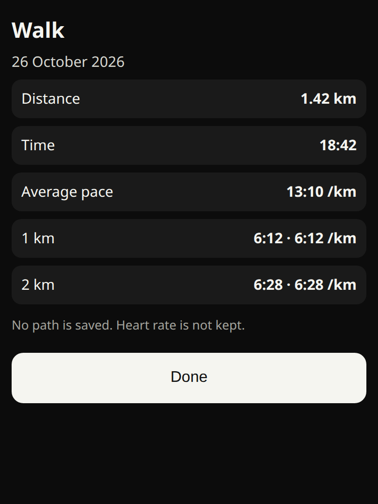

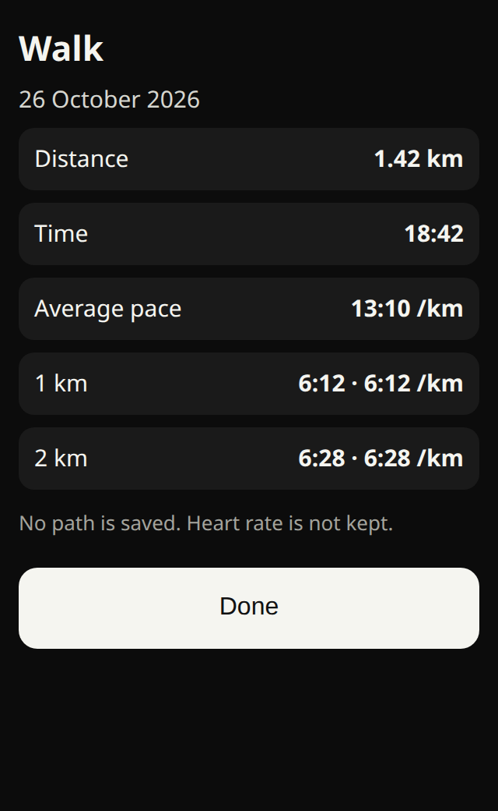

The earlier finish pictures in this note are the summary in the app today. They do not have splits.

### Where a heart rate can come from

Ben will test this with both an Apple Watch and a Garmin. The iPhone cannot measure heart rate. Do not estimate one from pace, and do not invent one. Do not use the camera. If neither source has a recent reading, the tile says "No heart-rate source" and Thumos does not mention a heart rate. The proofs above are that empty state, with the map still visible.

Least privilege, in this order. Use the first source that actually has a recent reading. Do not turn on the next radio while the earlier one is already supplying it.

1. Apple Health, for the Apple Watch. No new Info.plist key. This is the realistic first build.
2. Bluetooth, for a Garmin watch or strap that is broadcasting. New purpose string and a new background mode. A later build, after you approve that wording.
3. Nothing. Hide the number.

Do not average the two. If both are recent, show the Apple Health sample and do not scan for Bluetooth. Say on the tile which source it is.

**Apple Watch. Apple Health on the iPhone. First build, if you approve the Health sentence.**

A workout session on the Watch writes heart-rate samples into Apple Health. The phone reads those samples. Charioteer already asks to read heart rate. The read list already includes `HKQuantityTypeIdentifierHeartRate`. The share sentence already says the app reads heart rate. There is no new Health type and no new permission key. People who have already allowed heart rate are not asked again, because the read list does not change. The recommended share sentence in the wording list names the live outing. It is the same key, not a new one, and it is not written in until you approve it.

How the Watch gets into a workout state.

- Without a companion app. This is the recommendation. They open the Workout app on the Watch and start a walk, a run, or a cycle. That is the Watch's own workout session. The Watch then writes heart rate into Apple Health. Charioteer does not start that session, and it does not stop it. There is no Watch app in this design. Wearing the Watch without starting a workout is not that state. The Watch then records heart rate only now and then, and the tile stays on "No heart-rate source".
- With a companion app. A later choice, not this test. A watchOS app could start the workout session when they tap Start in Charioteer. That is a new Watch target. The phone cannot put the Watch into a workout by itself. Do not build that for the first test.

When this is built, and only while the outing is running, the phone would subscribe to heart-rate changes and turn on Health background delivery at the immediate frequency. The Health library already in the app can do both (`subscribeToChanges` and `enableBackgroundDelivery`). When a change arrives, an anchored query (`queryQuantitySamplesWithAnchor`) reads samples since the last anchor. The workout screen's one-off read of a finished route is a different query. This outing does not read a workout route. The subscription and the background delivery stop on Stop, on discard, on termination, and at the time limit. They are not left on for the rest of the day. Health background delivery does not need a `UIBackgroundModes` entry.

What "live" honestly means. Apple does not promise every beat. Immediate is a hint. A sample is often a few seconds to about a minute behind the Watch. With the phone locked, or in Low Power Mode, it can be slower, batched, or deferred. The tile shows the latest sample and how old it is, for example "142 bpm" and "20s ago". If the newest sample is older than about a minute, the tile returns to "No heart-rate source" and the lines stop mentioning a rate. Do not draw a trace.

No new Info.plist key for this source.

**Garmin. Bluetooth broadcast only. Later build. New keys.**

The documented control on the watch is Broadcast Heart Rate. Garmin's manuals tell the person to turn that on, and they warn that it uses more battery. The Forerunner 970 manual, for example, is Watch Settings, Health & Wellness, Wrist Heart Rate, Broadcast Heart Rate. Some manuals also let an activity start the broadcast by itself. The Edge 1060 manual pairs that broadcast over Bluetooth, either a secure connection or an open one. A strap that is already advertising as a Bluetooth heart-rate sensor is the same kind of read. The phone would use the standard Bluetooth heart-rate measurement. It would not speak ANT+. Older Garmin manuals pair Broadcast Heart Rate with an ANT+ device. An iPhone does not use ANT+. If a particular watch is only broadcasting that way, the phone will see nothing, and the tile stays empty. Do not add a radio for ANT+.

They have to turn Broadcast Heart Rate on. Charioteer cannot turn it on for them. The Bluetooth permission is asked only after they choose Garmin or a strap, not when an Apple Watch outing starts.

This needs two new keys, which are not in the app:

- `NSBluetoothAlwaysUsageDescription`
- `UIBackgroundModes` entry `bluetooth-central`

The background mode is what keeps the reading while the phone is locked. Guideline 2.5.4 applies to that mode, and 5.1.1 applies to the new sentence. Both wait for your OK. They are not part of the Apple Watch build.

Garmin Connect and the Garmin Health API are not a source. Garmin's Health API description is data the person has synced from the device to Garmin Connect, after which the API can serve it. That is not a live heart rate for this screen. Do not call it. Do not add a Garmin host. Garmin also publishes a Health Companion SDK for enterprise partners, which is a different product and can stream heart rate under that licence. It is not proposed here.

**No sensor.** This is the screen when the Apple Health sample is older than about a minute and, in the later build, no Bluetooth broadcast is connected. The tile says "No heart-rate source". The lines do not mention a heart rate.

What is realistic. The first heart-rate build is the Apple Watch, through the Health read the app already has, with no new key. You can test that as soon as that build exists: start a workout on the Watch, then start the outing on the phone. The Garmin test is real, and it is second. It cannot be honest until the Bluetooth sentence and `bluetooth-central` are approved and built. Turn Broadcast Heart Rate on, choose Garmin or a strap in the app, and the tile should follow that broadcast. Until then the Garmin shows "No heart-rate source", which is the honest result.

### Safeguards

No medical claim. No heart-rate zones. No alarm, and no line that tells them to slow down or stop because of a number. At most one calm line if the rate is very high. The number to confirm is 180 bpm or above, once in that outing: "Heart rate is 180. This is not medical advice." Then no further heart-rate warning. The Good to know lines stay, including the GP, NHS 111, and 999 line. "Not medical advice" stays.

An ordinary heart-rate line, if they left spoken updates on, rides the interval they already chose. It does not speak on every sample. "Heart rate 142." It states the number. It does not say what the number means.

The number stays on the phone. It is not sent to xAI or to Supabase in this version. It is not written to a log. The summary does not keep a trace or a list of readings. Recommendation: the summary keeps no heart rate at all. A single average would be a later decision. If Thumos lines later use xAI, the input is aggregate numbers only, such as average pace and, only if you allow it, an average heart rate, after an explicit opt-in. Never a trace, and never coordinates. `XAI_PERSONAL_DATA_ENABLED` stays false. That later use is not this version.

## A gym session in progress

Ben, 26 October 2026, 08:18 GMT. This is read as his own session in the gym, for example cardio or strength, while he trains with an Apple Watch or a Garmin. It is not a walk, a run, or a cycle. It does not use the map, the path, or location. It is not built. No purpose string and no Info.plist key has been changed.

The reading could be wrong. The questions at the end of this section are there so you can say if you meant something else. Nothing in those questions is designed, and nothing is built.

### What it is

On the Workouts screen he taps **Start live session**. The earlier name, I'm training now, is withdrawn. He picks Strength or Cardio, and the same Thumos updates switch and 3, 5, or 10 minute choice as an outing. Stop ends it.

The live screen reuses the outing's clock, heart-rate tile, spoken line, and interval. It does not reuse the map, the splits, or the pace. There is no distance.

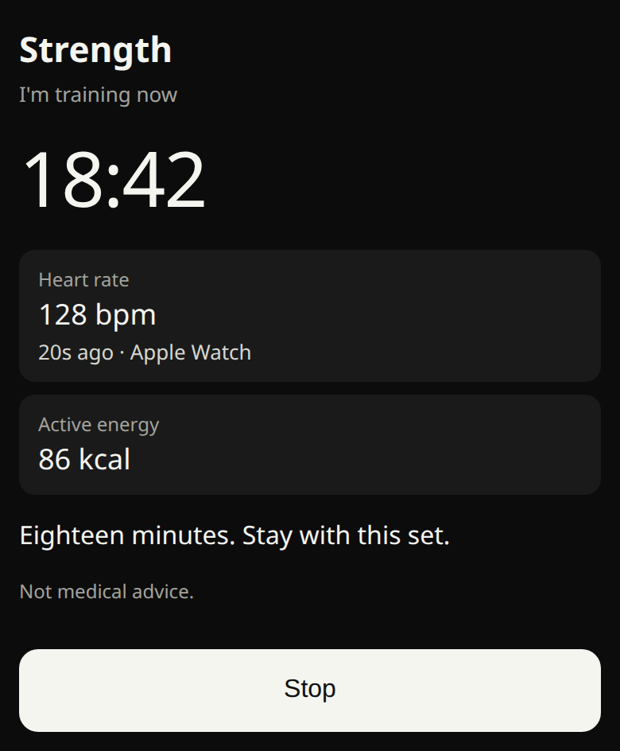

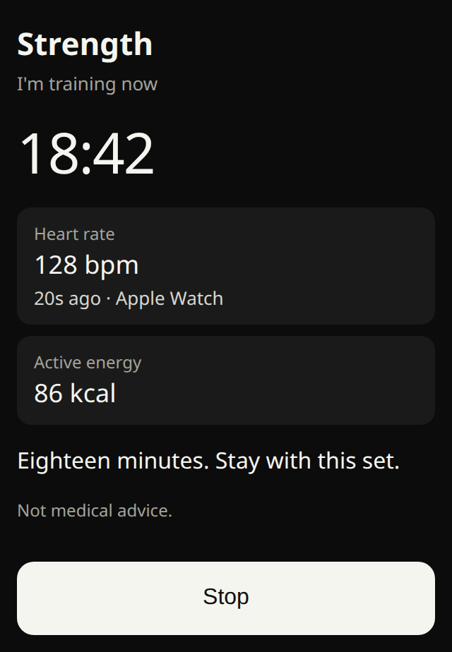

These pictures are not the app. The heart-rate number and the energy number are examples of a session that already has both. If there is no recent heart rate, that row says "No heart-rate source". If Apple Health has not sent energy yet, that row says "Active energy not available yet".

### What the iPhone can honestly read

**Apple Watch, through Apple Health.** The same read as the outing, and the same limits.

He starts a workout on the Watch, in the Watch Workout app. This app does not start it. There is no companion Watch app. While that workout session is running, the Watch writes heart-rate samples, and active-energy samples, into Apple Health. The phone reads them with an observer and an anchored query (`subscribeToChanges`, then `queryQuantitySamplesWithAnchor`), only while this session is running, and stops them on Stop, on termination, and at the same four-hour limit as an outing. Both types are already in the read list: heart rate, and `HKQuantityTypeIdentifierActiveEnergyBurned`. No new Health type.

The same latency applies. A sample is often a few seconds to about a minute behind the Watch, and it can be slower when the phone is locked or in Low Power Mode. Health background delivery does not need a `UIBackgroundModes` entry. Immediate is a hint, not every beat. If the newest heart-rate sample is older than about a minute, the row goes back to "No heart-rate source".

Active energy is the samples Apple Health has saved since he tapped Start, summed in kcal. They often arrive in lumps, so the number can sit still and then jump. It can include other movement in that window. It is not guaranteed to match the total on the Watch. The Watch's own workout total, and the Watch's workout type, are properties of the workout object. That object is saved when the workout ends. Until then the iPhone cannot read them.

So the type on this screen is the one he picked, Strength or Cardio. The phone cannot tell strength from cardio live. After the Watch saves the workout, the saved type can be shown as a note if it falls in the same window. It does not replace the label he chose unless you later say so.

**Garmin.** The same Bluetooth broadcast as the outing, and only in that later build. Broadcast Heart Rate has to be on. The phone reads the standard heart-rate measurement. It does not read calories from that broadcast. Garmin's manuals describe heart rate, not energy. Energy stays "Active energy not available yet" unless Apple Health has samples. The new keys are the same ones already listed, not a second permission: `NSBluetoothAlwaysUsageDescription` and `UIBackgroundModes` `bluetooth-central`. The Bluetooth sentence in the wording list now also names this gym session, so one sentence covers both. It is not in the app.

**No sensor.** He can still tap Start live session. The clock runs. Thumos can speak the check-in on the interval he picked. The heart-rate row says "No heart-rate source". Energy says it is not available. Nothing is estimated.

### What is not possible

Garmin Connect and the Garmin Health API do not give a live heart rate or live calories to this app. They are not a source. Do not add a Garmin host.

The phone cannot count reps or sets. It has no sensor for that, and the motion sentence says the app does not use motion. Do not count from the accelerometer. Do not invent a rep.

The phone cannot see the Watch workout type while the workout is still running. A companion Watch app could send it. That is not this design.

### Background

The clock is a start time. It does not need a background mode. If they lock the phone, the elapsed time is right when they come back. If the app is killed, the session is lost. Say that before they start. There is no crash file.

This session does not use location. It does not add `UIBackgroundModes` `location`, and it does not show the blue location mark.

Spoken lines, if they asked for them and the phone is locked or another app is in front, need the `audio` background mode already proposed for an outing. Same rules: mix with other audio, duck it, deactivate when the line ends, no silent keepalive, no recording. If that mode is not approved, the line is on screen only, and only while the screen is open. The gym session does not add a second audio key.

Heart-rate delivery from Apple Health needs no background mode. The Garmin broadcast, later, uses the same `bluetooth-central` entry as the outing. It is not started unless they chose Garmin or a strap.

One session at a time. Starting this stops nothing by itself, but a GPS outing and this gym session should not both be running. Recommendation: starting one ends the offer to start the other until Stop.

### Lines

The interval is the outing's interval. The words are a list on the phone, for strength and for cardio. Time can be filled in. A heart-rate number is spoken only when a sample is recent, and only on that interval, not on every sample. No pace and no distance. No model. No zones. No alarm. The one calm line at or above 180 bpm is the same line as the outing, once. "Not medical advice" stays in Good to know, with the GP, NHS 111, and 999 line.

### What is stored

On the phone only, and only if they stop and choose to keep it. The summary is the label he picked, the date, the duration, and the active energy if Apple Health had any. No heart-rate trace. No path. No coordinates. It is not sent to Supabase, to xAI, or to the route service. It is not added to `export_my_data`. It is not joined to sobriety logs. It is a different list from the GPS outing summaries, and a different list from the finished workouts Apple Health and Garmin already show.

Deleting the app deletes that list. If the app is killed mid-session, there is no summary.

This does not write a workout to Apple Health. The Health write sentence still says the app does not write workouts.

### Where it sits

The Workouts screen today is the calendar and the history. The intro is "Your workout calendar and history." Under the refresh bar and the Garmin notice, the Workouts card has the day strip, the finished workouts for that day, the duration chart, and the activity charts. The workout calendar is below that card. A finished row can open a route. The card already says a route stays on the phone.

**Start live session** goes above that card. It does not replace the day strip, the history, the charts, or the calendar. It does not open a route and it does not call the route service. A kept gym summary is labelled as on this phone, so it is not mistaken for a workout Apple Health saved.

### Questions for you

These are not designed. Say if one of them is what you meant.

- A buddy's live workout. This section is his own session. Showing someone else's heart rate, or that they are training, is a different feature and it is not in this note.
- A mirror of the Watch only, with no Start live session button. The phone still cannot see the workout type, or a reliable start time, until the Watch saves the workout. The button is what starts the clock.
- The GPS outing. That is the earlier section. It has the map. This one does not.

## Wording

Ben approved the location sentence, the Health share sentence, the audio line, and the background modes on 26 October 2026. Those are in this build. Always location, Garmin, and the Health write sentence are not.

**While-using location, for background measuring.** Same permission as the map. There is no Always sentence. The long sentence from the first 07:42 draft is withdrawn. The previous while-using sentence is withdrawn and is not copied here.

The Security and Compliance Bot's text, unchanged: "Charioteer uses your location while you are on a walk, run or ride to track distance and give you spoken updates, including when the screen is locked or you are using other apps. Your route stays on your phone and is not sent anywhere."

Recommended adaptation of that text. It keeps both of the bot's sentences. It says cycle, because that is the button. It adds the map and the route service, because this one purpose string also covers those, and "is not sent anywhere" would be false for a route the person asks for. The live path is still not sent.

"Charioteer uses your location while you are on a walk, run or cycle to track distance and give you spoken updates, including when the screen is locked or you are using other apps. Your route stays on your phone and is not sent anywhere. The same permission shows where you are while the map is open. A route is sent to the route service only if you turn route finding on. That request is the start, the destination, and any points you add on the map. It is not the outing path."

Do not add `NSLocationAlwaysAndWhenInUseUsageDescription`. Do not add `NSLocationAlwaysUsageDescription`.

**Lines on the screen, for the same build.** Not purpose strings. Ben confirmed the time limit as six hours on 26 October 2026.

- Before the location prompt, and before Start: "You can lock the phone, take a call, or open another app. Measuring continues until you tap Stop, or for six hours. A blue location mark shows while it is on. The route stays on this phone. If the app is closed, that route is lost."
- On the live screen: "You can lock the phone. Measuring continues until you tap Stop."
- When they come back and it has been running: "Tracking is active. The blue location mark stays on until you tap Stop."
- In Good to know: "Distance and pace keep going after you lock the phone, until you tap Stop or six hours pass. The route stays in memory for that outing. It is cleared when you stop or discard it. If the app is closed, it is lost. The outing path is not sent."
- Beside the spoken choice: "A spoken line lowers your music for a moment, then lets it return. The phone speaks. Nothing is recorded."
- The end control: "Stop"
- Pause stays "Pause", and "Resume" after a pause. Pause holds the clock. Stop ends the outing. There is no notification for Stop.

**Microphone.** No new words. The sentence stays: "Charioteer does not record audio. Voice is switched off in this version. Apple requires this note because an audio component is included in the app."

**Motion.** No new words. The sentence stays: "Charioteer does not use your motion or fitness data. The map component in the app can reference motion sensors, so Apple requires this note."

**While-using location.** Ben approved the sentence in the block above on 26 October 2026. It is the sentence in this build. The previous sentence is withdrawn and is not copied here.

The map screens keep their own page line. That line is about the map, not about an outing.

**Heart rate and splits, for the same later build.** Not in the app. Splits need no new permission. Heart rate uses the Health read the app already has. The sentence below is a change to that existing share sentence, not a new key.

The previous Health share sentence is withdrawn. Ben approved this one on 26 October 2026. The live read is still foreground only, because the background-delivery entitlement is not approved. The sentence itself is unchanged from the approval.

Approved `NSHealthShareUsageDescription`: "Charioteer reads steps, sleep, heart rate, resting heart rate, heart rate variability, cardio fitness, walking heart rate, heart rate recovery, workouts (type, duration, distance, energy, and average heart rate), and walking, cycling and swimming distance, plus weight, height, body fat, lean body mass, active energy, and exercise minutes. Readings stay on your iPhone. During a walk, run, or cycle you start, the latest heart rate from Apple Health can be shown on that screen. During a strength or cardio session you start in Workouts, the latest heart rate and active energy from Apple Health can be shown while you train. The iPhone does not measure heart rate. Those readings stay on this iPhone and are not sent. A workout route is read only when you open that route, and the path stays on this iPhone. A short summary is sent to write your plan only if you turn the coach on. It is not used for ads. Other people cannot see this."

Lines on the screen. Not purpose strings.

- The empty tile: "No heart-rate source"
- Under that tile on the Apple Watch build, when it is empty: "Start a workout on your Apple Watch to show heart rate. The iPhone does not measure it."
- Under that tile on the later Garmin build, when they have chosen Garmin or a strap and nothing is broadcasting: "On a Garmin, turn on Broadcast Heart Rate. Charioteer does not read Garmin Connect."
- On the tile when a number is showing: "Apple Watch" or "Garmin", so the source is visible.
- A recent sample: "142 bpm" and "20s ago"
- A finished split, kilometres: "1 km · 6:12 · 6:12 /km"
- The split still going: "This kilometre · 0.42 km"
- The same split in miles, if that is their unit: "1 mi · 6:12 · 6:12 /mi" and "This mile · 0.42 mi"
- A spoken or on-screen split line: "Kilometre 1 took 6 minutes 12." Miles: "Mile 1 took 6 minutes 12."
- A spoken or on-screen heart-rate line, only when a sample is recent, and only on the interval they chose: "Heart rate 142."
- Once, if the rate is 180 or above. Confirm 180 before this is used: "Heart rate is 180. This is not medical advice."
- In Good to know, Apple Watch build: "Heart rate, if it shows, comes from Apple Health and can be a little behind. It is not medical advice."
- In Good to know, later Garmin build: "A Garmin heart rate is the broadcast from the watch or strap. It is not read from Garmin Connect. It is not medical advice."

**Garmin broadcast. Later. New keys. Not in the Apple Watch build.**

`NSBluetoothAlwaysUsageDescription`: "Charioteer reads heart rate from a Garmin watch or strap that is broadcasting it, while a walk, run, or cycle is running, or during a strength or cardio session you start, including when the phone is locked. The reading stays on this phone. It is not sent. Garmin Connect is not used."

**Gym session. Not a purpose string, except the Health and Bluetooth sentences above.** The Health sentence gains the strength-or-cardio clause. The Bluetooth sentence gains the same session. Neither is a new key beyond the Garmin keys already waiting. The gym session adds no location key.

- The button on Workouts: "Start live session"
- The choices: "Strength" and "Cardio"
- The interval, same words as an outing: "3 minutes", "5 minutes", "10 minutes", "Off"
- Before Start: "The clock runs until you tap Stop. Heart rate shows only if your Apple Watch workout, or a Garmin broadcast, has a recent reading. The iPhone does not measure it. If the app is closed, this session is lost. This is not medical advice."
- The empty heart-rate row: "No heart-rate source"
- The energy row when Health has nothing yet: "Active energy not available yet"
- The energy row when it has: "86 kcal"
- A check-in line, from the list on the phone: "Eighteen minutes. Stay with this set."
- A heart-rate line, only when a sample is recent and only on the interval: "Heart rate 128."
- In Good to know: "Not medical advice. If you feel unwell, contact your GP or NHS 111. Call 999 for chest pain, fainting, or breathlessness."
- The end control: "Stop"

`UIBackgroundModes` entry `bluetooth-central` goes with that sentence. Neither is in the app. Do not add them for the Apple Watch test.

**Apple Health write, only if you want that button built.** Not the first version.

Today: "Charioteer writes the food and water you log to Apple Health: dietary energy, protein, carbohydrate, sugar, fibre, fat, sodium and water. It does not write steps, sleep, heart rate, workouts, or weight."

Proposed: "Charioteer writes the food and water you log to Apple Health: dietary energy, protein, carbohydrate, sugar, fibre, fat, sodium and water. If you tap Save to Apple Health after a walk, run, or cycle, it also writes that workout: the type, the time, and the distance. It does not write the path, steps, sleep, heart rate, or weight."

**Still not added, even after this change of scope**

- `NSLocationAlwaysAndWhenInUseUsageDescription`.
- `NSLocationAlwaysUsageDescription`.
- A new motion sentence. The current one stays, because the app does not read motion.
- A new microphone sentence. Speaking is not recording.
- `NSBluetoothAlwaysUsageDescription`, and `UIBackgroundModes` `bluetooth-central`, until you approve the Garmin broadcast. Not the Apple Watch build. Garmin Connect is not a source.

`UIBackgroundModes` `location` and `audio` are in `app.json` for build 74. Ben approved them on 26 October 2026 and, later the same day, kept `audio` and turned speech on for TestFlight. They are not shipped. The audio plugin's own background switch stays off. The plist lists `audio` directly. Audio is used only for Thumos spoken lines when the person picks spoken updates. App Store submission is blocked until a real phone shows music ducks, then returns to full volume after each line, with no leftover audio session, including a phone call and Bluetooth headphones.

## Review risks

The binary on this branch pauses when the phone locks, and it has no background mode. Its purpose sentence matches that.

Build 74 uses background location. Speech is on for TestFlight when spoken updates are chosen. The audio background mode is for those lines only. On screen only does not start a session. There is no silent keepalive. That is a real review. Guideline 2.5.4, 5.1.1, and 5.1.2 are the ones that apply, and they are set out in section (c), with the video script. An Always prompt, a silent audio keepalive, or significant-change monitoring are the likely rejections. Ben approved the wording on 26 October 2026. It is in this branch and it is not shipped. App Store submission is blocked until a real phone shows music ducks, then returns to full volume after each line, with no leftover audio session, including a phone call and Bluetooth headphones. The nutrition label is checked against the final binary, after a proxy check, not against this note.

Writing a workout while the Health sentence says we do not write workouts would be a rejection. The button stays on the drawing until the sentence is approved.

A step counter while the motion sentence says we do not use motion would be the same kind of rejection. The step counter is not in the plan.

A Garmin broadcast needs a new Bluetooth sentence and `bluetooth-central`. Those keys are not in the Apple Watch build. Garmin Connect and the Health API are not a live source. Showing a heart rate the iPhone invented would make the Health sentence false. The tile stays on "No heart-rate source" when neither source has a recent reading.

## On-screen words for the controls

Ben named these on 26 October 2026 at 12:05 GMT. They are not purpose strings. This note does not write them into the app. The three Start buttons already exist on this branch. The switch, the You card, and Start live session do not.

- "Thumos updates"
- "3 minutes"
- "5 minutes"
- "10 minutes"
- "This choice is for this outing. Your default stays on You."
- "This choice is for this session. Your default stays on You."
- "Start live session"
- "Activity updates"
- "Off until you turn it on. Start a walk, Start a run, Start a cycle, and Start live session begin from this. Changing it on that setup screen is for that session only."

## What goes into build 74

Build 73 is the binary uploading from `fb05f08`. It does not include Start a walk. This branch does. Recommendation for the next binary, and only the part that does not need a new permission sentence.

Put in build 74:

- Superseded. Outside is Good has Start a walk, Start a run, and Start a cycle. The live screen shows the map. Measuring continues when the phone is locked. The approved while-using sentence is the one in this build.
- Superseded. The Thumos updates switch, the 3, 5, and 10 minute choice, and the default on You are in this build. Spoken lines are on for TestFlight when that choice is spoken. The `audio` background mode stays. On screen only does not start a session. App Store submission is blocked until a real phone shows music ducks, then returns to full volume after each line, with no leftover audio session, including a phone call and Bluetooth headphones.
- Start live session on Workouts, with Strength or Cardio, the same switch, and a clock. The heart-rate row says "No heart-rate source" until the Health share sentence in **Wording that needs your OK** is approved. No map. No reps.
- Split times on the GPS outing. No new permission. The summary still has no path.

Leave out of build 74 until the exact sentence is approved:

- Background measuring, the blue location mark, and spoken lines over music while the phone is locked or another app is in front. That needs the while-using sentence replaced, plus `UIBackgroundModes` `location` and `audio`.
- A live heart rate from Apple Watch. The read type is already in the app. The share sentence still has to change before the number is shown during an outing or a gym session. If that one sentence is approved before the build is cut, add the Apple Watch row in the same binary. Do not add Garmin in that binary.
- A Garmin broadcast. New Bluetooth sentence and `bluetooth-central`. Not build 74.
- Save to Apple Health. The write sentence still says the app does not write workouts.

## What this note does not do

Version 1, including the live map, is in the app on this branch. It still pauses when the phone locks. The background section, the Security and Compliance Bot recommendations, the heart-rate and split section, the gym-session section, and the control map above are decisions only. This update does not change a purpose string and does not add an Info.plist key. The while-using sentence already on this branch is the awake-screen sentence. Build number 72. Build 73 shipped from `fb05f08` and does not include this branch. The outdoor-route function is still not deployed.
