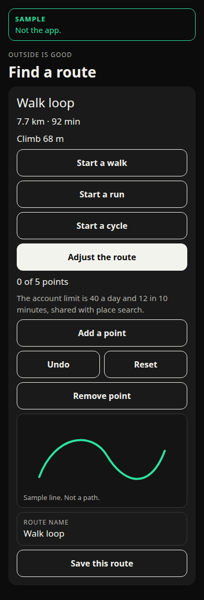
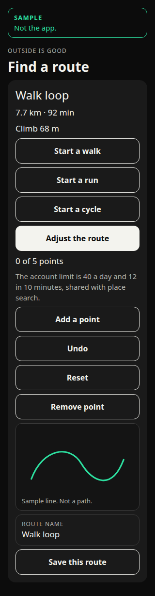
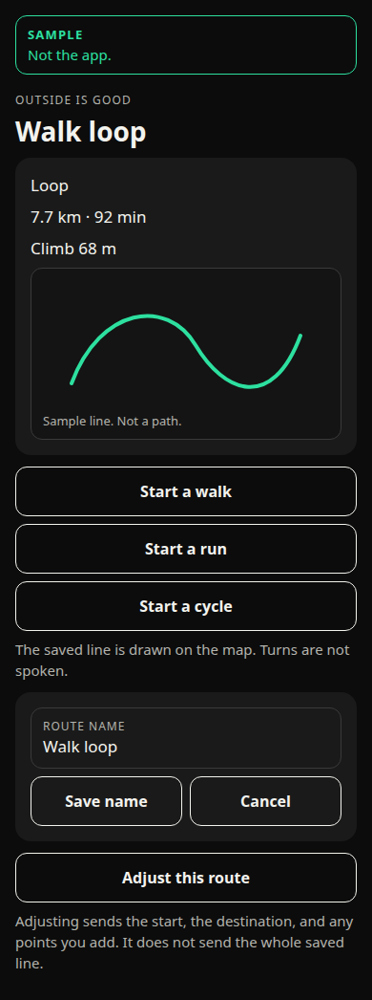
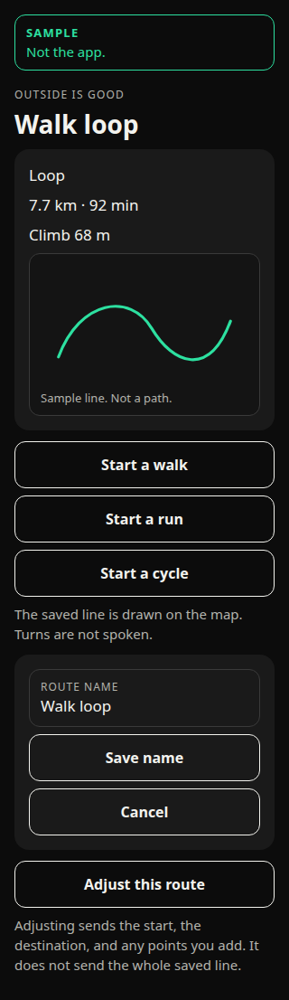

# Start from the route you just made

Approved by Ben on 27 October 2026, in his words: "Approve all 6". All six decisions below take the recommended option. This branch builds that. No migration is written or applied. No deploy. `ios.buildNumber` stays 72. Branched from the design tip `e6f8474` (PR #41). Not mixed with the route-button hotfix, the walked line, the More info collapse, or the activity-minute build. Not shipped.

Ben, on the made-route card: "Once you've created a route, can you have the Start Walk, Start Run, Start Cycle on this screen too, so you can log the route and get feedback while you're following the map."

The layout proofs are sample drawings, labelled Sample and Not the app. They are not screenshots of the running app.

## What the code does today

Checked on `0571e53`, and against the build 74 outing.

**Made-route card** (`src/ui/RouteMaker.tsx` on this tip). After Make the route, the card shows the name, the distance and the time, the climb, Adjust the route, the map, the name field, and Save this route. It does not show Start a walk, Start a run, or Start a cycle. Those three labels already exist on Outside is Good. Each one opens the setup screen with that activity chosen. The person still taps Start.

A separate hotfix, PR #40, branch `cursor/route-first-tap-adjust-daf4`, commit `5c3d359`, puts those three buttons on the made-route card. Ben had written "I pre approve this, as it is just an adjustment." That branch is not this one. This sheet does not move that code. The drawing below is the layout that hotfix used, so the saved-route screen can be judged beside it.

**Saved-route open screen** (`src/app/(main)/saved-route.tsx`). **Use this route** opens `/activity?kind=walk&route=<id>`. Walk is selected. The person can switch to Run or Cycle, then taps Start. The saved line is copied at Start (`copyGuide` in `src/domain/savedRoute.ts`). A later rename or delete does not change that copy. The live map draws it. The screen says "Guide: {name}. The line stays on this phone. Turns are not spoken." Use this route does not call the route service.

The saved row does not store walk, run, or cycle. `kind` is the shape: Loop, A to B, Saved route, or Craving walk (`routeKindLabel` in `src/domain/outdoorRoute.ts`). The travel type exists only while the route is still on the Find a route screen (`plan.mode`).

**What gets logged.** `summaryFrom` in `src/domain/activitySession.ts` stores `id`, `activity`, `date`, `distanceM`, `movingMs`, and `averagePaceSecPerKm`. `saveActivitySummary` writes that object on this phone. It does not write the route name, the route id, or the points. The distance and the time are the outing, from the fixes taken while it is running. They are not the 7.7 km and 92 min printed on the route card. `parseActivitySummary` drops anything else.

The live screen is unchanged. Thumos lines come from `activityLine`, which fills time and pace for the activity they started. The route name is not in those lines. Splits and the heart-rate row stay on that screen as they are in build 74. Splits are not part of the stored summary. The heart-rate row is not part of it either.

The walked line stays in memory. Stop clears it. It is not sent.

**Adjust, and Ben's screenshot of "0 of 5 points".** On build 74 the Adjust the route button does turn adjust on, including for a loop. Undo, Reset, Add a point, and "0 of 5 points" were drawn under the map. On a phone that map is 220 or 360 points tall, so those controls sat below the fold. No drag handle is drawn until Add a point, or until a drag of at least 40 metres. The button was not unwired. The mode was on and the controls were easy to miss. A screenshot that shows "0 of 5 points" is that mode, reached by moving the page. The hotfix moves those controls to sit under the button and above the map. This sheet does not redesign Adjust. The sample drawing uses that order so the start buttons and the counter can be seen together.

## Recommendation

Put **Start a walk**, **Start a run**, and **Start a cycle** on the made-route card and on the saved-route open screen. Each one opens the existing setup screen with that activity already chosen and this line as the guide. The person still taps Start. The route screen does not start measuring.

The three buttons do the job **Use this route** does today. On the open saved route, take **Use this route** off, so there are not four ways in. The approved guide sentences stay.

All three buttons stay outline buttons. The one that matches a route made for walking is not filled in. On a saved route there is no stored travel type to match. On a made route the title already says Walk loop, Run loop, or Cycle loop.

Start a run or Start a cycle on a line that was made for a walk does not redraw the line and does not send it. The guide is the same points. The outing, the Thumos lines, and the stored summary use Run or Cycle. The route card's 7.7 km and 92 min are not copied into that summary.

No new sentence. No new permission. No new purpose string. `Info.plist` and `app.json` stay as they are. The while-using sentence approved on 26 October 2026 still covers the outing.

## A. The made-route card

The buttons sit under the climb and above Adjust the route. They show only after a line exists, and not on a craving walk. A craving walk keeps Make this walk and does not gain these three.

Tapping one copies the last accepted line and the name into the outing on this phone, the same way Use this route copies a saved line. The setup screen still shows the before-start line, the Thumos choices, and Start. If an outing or a gym session is already running, the tap does not open another. The screen uses the sentence already in the app: "Finish the session already running before you start another."

The copy is the points on the card (`plan.points`). A dashed preview, a finger still down, and a point that has not been sent are not that copy. Undo or Reset, before the tap, changes the accepted line, so the copy follows. Save this route is a different button. Start does not press it.

## B. The saved-route open screen

The same three buttons replace **Use this route**, in the same place, under the map card. Each passes that activity and that saved id. Walk is no longer forced.

The line copied at Start is the row on the account. Adjust this route still replaces the open screen while it is open, as it does now. The three buttons are not inside Adjust.

## C. A line made for a walk, started as a cycle

The route service was asked for a walk. The profile, the pace, and the title follow that. The points are still a line on a map.

Start a cycle uses those points as the guide and records a cycle. It does not ask the route service for a cycling line. It does not change the saved row. It does not change the made-route card.

The app does not add a warning. The button is the choice. A warning would be a new sentence. One is written below and marked not approved, so it can be refused.

A saved route cannot show that warning from the row. The row does not know the travel type. Only the made-route card, while that screen is still open, still has `plan.mode`.

## D. What is logged

Stop writes one summary on this phone:

- the activity they started, walk, run, or cycle
- the date
- the distance the outing measured
- the moving time
- the average pace from those two

It does not write the route's 7.7 km, the route's 92 min, the climb, the name, or the path. Following the map is the guide on the live screen. The feedback is the clock, the distance, the pace, the Thumos lines, the splits, and the heart-rate row, as on the build 74 outing. The path is gone when the outing ends.

## E. A route that was not saved

Start from the made-route card does not insert an `outdoor_routes` row. The account list does not gain the line. The outing can still be logged, as distance and time only.

The guide lives in memory for that outing. The before-start line already says the route stays on this phone and is lost if the app is closed. That sentence stays. The summary already written by Stop stays. The guide does not.

Save this route remains the way to keep the line on the account. It can be tapped before or after Start. After Start, a save writes the account row. It does not change the copy already taken for the outing.

## F. Adjusted, and not saved

On the made-route card, a redraw that succeeded replaces the line on the card. Start copies that line. Save this route is still required before the account has it. A redraw that failed leaves the previous line, and the screen already says "The route on the map is unchanged." Start copies the line still on the card.

On a saved route, Adjust shows the redraw in memory and offers Save this route and Cancel. Cancel returns to the saved row and drops the redraw. Save this route writes the new line when the update grant is in place. Until that save succeeds, the row is the old line.

The three buttons stay on the open screen, so they copy the row. They do not copy an unsaved redraw. Putting them inside Adjust would start a line the account does not hold, including when Save then fails because the grant is not applied. That is the wrong line to log against.

A point added and not yet released is not part of either copy. The approved route-editing note already says a dashed preview is never the line Start uses.

## Wording

Sentences already in the app. Reuse them. Do not rewrite them. The six approvals include no new wording.

- Start a walk
- Start a run
- Start a cycle
- The saved line is drawn on the map. Turns are not spoken.
- Guide: Walk loop. The line stays on this phone. Turns are not spoken.
- Reminder: Walk loop. Turns are not spoken.
- Finish the session already running before you start another.
- You can lock the phone, take a call, or open another app. Measuring continues until you tap Stop, or for six hours. A blue location mark shows while it is on. The route stays on this phone. If the app is closed, that route is lost.
- The outing path is not sent.
- The route on the map is unchanged.
- 0 of 5 points

**Use this route** stays an approved sentence. This design takes the button off the open screen. The words are not deleted from the approved list. They are unused on that screen if this design is accepted.

No new sentence. The six approvals do not include a mismatch warning. That sentence stays **not approved**:

- This line was made for a walk. Starting a cycle does not change the line.

No new permission. No new purpose string.

## Layout proofs

Sample drawings. Not the app. The figures are Ben's example, written in the app's own shape: "7.7 km · 92 min" and "Climb 68 m". The line on the map is a sketch.

The made-route card. The three buttons are above Adjust. Adjust is on, so "0 of 5 points" is visible above the map.

The saved-route open screen. The three buttons stand where Use this route stands today.

## Decisions for Ben

Approved by Ben on 27 October 2026, in his words: "Approve all 6".

1. On the saved-route open screen, do the three buttons replace **Use this route**? Recommendation: yes. The person still taps Start. Approved.
2. On a line made for a walk, Start a run and Start a cycle keep that line and record a run or a cycle. They do not redraw it. Recommendation: yes. No warning sentence.
3. Leave all three buttons as outline buttons, including when the route was made for a walk. Recommendation: yes. A saved row has no travel type to highlight.
4. Start from a made route that has not been saved. The outing can be logged. The account does not gain a route. Recommendation: yes.
5. An adjusted saved route is the guide only after Save this route succeeds. Until then, Start uses the saved row. Recommendation: yes.
6. No new wording, no new permission, and no new purpose string. Recommendation: yes.

The made-route buttons on the hotfix are already Ben's "just an adjustment". This list is the rest.
