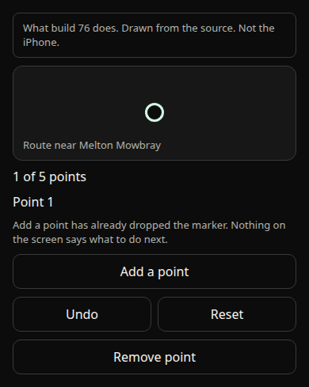
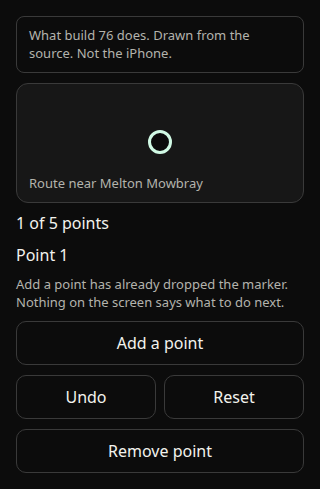
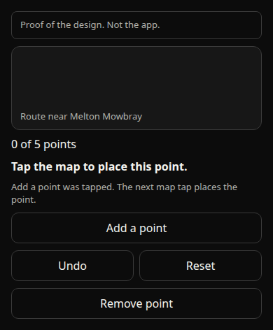
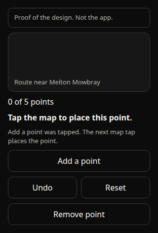
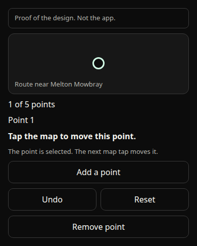
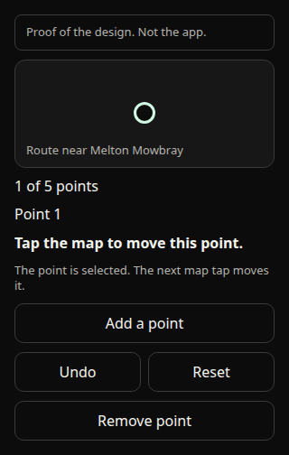

# The Adjust point still does not move

Investigation and design. Nothing in this note is a change to the app. No new permission, purpose string, background mode, or dependency. `app.json` is unchanged. `ios.buildNumber` stays 72. Branched from build 76, `6a16d96`, which already has the Start crash fix and the Apple Watch outing line. Line drag and grey alternatives stay the design in PR #49. Not merged. Not shipped.

Ben tested build 76 on his iPhone, iOS 27.0.1. He confirmed on 27 October 2026, 12:59 GMT, that the phone was on build 76, not build 75. On the route map, with Add a point, Undo, Reset, and Remove point, near Melton Mowbray, tapping Add a point drops a marker and then nothing else happens. The marker sits there. His build 75 report was the same: he could not move a point after adding it.

## What this checkout can and cannot verify

This machine is Linux. It has no iPhone and no iOS simulator. The MapLibre view Ben used is the native iOS view. The web map is a different file, `src/ui/FootpathMap.web.tsx`, and it is not the path he tested. Nothing below is a claim that a finger was watched on his phone.

What was read here:

- Build 76 source: `src/ui/FootpathMap.tsx`, `src/ui/RouteMaker.tsx`, `src/ui/SavedRouteAdjust.tsx`, `src/domain/routeAdjust.ts`.
- The installed library `@maplibre/maplibre-react-native` 11.5.0, including `ios/components/annotations/point-annotation/MLRNPointAnnotation.m` and `MLRNPointAnnotationComponentView.mm`.
- MapLibre Native iOS 6.31.0, the version that podspec pins (`$MLRN_NATIVE_VERSION`). The drag code is `platform/ios/src/MLNAnnotationView.mm` at tag `ios-v6.31.0`.

What a phone still has to show: whether a press-and-hold of about half a second on the dot, with the finger kept still and then moved, ever starts a drag. This checkout cannot show that.

React Native 0.86 is the new architecture. MapLibre React Native 11 ships the annotation as the Fabric view `MLRNPointAnnotationComponentView`. There is no old-architecture annotation in that library. `app.json` does not turn the new architecture off.

## 1. The marker, and why a pan does not drag it

The dot is a `ViewAnnotation`. In 11.5.0 that name is the React component. The native view is a point annotation: `PointAnnotationNativeComponent`, backed on iOS by `MLRNPointAnnotation`, which is an `MLNAnnotationView`. Build 76 sets `draggable`, and wires `onDragStart`, `onDrag`, and `onDragEnd`. The child is a 44 by 44 point view with a 24 point circle. While those handles are shown, the GeoJSON circle layer is given an empty collection, so the visible dot is the annotation, not a second circle underneath it.

MapLibre Native 6.31 does support dragging that view. The drag is not a normal pan. `MLNAnnotationView` adds two recognizers when `draggable` is set: a long press, and a pan. `gestureRecognizerShouldBegin:` refuses the pan unless `dragState` is already `Dragging`:

```objc
if (gestureRecognizer == _panGestureRecognizer && !(isDragging)) {
  return NO;
}
```

`Dragging` is set only from the long-press recognizer, after that recognizer has begun and then changed. The header states the same rule in prose: the person drags the annotation after pressing and holding it. The installed `MLNAnnotationView.mm` does not change the long-press duration, so it is UIKit's default, half a second, and the finger must stay inside the default movement allowance until then.

The map's own pan is a separate `UIPanGestureRecognizer` on `MLNMapView` (`handlePanGesture:`). It begins as soon as the finger moves. The annotation pan is not allowed to begin yet, and `shouldRecognizeSimultaneouslyWithGestureRecognizer:` returns yes only for the annotation's own long press and its own pan. It does not include the map pan. A finger that goes down on the dot and moves is the map pan. The marker stays where it was.

The page scroller is a second thief, and it is disarmed too late. `FootpathMap` calls `setScrollEnabled(false)` only from `onDragStart`. That callback is the long-press began event. Until then the screen `ScrollView` can take a vertical move. `onDragStart` never runs for a normal drag, so the scroller stays enabled.

The April 2026 MapLibre React Native fix for custom-view drags is already in 11.5.0. `MLRNPointAnnotation.m` sets `self.annotation = self`, skips `reactSetFrame:` while a drag is active, and rejects the map's mid-drag snap of `setCenter:`. That fix stops a drag that has already started from being cancelled or snapped back. It does not remove the long-press gate in MapLibre Native.

A touch can reach the annotation's recognizers only if it hits that annotation view. The Fabric component reparents the annotation onto the map, which is what the library's own comment describes. Whether the 44 point frame actually sits on the dot Ben sees is not visible from this checkout. If the frame is elsewhere, even a press-and-hold hits the map and pans it.

`react-native-gesture-handler` 2.32 is already a dependency. Putting a pan gesture on the React child does not, by itself, beat `MLNMapView`'s UIKit pan. The handler would also be attached inside a view MapLibre reparents out of the React tree. Disabling the map's scroll from the first touch on the handle has the same race: the touch has to be recognised as the handle before the map pan begins. A true immediate drag needs a change inside MapLibre Native's `gestureRecognizerShouldBegin:`, or another native recognizer that wins over the map pan. That is a dependency change. It is not in this note.

## 2. What Add a point does

`addPoint` in `src/ui/RouteMaker.tsx` and `src/ui/SavedRouteAdjust.tsx` does not wait for a map tap and does not start a drag. It takes the middle vertex of the current line (`lineMidpoint`), appends that coordinate as a via point, and stores it in `shownVias`. On the make-route screen it also selects that index. On the saved-route adjust screen it clears the selection. Neither screen says what to do next.

The line under the buttons is `viaCountLine`. For one point it is "1 of 5 points". The only drag instruction in the app is the five-point line: "5 of 5 points. Drag one to move it, or remove one."

So the marker Ben sees is the middle of the route line, not a point under his finger. It sits there because nothing in that button starts a move.

A later tap on the map is also not "move the selected point". The iPhone map's `onPress` calls `onDown` and then `onUp` with the same coordinate, and it never calls `onMove`. `finishDrag` sends a new line only when the two coordinates are at least 40 metres apart (`MIN_LIFT_METRES`). A tap on the dot fails that test. The make-route screen then keeps a parked point only if that same tap is 40 metres from the parked coordinate, which a tap on the dot is not. The last step selects the nearest via within 80 metres. Selection does not arm the next tap. The next tap runs `beginDrag` again from scratch: within 80 metres of an existing via it grabs that via, otherwise within 80 metres of the line it prepares a new via, otherwise it does nothing. With down and up on the same coordinate, none of those paths redraws the route.

The interaction is ambiguous. After Add a point, the screen grows a dot and the count changes, and it does not say to press and hold, to drag, or to tap the map.

## 3. Recommendation

Recommended: tap to place, then tap to move. No drag on the phone.

- Add a point does not drop a marker. It arms placement. The next map tap places one via point there and redraws.
- Tapping an existing point selects it. The next map tap moves that point and redraws.
- A tap on the selected point does not move it and does not add another.
- A map tap does not add a point by itself. Add a point is the only way to add one.
- The 40 metre rule was for an accidental twitch at the end of a drag. A deliberate tap is the placement, so that rule does not apply to it.
- The web map keeps its own mouse drag. This note does not change that file. The phone and the web map are different paths.

This uses the map `onPress` that already reaches JavaScript on iOS. It does not depend on MapLibre's long press, and it does not fight the map pan or the page scroller.

The one-line prompts are **not approved**. They stay out of the app until Ben confirms them in his own words.

After Add a point: "Tap the map to place this point."

After a point is selected: "Tap the map to move this point."

The other options:

- Keep the long-press drag and say so. A prompt such as "Press and hold the point, then drag." would also be **not approved**. It still depends on the long press winning against the map pan and the page scroll, which this checkout cannot show, and the scroller is still locked only after the drag has started. It leaves Add a point dropping a marker at the middle of the line.
- Build an immediate drag. That means changing MapLibre Native so the annotation pan can begin without a prior long press, and locking the page scroll and the map pan while the finger is on the handle. `react-native-gesture-handler` is already installed, and it still loses to the map's UIKit pan unless the map pan is turned off first. This is a native change. It should not be the next build. It can be revisited only after a phone shows the long-press drag working and Ben still wants a drag.

PR #49, dragging the route line and the grey alternatives, stays a design. Tap to place does not build that.

## 4. Why there is no new test

The build 76 test named "drags a via-point on the iPhone map instead of finishing the press where it started" reads `FootpathMap.tsx` and expects the strings `ViewAnnotation`, `draggable`, `onDragStart`, `onDrag`, and `onDragEnd`. That test passes on `6a16d96`. Ben's phone still does not move the point. The failure is `gestureRecognizerShouldBegin:` inside MapLibre Native, which vitest never runs. A further source-string test would have passed for the same reason.

A domain test can describe tap-to-place once that behaviour is in the app. Asserting it now would describe a design that is not built. This note does not add that test, and it does not change the suite.

## Proofs

Drawn here. Not a capture of the iPhone. The route label is the place Ben named. It is not a tile from his phone.

What build 76 shows after Add a point. 390 wide.



320 wide.



Recommended, after Add a point. The sentence is **not approved**. 390 wide.



320 wide.



Recommended, with a point selected. The sentence is **not approved**. 390 wide.



320 wide.


