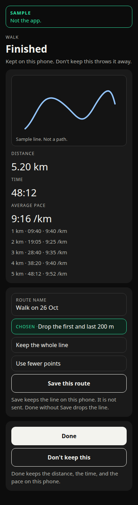
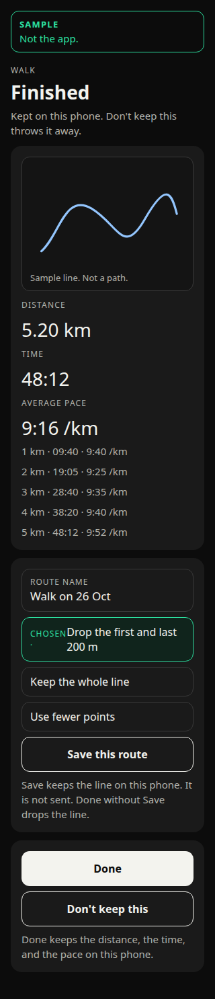
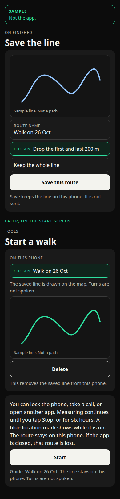
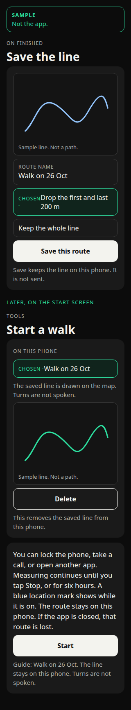

# Keep the line you walked

Approved by Ben on 26 October 2026. His words: "Approve all seven recommendations for the walked route design as written: phone only, separate Save, 200 m trim".

Built on this branch. Not shipped. No SQL is applied. No deploy. `ios.buildNumber` stays 72. No new purpose string. Branched from `e6f8474` on `cursor/start-from-route-design-daf4` (PR #41), which sits on the build 75 saved-routes tip `0571e53` (PR #38).

The live path is still dropped when Finished is left without Save. A copy of the line stays on this phone only after Save this route. It is not sent. Done without Save drops the line. Delete removes it. The first and last 200 m are left out unless you keep the whole line.

Ben: "Can you do it so that when you click start a walk, run, cycle on the screen before creating a route, it plots out your route on a map, so you can view the distance and pace etc and redo the route in the future."

The layout proofs are sample drawings, labelled Sample and Not the app. They are not screenshots of the running app.

## What this sheet takes Ben to mean

He starts a walk, a run, or a cycle, with no route drawn first. When the outing ends, the phone shows the line he actually covered, with the distance, the moving time, the pace, and the splits. He can save that line and follow it again later, as a guide, the same way a saved route is a guide: drawn on the live map, copied on the phone at Start, turns not spoken, not sent, not written into the summary. He still taps Start.

That is the design below.

## What else he might have meant

These are not the design. They are here so the reading can be refused.

1. The three buttons on Outside is Good, which is the screen before Find a route, should ask the route service to plot a loop before he goes out, with a planned distance and an estimated pace, and that planned line is what he saves. Find a route already does the plotting. It sends the start and the travel type. The pace on that card is the service's estimate, not the outing. This sheet does not add a second route-service call to those buttons.

2. He only wants the line on the map while he is out, and the figures. The live map already draws the walked line, and the live card already shows time, distance, and pace. That line is cleared when the outing ends. A result map after Stop is the new part of reading 1. Reading 2 does not include a line he can redo next week.

3. Redo means spoken turns along the old line. This app does not speak turns. A saved line is a guide on the map. The approved sentence stays: "Turns are not spoken."

## What the code did before this build

Checked before this build, on the branch that has the build 74 outing. The paragraphs below are that starting point. The build described at the top of this sheet is what the app does now.

Stop, the time limit, and Stop on the outing banner all end measuring. `summaryFrom` in `src/domain/activitySession.ts` stores `id`, `activity`, `date`, `distanceM`, `movingMs`, and `averagePaceSecPerKm`. `saveActivitySummary` writes that object on this phone. It does not write the route name, the points, or the splits. Splits on the Finished screen are the kilometre index, the time, and the pace. They have no coordinates. The heart-rate row is not in the summary.

`clearPath` runs before that summary is built. The Finished screen (`src/app/(main)/activity.tsx`) has no map. The path is gone. Don't keep this deletes the summary. Done leaves the summary. The intro already says "Kept on this phone. Don't keep this throws it away." The line under the buttons already says "Done keeps the distance, the time, and the pace on this phone."

The limit is six hours (`OUTING_TIME_LIMIT_MS`). When it fires, measuring stops, the banner comes down, and Finished uses "The time limit ended this outing." The banner sentence, approved by Ben on 26 October 2026, is "Outing in progress. Measuring is still on. Open it to see the map, or tap Stop to end it." It is shown only while measuring is on. It is not on the Finished screen.

If the app is killed mid-outing, the path is lost. There is no crash-recovery file. `DIARY_HINT` already says the diary gets the words, not the path.

The purpose sentence in `NSLocationWhenInUseUsageDescription`, `app.json`, `src/domain/outdoorRoute.ts`, `docs/privacy.md`, `docs/privacy.html`, and `docs/dpia-location.md` includes: "Your route stays on your phone and is not sent anywhere." The same sentence says the route-service request "is not the outing path."

`simplifyLine` in `src/domain/outdoorRoute.ts` keeps an even sample of the points, including the first and the last. It does not drop the ends. The route cap is 2,000 points (`ROUTE_POINT_CAP`). The live-table cap of 64 is a database limit for a different write. It is not a privacy trim.

## Recommendation

Option A. The saved walked line stays on this phone. It is not sent. It is not an account row. Delete removes it. The purpose sentence stays true, because the line is not sent anywhere.

What A loses: a new phone does not have the line. Deleting the app removes it. There is no account copy to restore. This design does not add an iCloud copy of its own. A backup the phone already makes can include the app's files. That is the operating system's backup, not a send from this feature.

Option B is not recommended. Saving the walked line as an `outdoor_routes` row puts a precise GPS trace on the account. That trace can show home and work. It needs the saved-route grants, a close of the `export_my_data` gap, a privacy-notice change, and a new purpose sentence, because "is not sent anywhere" would be false. Those grants are not applied from this note. No SQL is applied.

## A. On this phone

After Stop, Finished still shows the distance, the time, the pace, and the splits. It also shows the walked line on the map, from the points still in memory. Nothing is written for that line until he taps **Save this route**.

The name field is the existing **Route name**, at most 80 characters. Empty is refused with the existing sentence "A route needs a name." The suggestion is "Walk on 26 Oct" (the activity word, " on ", then the day and the month). An unreadable date opens on the existing "My route".

Two choices, both off until he taps them, except the trim, which the drawing shows on:

- **Drop the first and last 200 m.** On by default. Measured along the line, not as a circle on the map. The first 200 metres of distance and the last 200 metres are left out of the copy. If the outing is too short to leave two points, the trim is not applied and the screen says so. He can still keep the whole line, or not save.
- **Use fewer points.** Off by default. This is `simplifyLine` up to 2,000 points. It keeps the first and last point of the line being saved. It does not hide home. It is not a substitute for the trim.

Save writes one record in the app's local store: the name, the activity, the date, and the points after those choices. It does not write a log line. It does not call the route service. It does not call Supabase. Coordinates are not logged.

Done, without Save, drops the in-memory line and leaves the summary. Don't keep this deletes the summary, drops the line, and deletes a line just saved from this Finished screen. The diary tick is unchanged. The diary still gets the words, not the path.

The six-hour stop uses the same Finished screen. The banner is already down, because measuring has stopped. Save is still a separate tap. A kill mid-outing still has no file to recover. This design does not add one. An automatic file would keep a home-to-work trace without a tap.

Later, the Start screen lists the line under **On this phone**, separate from account routes. Choosing it and tapping Start copies it as the guide, the same mechanics as Use this route in `docs/saved-routes-decisions.md` and the three buttons in `docs/start-from-route-decisions.md`. The live map draws it. The summary of the new outing is still distance, time, and pace only. The old line is not overwritten by the new outing unless he saves again.

**Delete** on that row removes the local record. It does not hide it. It does not leave the points under another key. It does not affect an outing that already copied the line at Start. The account, if he has saved routes there, is not touched.

## B. On the account

Not recommended. The same Save would insert an owner-only `outdoor_routes` row, geometry included. That is a send. The current purpose sentence would have to change. The privacy note would have to say the walked line can be stored on the account. `export_my_data` would have to include it, and a delete would have to remove that row. The update grants for saved routes are a separate build 75 question and are not applied here. Route finding must still not be given this path to redraw unless he later taps Adjust, which is a different consent.

## Purpose sentence and the privacy note

For option A, `NSLocationWhenInUseUsageDescription` does not change. "Your route stays on your phone and is not sent anywhere" stays true. The route-service clause stays true. No new permission. No new purpose string.

The privacy note is a different document from the iOS purpose string. `docs/privacy.md`, `docs/privacy.html`, `docs/dpia-location.md`, and `docs/store-privacy-labels.md` now say the same thing as this build: the live path is dropped when Finished is left without Save, and a copy of the line stays on this phone only after Save this route. It is not sent. Done without Save drops the line. Delete removes it. The first and last 200 m are left out unless you keep the whole line.

For option B, the purpose sentence would have to change. This wording is **not approved**, and it is not built:

- Charioteer uses your location while you are on a walk, run or cycle to track distance and give you spoken updates, including when the screen is locked or you are using other apps. A line you save from that outing is stored on your account. The same permission shows where you are while the map is open. A route is sent to the route service only if you turn route finding on. That request is the start, the destination, and any points you add on the map. It is not the outing path, unless you save that path to your account.

Do not put that sentence in `app.json` or the purpose constant unless Ben approves option B.

## Wording

Approved by Ben on 26 October 2026, with the seven recommendations. Existing sentences are reused and not rewritten.

Already in the app:

- Finished
- The time limit ended this outing.
- Done keeps the distance, the time, and the pace on this phone.
- Don't keep this
- Save this route
- Route name
- A route needs a name.
- My route
- Delete
- Guide: Walk on 26 Oct. The line stays on this phone. Turns are not spoken.
- The saved line is drawn on the map. Turns are not spoken.
- Outing in progress. Measuring is still on. Open it to see the map, or tap Stop to end it.
- The diary gets the words, not the path.

Approved for this build:

- Walk on 26 Oct
- Drop the first and last 200 m
- Keep the whole line
- Use fewer points
- The line is too short to drop the ends.
- Save keeps the line on this phone. It is not sent. Done without Save drops the line.
- On this phone
- This removes the saved line from this phone.

The approved delete sentence for an account route stays "This removes the saved line from your account." It is the wrong sentence for a phone-only line.

## Layout proofs

Sample drawings. Not the app. The figures use the app's own formats: distance `5.20 km`, time `48:12`, pace `9:16 /km`, splits as `1 km · 09:40 · 9:40 /km`. The line is a sketch.

Finished, with the map, the figures, the splits, and Save. The trim is on.

Save, then later the Start screen, where the line can be chosen and deleted.

## Decisions for Ben

1. Is the reading right: show the walked line after the outing, and let him save it to follow again? Recommendation: yes. The other readings are in the section above.
2. Option A, on this phone only, or option B, on the account? Recommendation: A.
3. Save is a separate tap. Done without Save drops the line and can still keep the summary. Recommendation: yes.
4. Drop the first and last 200 m along the line, on by default, with Keep the whole line as the other choice? Recommendation: yes.
5. Use fewer points stays off unless he asks, and it does not replace the trim? Recommendation: yes.
6. No crash file, so a kill mid-outing still loses the line? Recommendation: yes.
7. No new purpose string if A is chosen. The privacy note is updated only after this sheet is approved. Recommendation: yes.

## What the Security bot should review

This pull request builds option A. It adds a local store on the phone. It does not add a grant, a migration, or a function change. The purpose sentence is unchanged.

- The approved purpose sentence is still the one in `docs/dpia-location.md`. Option A does not need a new `NSLocationWhenInUseUsageDescription`. Option B would, and that sentence is not in `app.json` or the purpose constant.
- The build does not weaken "the outing path is not sent". The saved copy stays in the app's local store (`charioteer.walked-lines`). It is not an `outdoor_routes` insert. It is not added to `export_my_data`. It is not sent to HeiGIT, OpenFreeMap, the coach, or a model.
- Save is explicit. Stop, the six-hour limit, and the banner's Stop do not write the line. Done without Save drops it. Don't keep this deletes the summary and the line from that finish screen.
- Delete removes the local record. An empty list deletes the storage key. It is not a hidden flag.
- Coordinates are not logged. There is no console line, crash breadcrumb, or analytics event for the path.
- The trim is along the line, 200 m at each end, on by default. "Keep the whole line" is the other choice. `simplifyLine` keeps the ends, so "Use fewer points" is not the privacy control. It stays off unless asked.
- There is still no crash-recovery file. A kill mid-outing does not leave a path on disk.
- The banner stays tied to measuring. Finished is after `releaseLive`. The six-hour limit ends measuring before Save is offered.
- `docs/privacy.md` and `docs/privacy.html` match this build, as do the DPIA and the store privacy label notes.
- No migration is added. The build 75 grants are not applied by this build.
